<h1 align="center">
  <picture>
    <source media="(prefers-color-scheme: dark)" srcset="docs/assets/craftsman-logo-dark.svg">
    
  </picture>
</h1>

<p align="center"><strong>A coding agent that builds its own tools.</strong></p>

Craftsman is a Rust terminal coding agent that reads your code, makes edits,
runs commands and carries work across sessions. Bring your own configured model
connection.

Its superpower: turn a useful routine into a **reusable WebAssembly gadget**,
then use it as a tool in the next model round.


## From a task to a new tool

> “Build a gadget that totals CSV numbers, then use it on `10, -4, 7`.”

Craftsman can write the Rust code, compile it into a WASM component and discover
its typed functions without a restart. The tool stays available for future tasks
instead of being rewritten each time.

1. **Create** — the embedded SDK and authoring skill scaffold the gadget.
2. **Build** — compile and validate its component interface.
3. **Use** — approve its capabilities, then call it from the agent.

Gadgets run in Wasmtime with no inherited filesystem, sockets or environment.
Declared capabilities and user approval govern host access. Native builds and
shell commands retain their separate permission checks.

Text statistics, slug generation, checked CSV totals and JSON inspection have
already been built and used in [live model sessions](docs/live-gadget-evaluation.md).

## Current architecture: query to response

This follows the implemented branch code: a session is prepared once, then reused
across inputs and model rounds. It describes the TUI, ACP and legacy `-m` routes;
it is not a claim that this branch has completed fresh native validation.
Diamonds are decisions, and back edges mean more work in the same session.
Phase 4 expands the tool-dispatch step inside phase 3; results return to the same
round boundary.

```mermaid
%%{init: {"theme":"base","themeVariables":{"primaryColor":"#edf5f5","primaryTextColor":"#263238","primaryBorderColor":"#408b8b","lineColor":"#65777d","secondaryColor":"#f3f4f4","tertiaryColor":"#f8fafb","clusterBkg":"#f8fafb","clusterBorder":"#a9b7bd","edgeLabelBackground":"#ffffff","fontFamily":"sans-serif","fontSize":"16px"},"flowchart":{"curve":"linear","nodeSpacing":14,"rankSpacing":48,"wrappingWidth":200,"subGraphTitleMargin":{"top":72,"bottom":36}}}}%%
flowchart TB
    C_LAUNCH(["Launch Craftsman"]) --> C_SETUP
    subgraph C_SETUP["1 · CLI and session setup — once per session or reconfiguration"]
        direction TB
        C_CLI["Parse CLI; load local config"] --> C_FRONT{"Frontend?"}
        C_FRONT -->|TUI / setup| C_TUI["Owned terminal + signal router<br/>SafeBackend; optional OSC 7501"]
        C_FRONT -->|ACP stdio / bridge| C_ACP["Protocol initialize; new/load session<br/>JSON and client permission callbacks"]
        C_FRONT -->|legacy -m| C_ONCE["Capture fallible main stdout<br/>TTY approval; non-TTY denies"]
        C_TUI & C_ACP & C_ONCE --> C_CONFIG{"Connection/settings valid?"}
        C_CONFIG -->|yes| C_SESSION["Build selected provider/protocol/options<br/>Instructions, skills, profile and tools<br/>Local stores; optional history restore"]
        C_CONFIG -->|missing / invalid| C_INITERR["Configuration/setup error<br/>Agent request does not start"]
    end

    subgraph C_INPUT["2 · Each input — reuse the session"]
        direction TB
        C_INPUT_KIND{"Input route?"}
        C_INPUT_KIND -->|TUI built-in slash| C_LOCAL["Local command/picker/session action<br/>/model is local; --refresh is explicit<br/>/compact can request a summary"]
        C_LOCAL --> C_CHANGE{"Reconfigure session?"}
        C_CHANGE -->|yes| C_REBUILD["Rebuild; await old child/LSP cleanup<br/>Transfer idle conversation/thread/usage<br/>Return to setup without replay"]
        C_CHANGE -->|no| C_LOCALOUT["Local result; await next input"]
        C_INPUT_KIND -->|TUI user-typed !command| C_INLINE["Owned native shell operation<br/>Direct user action, outside model dispatch"]
        C_INLINE --> C_LOCALOUT
        C_INPUT_KIND -->|TUI input while working| C_STEER["Accept plain steering or queue follow-up<br/>Slash/! wait; ACP refuses concurrent prompts"]
        C_INPUT_KIND -->|prompt / extension expansion| C_BEGIN["Expansion is model input only<br/>Commit actual user input + turn_start<br/>TUI saves intent before further work"]
    end

    subgraph C_ROUNDS["3 · Model rounds — prepare, sample, review, branch"]
        direction TB
        C_STOP{"Stop or round limit?"}
        C_STOP -->|continue| C_BOUNDARY["Drain accepted steering/child messages<br/>Commit; selected progress checkpoint"]
        C_STOP -->|cancel| C_CANCEL["Balance skipped calls; real end/save<br/>Selected controls retain accepted input"]
        C_STOP -->|limit| C_LIMIT["TUI end/save, then follow-up pause<br/>ACP/-m retain default limit exits"]
        C_BOUNDARY --> C_CONTROL{"Context/failure permits sample?"}
        C_CONTROL -->|off / valid; budget open| C_PREP["Prepare native history + memory/todos<br/>Selected bounded context compilation"]
        C_CONTROL -->|identical-failure limit| C_PAUSE["Recheck raced input; settled local stop<br/>Close admission; actual end/save"]
        C_CONTROL -->|invalid state / observer| C_ERROR["Return actual error<br/>Retain committed results and effects"]
        C_PREP --> C_COMPACT{"Compact history?"}
        C_COMPACT -->|yes| C_SUMMARY["Selected-model summary + configured tail<br/>Frontend cancellation policy applies"]
        C_COMPACT -->|no / disabled| C_PACK["Reminders; protected gadget refresh if enabled<br/>Finalize per-round system additions"]
        C_SUMMARY --> C_PACK
        C_SUMMARY -->|failure| C_ERROR
        C_PACK --> C_REQUEST["System + messages + tool schemas<br/>Configured protocol; stream frontend deltas"]
        C_REQUEST -->|complete + returned usage| C_REVIEW["Review hooks; commit assistant/history<br/>Journal/checkpoint before effects"]
        C_PREP & C_REQUEST & C_REVIEW -->|actual error| C_ERROR
        C_REVIEW --> C_AFTER{"Stop after response?"}
        C_AFTER -->|yes| C_CANCEL
        C_AFTER -->|no| C_FLOW{"Calls / resample / finish?"}
        C_FLOW -->|calls| C_CALLS["Dispatch in order; await actual outcomes<br/>Merge history/journal; TUI result checkpoint<br/>Each call is expanded in phase 4"]
        C_CALLS -->|all results retained| C_NEXT
        C_CALLS -->|required save error| C_ERROR
        C_CALLS -->|stop; remaining calls balanced| C_CANCEL
        C_FLOW -->|resample| C_NEXT["Another permitted round"]
        C_FLOW -->|finish / no calls| C_PENDING{"New input / child feedback?"}
        C_PENDING -->|yes| C_NEXT
        C_PENDING -->|no| C_VERIFY{"Verification needed?"}
        C_VERIFY -->|yes| C_CHECK["Save verifier call; SAME gated commands/tools<br/>Actual zero exits + complete unchanged sources<br/>At most three configured repair rounds"]
        C_CHECK --> C_CHECKED{"Check ran; repair allowed?"}
        C_CHECKED -->|yes; result retained| C_NEXT
        C_CHECKED -->|no / denied / invalid| C_REFUSE["Refuse completion; retain real effects/results<br/>Actual end hook + save"]
        C_VERIFY -->|off / already acceptable| C_FIN["Close input; actual turn_end + final save<br/>Answer accepted after these returns"]
        C_FIN -->|hook / required save error| C_ERROR
        C_NEXT --> C_STOP
    end

    subgraph C_TOOLS["4 · Tools — mode gate, then each tool's independent authority"]
        direction TB
        C_PERMISSION{"Mode/policy permits tool?"}
        C_PERMISSION -->|allow| C_TOOL{"Registered route?"}
        C_PERMISSION -->|prompt| C_HUMAN{"Human approves?"}
        C_HUMAN -->|yes| C_TOOL
        C_PERMISSION -->|deny| C_DENIED["Denied/unavailable/unknown operation<br/>Error result; operation not dispatched"]
        C_HUMAN -->|no / unavailable| C_DENIED
        C_TOOL -->|unknown| C_DENIED
        C_TOOL -->|FS / shell| C_HOST["Host FS + native ShellRunner/ProcessTree<br/>Gadget build: static ABI, no guest"]
        C_TOOL -->|integrations| C_CONNECTED["Configured MCP / lazy LSP<br/>Web tools: independent network gate"]
        C_TOOL -->|questions / todos / ACP UI| C_SESSIONTOOLS["TUI/ACP questions; todos; ACP A2UI<br/>Legacy -m questions decline; no guest forms"]
        C_TOOL -->|task / messages| C_CHILD["Gated foreground/background task<br/>Own usage; no recursive delegation"]
        C_TOOL -->|existing gadgets| C_GRANT{"Enabled; source/trust/grant valid?"}
        C_GRANT -->|valid grant / invocation allow| C_GUEST["Load; describe with empty capabilities<br/>gadget_call: schema + fresh WASM instance<br/>Scoped imports; create-only per-write gate; bounds"]
        C_GRANT -->|first-load interactive review| C_GAPP{"Approve source capabilities?"}
        C_GAPP -->|yes| C_GUEST
        C_GAPP -->|no| C_DENIED
        C_GRANT -->|untrusted / broken / unapproved| C_DENIED
        C_HOST & C_CONNECTED & C_SESSIONTOOLS & C_CHILD & C_GUEST & C_DENIED --> C_RESULT["Await outcome; merge state + tool history<br/>Journal; TUI saves each result"]
        C_RESULT --> C_CONTINUE{"Remaining calls / stop?"}
        C_CONTINUE -->|more; stop clear| C_PERMISSION
        C_CONTINUE -->|all returned| C_TO_ROUND["Return to model-round boundary"]
        C_CONTINUE -->|stop| C_TOOLSTOP["Balance remaining calls; real end/save"]
        C_RESULT -->|required save fails| C_TOOLERR["Further work stops; actual error"]
    end

    subgraph C_FINISH["5 · Completion and frontend output — after actual returns"]
        direction TB
        C_OUTCOME["Actual answer / stopped / paused / error / local result<br/>Early errors do not imply normal end hooks"] --> C_DISPLAY["TUI: SafeBackend + actual OSC status<br/>ACP: JSON updates/results/errors + main usage<br/>Legacy -m: fallible captured stdout"]
    end

    %% Layout-only links keep the expanded panels in reading order.
    C_REFUSE ~~~ C_PERMISSION
    C_TOOLSTOP ~~~ C_OUTCOME
    C_SETUP --> C_INPUT
    C_INPUT -->|model prompt| C_ROUNDS
    C_INPUT -->|local result| C_FINISH
    C_ROUNDS -. each tool dispatch expanded .-> C_TOOLS
    C_ROUNDS -->|actual finish / stop / limit / error| C_FINISH
    classDef boundary fill:#dcefee,stroke:#408b8b,color:#263238;
    classDef notice fill:#f3f4f4,stroke:#83949b,color:#263238;
    class C_CONFIG,C_CONTROL,C_PERMISSION,C_GRANT,C_GAPP,C_VERIFY boundary;
    class C_INITERR,C_ERROR,C_CANCEL,C_PAUSE,C_REFUSE,C_LIMIT,C_TOOLERR notice;
```



Frontend defaults remain distinct:

| Frontend | Ownership, limits and presentation |
| --- | --- |
| TUI | Reused owned session; durable step checkpoints; 200-round default and follow-up pause; UI approval/question modals; `SafeBackend` cells and configurable OSC 7501. Local gadgets require `gadgets.enabled`. |
| ACP | New/load session over stdio or bridge; cancellable model wait, 50-round default (`max_turn_requests`); client permission requests and JSON updates/results. Ordinary progress saves are not durable per step; local gadgets are not selected. |
| Legacy `-m` | One turn with 50-round default (limit exits 2); fallible captured main stdout; approvals require TTY input. Owned-TUI lifecycle/durable defaults are absent; enabled gadgets retain explicit source/grant/trust conditions. |

All three begin in manual permission mode unless user configuration/flags select
otherwise. The conditions behind the diagram:

- **Session versus round:** startup selects the actual connection, protocol and
  generation settings: Chat Completions, Responses, Messages or GenerateContent
  as explicitly configured. Catalog metadata and unselected credentials do not become
  generation inputs. Local instruction/skill discovery and configured MCP
  connections belong to session construction; LSP starts lazily. A skill listing
  teaches the model to read its instructions, rather than executing its scripts.
  Gadget command expansions refresh at submission; manifest prompts/agents belong
  to session construction. Enabled gadget catalogs refresh before main and
  delegated model rounds without replacing the system prefix/tool definitions.
- **Optional controls:** TUI/ACP support `context.enabled` / `max_bytes` and
  `failure_control.repeat_limit` / `test_review_signals`; absent settings are off.
  Failure budgets observe actual identical eligible operations/errors; changed
  input or real progress can reopen the next boundary. Context observations are
  historical information, never file-read authority. Verification requires a
  nonempty user declaration or reviewed `.craftsman/verification.json` proposal.
  It accepts real zero exits only with a complete, unchanged source image; stale
  policy or protected content needs fresh human review even under bypass. Test
  review signals are advisory and cannot waive that review.
- **Compaction and limits:** when compaction is enabled, a configured context
  window triggers at 85% estimated input tokens, retaining recent user messages
  within a 20,000-token tail; without that setting, more than 120 messages triggers
  a 20-message tail with tool pairs kept together. Summary failure remains a
  failure. The TUI defaults to 200 rounds (`terminal.max_rounds`, 1–1000) and saves
  a completed limited turn before its pause. ACP, legacy and delegated agents
  retain the framework's 50-round default and existing limit handling. TUI/ACP
  can drop pending model sampling on cancellation; tools retain their actual
  return/cleanup rules, and started blocking work is not thereby undone.
- **Permissions and tools:** manual prompts for gated mutations/network calls;
  plan denies file mutation and allows only clearly read-only shell commands;
  accept-edits allows file edits; current auto allows file/web work and prompts
  for shell commands beyond the read-only/allow-list policy. Configured MCP
  tools are trusted connection capabilities, not a per-call human-review or
  sandbox guarantee; read-only hints only help checkpoint observations. Gadget
  source grants, protected gadget paths and per-write policy remain independent.
  Same-source gadget rebuilds may inherit equal/narrower capability grants today;
  the exact interpreted-source review below is a planned stronger boundary.
  The current gadget host has no script interpreter or copy-on-write CRUD overlay.
  Ordinary host filesystem/native shell operations are outside WASM confinement.
- **History, saves and output:** native adapters retain exact signed/opaque
  history bound to their selected connection and validate its portable-message
  pairing. User-visible streaming precedes final acceptance; usage reflects
  returned provider data, with separate child/compaction counters. TUI durable
  checkpoints save intent, reviewed calls and each result; reopen marks unresolved
  calls **UNKNOWN**, without replay or an exactly-once/rollback claim. ACP and
  legacy progress-save defaults differ, so not every frontend has that recovery
  guarantee. Normal end hooks/save run on actual finish paths; an early error
  does not imply they ran. `SafeBackend` covers TUI cells; ACP and other CLI output
  have their own producers. Legacy native peer-state observation depends on the
  captured source: low-grant pipes use checked write/flush errors and cannot
  proactively prove peer loss after successful IO. OSC 7501 uses fixed status
  messages from actual TUI activity; stop stays working until return.

Explicit `gadgets` CLI management/calls and the restricted `service-agent` JSON
turn have their own entry paths. The latter uses a virtual file profile, with no
host shell or local session stores; it is not the proposed script runner.
Public `craftsman exec`, private headless admission/usage/guest foundations and the
planned virtual script/CRUD exporter are outside this current frontend flow.

## Planned architecture: WASM scripts and batch changes

**Design for review; implementation is on hold.** Keep the session/model loop
above, and add a managed execution path for agent-authored reusable tools and
compatible skill/plugin scripts. The first target is a WASI `python` interpreter
with small eager snapshots, subject to callable interpreter/VFS compatibility
proof. Phases 2–6 expand the managed invocation inside the phase 1 loop.

```mermaid
%%{init: {"theme":"base","themeVariables":{"primaryColor":"#edf5f5","primaryTextColor":"#263238","primaryBorderColor":"#408b8b","lineColor":"#65777d","secondaryColor":"#f3f4f4","tertiaryColor":"#f8fafb","clusterBkg":"#f8fafb","clusterBorder":"#a9b7bd","edgeLabelBackground":"#ffffff","fontFamily":"sans-serif","fontSize":"16px"},"flowchart":{"curve":"linear","nodeSpacing":14,"rankSpacing":48,"wrappingWidth":200,"subGraphTitleMargin":{"top":72,"bottom":36}}}}%%
flowchart TB
    P_LAUNCH(["User task"]) --> P_LOOP
    subgraph P_LOOP["1 · Same agent loop — managed invocation expanded in phases 2–6"]
        direction TB
        P_INPUT["Reuse session; accept actual input<br/>Same controls, compaction, limits and stop"] --> P_ROUND["Configured request + frontend streaming<br/>Review/commit response and returned usage"]
        P_ROUND --> P_CALLS{"Calls / final / stop or error?"}
        P_CALLS -->|calls| P_ROUTE{"Core or managed tool?"}
        P_ROUTE -->|core| P_CORE["Existing authorized FS/native/MCP/task/gadget path<br/>Native commands stay outside script WASM"]
        P_ROUTE -->|managed| P_MANAGED["Invoke reusable tool or compatible skill/plugin script<br/>Source → WASM → batch review → host CRUD, below"]
        P_CORE & P_MANAGED --> P_LOOP_RESULT["Actual tool result/history + selected checkpoint<br/>Managed return is detailed in phase 6"]
        P_LOOP_RESULT --> P_MORE{"Next round allowed?"}
        P_MORE -->|yes| P_ROUND
        P_MORE -->|no / stop / limit| P_COMPLETION["Same completion/verification/stop/limit handling<br/>Hooks/saves where selected; frontend outcome"]
        P_CALLS -->|final / actual stop or error| P_COMPLETION
    end

    subgraph P_SOURCE["2 · PLANNED script identity, capability review and automatic inputs"]
        direction TB
        P_COMPAT{"Compatible runtime/dependencies?"}
        P_COMPAT -->|yes| P_IDENTITY["Review exact script/package/adapter/runner identity<br/>Capabilities separate from shared interpreter approval"]
        P_IDENTITY --> P_ID{"Exact source/capabilities covered?"}
        P_COMPAT -->|unsupported| P_FAIL["Refuse; no native interpreter/Node/Bash fallback"]
        P_ID -->|first use / changed| P_CODE{"User approves first/changed source?"}
        P_CODE -->|yes| P_SCOPE["HOST captures narrow authorized task roots<br/>Automatically find needed files/snapshots<br/>Exact bytes, identities and absence facts<br/>Git optional; multi-project/document roots"]
        P_CODE -->|reject| P_FAIL
        P_ID -->|covered / unchanged| P_SCOPE
        P_SCOPE --> P_JOB{"Complete bounded job; stop clear?"}
        P_JOB -->|yes| P_READY["Bounded job; host authority stays outside JSON"]
        P_JOB -->|no / denied / stop| P_FAIL
        P_BUILD["Native runner build/install hooks<br/>Separate host trust and review"] -. never runtime fallback .-> P_COMPAT
    end

    subgraph P_WASM["3 · PLANNED interpreter INSIDE WASM — first MVP: .py scripts + eager snapshots"]
        direction TB
        P_VFS["/work immutable base + copy-on-write overlay<br/>/skill and /runtime readonly; temporary /scratch"] --> P_SCRIPT["Ordinary read/create/write/unlink changes guest memory<br/>Low-level WASI AND custom imports confined<br/>No real host FS, environment or network by default"]
        P_SCRIPT --> P_VALID{"Limits/stop/output valid?"}
        P_VALID -->|yes| P_CANDIDATES["Bounded candidates + explicit tombstones + report<br/>Guest selectors/claims remain untrusted"]
        P_VALID -->|failure / stop / invalid / oversized| P_GFAIL["Actual failure; no candidate apply"]
    end

    subgraph P_REVIEW["4 · PLANNED HOST-derived ChangeSet — ONE batch per task"]
        direction TB
        P_VALIDATE{"HOST validates candidates/scope?"}
        P_VALIDATE -->|yes| P_NET["Net CRUD from trusted originals + candidates<br/>CREATE: full additions; UPDATE: before/after<br/>DELETE: full removals; empty files still count"]
        P_VALIDATE -->|invalid / unknown / unsupported| P_RFAIL["Refuse / obtain missing data<br/>Unknown is not absent; omissions do not delete"]
        P_NET --> P_MUTATE{"Net supported changes?"}
        P_MUTATE -->|read / net no-op| P_READ["Report only; no mutation diff or write review"]
        P_MUTATE -->|unsupported view / unknown| P_RFAIL
        P_MUTATE -->|yes| P_CURRENT{"Base still current?"}
        P_CURRENT -->|stale| P_RSTALE["Invalidate; fresh snapshots/plan/review needed"]
        P_CURRENT -->|yes| P_FULL["Complete batch view: real paths + operations<br/>Full before/after bytes; source/policy epoch"]
        P_FULL --> P_AUTO{"Future scoped auto:<br/>WHOLE set qualifies?"}
        P_AUTOPOLICY["User authorizes roots/ops/source policy once<br/>HOST enforces permissions/protection/bounds"] -. user authority .-> P_AUTO
        P_ADVICE["Optional READONLY agent advice<br/>Actual approved verification evidence<br/>Neither creates permissions or waives human rules"] -. evidence only .-> P_AUTO
        P_AUTO -->|off / any change needs review| P_BATCH{"ONE batch decision?"}
        P_AUTO -->|whole set qualifies| P_BIND["HOST binds exact ops/paths/before+after<br/>Content, source identity and policy epoch"]
        P_BATCH -->|Approve all| P_BIND
        P_BATCH -->|Choose changes, optional| P_CHOOSE["Explicit chosen set + dependencies<br/>Rebind complete selection"]
        P_CHOOSE --> P_BIND
        P_BATCH -->|Request revision| P_REVISION["Revision feedback; fresh ChangeSet needed"]
        P_BATCH -->|Reject| P_REJECT["Rejected; no host mutation"]
    end

    subgraph P_APPLY["5 · PLANNED host CRUD adapter — revalidate each operation"]
        direction TB
        P_RECHECK{"Files/authority/stop still valid?"}
        P_RECHECK -->|yes| P_WRITE["HOST scoped create/update/delete primitives<br/>Await actual IO; record each effect<br/>Current SDK write-file remains create-only"]
        P_WRITE --> P_OPS{"Success; more ops; stop clear?"}
        P_OPS -->|yes| P_RECHECK
        P_OPS -->|done / failed / cancelled| P_ACTUAL["Actual completed / failed or uncertain / not-attempted<br/>Stop later operations; preserve earlier effects<br/>No multi-file atomicity / CAS / rollback claim"]
        P_RECHECK -->|stale| P_STALE["Invalidate approval; refresh next plan/review<br/>Retain earlier effects; never silent replay/rebase"]
        P_STALE --> P_ACTUAL
        P_RECHECK -->|denied / cancelled| P_ACTUAL
    end

    subgraph P_RETURN["6 · Normal result path — return to phase 1"]
        direction TB
        P_RESULT["Return actual inventory/report/error/feedback<br/>Same history + frontend-selected checkpoints"] --> P_AGAIN["Feed result into phase 1 agent loop<br/>Fresh invocation when explicitly needed; no replay"]
    end

    %% Layout-only links keep the expanded panels in reading order.
    P_COMPLETION ~~~ P_COMPAT
    P_READY ~~~ P_VFS
    P_CANDIDATES ~~~ P_VALIDATE
    P_BIND ~~~ P_RECHECK
    P_ACTUAL ~~~ P_RESULT
    P_LOOP -. managed invocation detail .-> P_SOURCE
    P_SOURCE -->|approved complete job| P_WASM
    P_SOURCE -->|source / permission / input failure| P_RETURN
    P_WASM -->|complete candidates| P_REVIEW
    P_WASM -->|quota / time / cancel / output failure| P_RETURN
    P_REVIEW -->|exact set approved by human or user policy| P_APPLY
    P_REVIEW -->|read / no-op / refuse / revision / stale| P_RETURN
    P_APPLY -->|actual complete or partial inventory| P_RETURN
    classDef planned fill:#dcefee,stroke:#408b8b,color:#263238;
    classDef notice fill:#f3f4f4,stroke:#83949b,color:#263238;
    class P_ID,P_SCOPE,P_VFS,P_NET,P_AUTO,P_BATCH,P_BIND,P_WRITE planned;
    class P_BUILD,P_FAIL,P_GFAIL,P_RFAIL,P_RSTALE,P_STALE,P_REVISION,P_REJECT,P_ACTUAL notice;
```



The planned boundaries and unresolved proof gates:

- **Automatic inputs, narrow authority:** ordinary authorized discovery needs no
  mandatory input/destination picker or per-file read popup. Capture only needed
  task roots/snapshots, not a whole home or every project. Missing/partial knowledge
  stays unknown. A later on-demand snapshot broker would need a new reviewed,
  versioned integration and could only read inside the already captured scope.
- **Execution approval is separate from changes:** first-use or changed scripts,
  packages, adapters, runner images and capabilities need their own user-controlled
  review. An approved interpreter, guest ID/hash or guest `approved` field grants
  no script authority. Compatibility of pure `.py` modules, the supported standard
  library and dynamic module loading must be proven. Arbitrary runtime/Node
  packages, native extensions and new guest UI forms are not promised. The first
  runner denies existing host file/HTTP
  imports so they cannot bypass its VFS; any future network capability needs
  separate scoped approval. Native builds/install hooks keep separate host trust.
- **One batch per task/change set:** default review offers **Approve all**, optional
  **Choose changes**, **Request revision**, or **Reject**. Review binds exact
  operations, paths, before/after content, source identity and policy epoch.
  Rename/copy need explicit paired operation views/preconditions; binary/metadata
  changes need exact-byte views and explicit permissions, or refusal. Repeated
  virtual writes consolidate into net changes; zero bytes are not deletion.
- **Optional future auto:** authorize scoped policy once, then let the host apply
  only if the **whole related set** qualifies. Otherwise hold it for one grouped
  review, avoiding inconsistent partial auto-applies. A read-only model assessment
  or real approved verification evidence can support the decision; neither can
  create permissions or waive existing hard human-review requirements. This is a
  design option, not authorization to enable current auto settings.
- **Apply and limits:** revalidate current files/absence, identity, permissions,
  source/policy epoch and cancellation before applying. Staleness refreshes review;
  partial failure reports actual effects and stops unattempted operations. A new
  CRUD adapter is still required, especially for exact-byte updates and deletion.
  Preserve the existing SDK/WIT, Wasmtime 48.0.8, 1 MiB JSON boundaries, 256 MiB
  memory/one-memory ceiling, 32 MiB component cap and 30-second default call budget.
  Prove the `.py` interpreter component/VFS fits those limits; the first MVP uses
  small eager snapshots and a preview before real-file apply. No implementation,
  native compatibility, model-quality or publication result follows from this
  diagram.

## Built for your workflow

- **Work in the terminal** — streaming replies, file edits, shell tools, planning
  and persistent sessions.
- **Choose your model** — provider-owned catalogs and per-model reasoning controls.
- **Extend the agent** — reusable WASM gadgets and MCP server connections.
- **Connect an editor** — standard ACP over stdio or a WebSocket bridge.
- **Keep control** — permission modes, explicit gadget grants and local storage.

The repository also includes the lightweight **`craftsman-harness`** Rust
framework and the gadget SDK/macros for building your own integrations.

## Get started

Install Rust through rustup and CMake. Linux also needs ALSA development headers;
see the [build guide](docs/production-readiness.md).

```sh
git clone https://github.com/kaobei-alabo/craftsman-harness.git
cd craftsman-harness
rustup toolchain install --no-self-update
./install.sh
craftsman setup
craftsman
```

The CLI command is `craftsman`. Run `./install.sh --upgrade` to update an older
installation and remove its retired compatibility launcher.

Configure your endpoint, API key and model using setup or the
[example config](examples/config/multi-provider.json). Enable `gadgets.enabled`
to use the gadget authoring tools and catalog. `/model` opens the grouped model
catalog, then its effort picker; `/effort` adjusts the current model directly.

For editor integrations, run `craftsman acp-serve`. Use `craftsman acp-bridge`
when the client needs WebSocket transport.
Compatible terminals can monitor work and approval waits through OSC 7501.

Start Craftsman in the folder where you want to work. Git is optional;
documents and folders containing several projects are supported too.

## Explore

[Gadget authoring](docs/gadgets.md) ·
[Models and configuration](docs/provider-models.md) ·
[Local state and connections](docs/connections.md) ·
[File checkpoints and rewind](docs/workspace-checkpoints.md) ·
[Long tasks and turn limits](docs/terminal-turn-limits.md) ·
[Legacy one-shot output](docs/runtime-status.md#4-legacy-one-shot-versus-accepted-headless-v1) ·
[Terminal lifecycle and recovery](docs/terminal-recovery.md) ·
[Durable manual compaction](docs/terminal-compaction.md) ·
[ACP integration](docs/acp.md) ·
[Terminal status reporting](docs/terminal-status.md) ·
[Architecture and current limits](docs/runtime-status.md) ·
[Harness improvement progress](docs/harness-improvements.md) ·
[Coding evaluations](docs/coding-evaluation.md) ·
[Fresh evaluation preparation](docs/coding-evaluation-preparation.md) ·
[Owned-terminal synthetic evaluation v2](docs/owned-terminal-evaluation.md) ·
[Task workflow](docs/task-workflow.md) ·
[Declared verification](docs/verification.md) ·
[Task context](docs/context.md) ·
[Failure controls](docs/failure-controls.md) ·
[Development and validation](docs/production-readiness.md)

MIT licensed. See [LICENSE](LICENSE) and [third-party notices](NOTICE).
