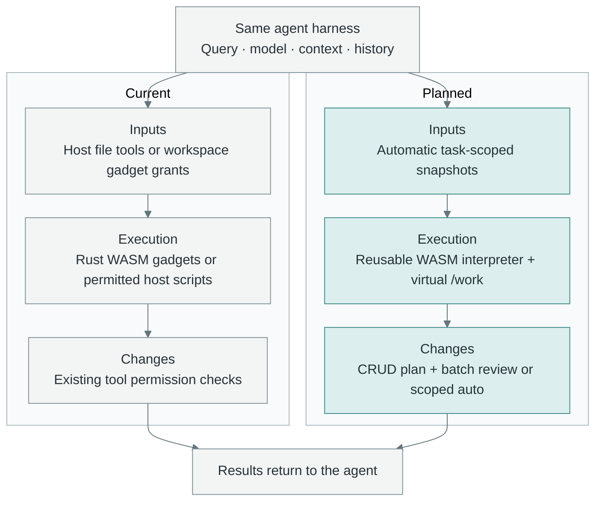

<h1 align="center">
  <picture>
    <source media="(prefers-color-scheme: dark)" srcset="docs/assets/craftsman-logo-dark.svg">
    
  </picture>
</h1>

<p align="center"><strong>A coding agent that builds its own tools.</strong></p>

Craftsman is a Rust terminal coding agent that reads your code, makes edits,
runs commands and carries work across sessions. Bring your own configured model
connection.

Its superpower: turn a useful routine into a **reusable WebAssembly gadget**,
then use it as a tool in the next model round.


## From a task to a new tool

> “Build a gadget that totals CSV numbers, then use it on `10, -4, 7`.”

Craftsman can write the Rust code, compile it into a WASM component and discover
its typed functions without a restart. The tool stays available for future tasks
instead of being rewritten each time.

1. **Create** — the embedded SDK and authoring skill scaffold the gadget.
2. **Build** — compile and validate its component interface.
3. **Use** — approve its capabilities, then call it from the agent.

Gadgets run in Wasmtime with no inherited filesystem, sockets or environment.
Declared capabilities and user approval govern host access. Native builds and
shell commands retain their separate permission checks.

Text statistics, slug generation, checked CSV totals and JSON inspection have
already been built and used in [live model sessions](docs/live-gadget-evaluation.md).

Also in development: **privacy hooks** that mask supported personal data before
model requests and restore it in local replies and file edits. The encrypted
vault, WASM detector and restoration views are implemented privately;
normal-session integration is still pending. See [development status](docs/privacy-hooks.md).
A private [restoration candidate](docs/privacy-restore.md) supplies a separate
human view of a committed reply and derived content for file writes or edits,
for the main agent and delegated agents behind their own gate. Its actual
pre-review source and independently registered inline policy/human producers now
exist in the local correction branch. Human approval uses an opaque request,
presentation and original reply from the registered UI; an ordinary callback,
digest or operation-owned decision is insufficient. The file tool still runs
its own checkpoint and diagnostics around such a write, and the terminal's
bridge draws a committed reply once through its safe backend. The local file
consumer now requires typed full-image data and retained-parent grants from
its selected policy; ordinary activity keeps model arguments and decoded
previews remain in the private UI. The local private union includes the
captured user policy/key owner and an owned terminal entry; combined-source
review and native validation are still pending. Nothing selects it in normal
sessions, and normal activation remains unavailable.
A private [final-send guard](docs/privacy-send.md) that refuses requests
containing already-mapped values is also implemented; nothing selects it yet.
Private [key and policy ownership](docs/privacy-key.md) now adds a password-wrapped
vault key and existing-only unlock backend. An unselected
[owned password popup and private bootstrap](docs/privacy-bootstrap.md) compose
those owners with a pinned detector and fresh conversation. The actual private
receiver carries opaque approvals and human questions, and refuses active
settings saves and in-place clear; normal activation remains unavailable.
The local key/UI union still has a retained macOS test-binary unwind warning;
warning and native integration gates remain open.
A private [detector contract and admission core](docs/privacy-admission.md)
and a private way to compose model requests from
[views of sources](docs/privacy-provenance.md), for all four model wires, are
in development on top of them. No frontend, configuration or command selects
either. The local core correction retains actual input/reply/tool facts and
sealed human decisions, with a separate sourced model view and actual child/
notification owners. It adds actual pre-review/terminal events, retained end/save
failures and stop checks for new selected invocations. Kept native items remain exact through compaction; changed
native replies refuse replay. Declared verification, context compilation and
failure controls now have private
[controller adapters](docs/privacy-provenance.md#controller-adapters): the
session's original controllers run behind them, the context section is sent as
source parts, and a declared check runs with its real commands and result,
whether the model asks for it or the verification controller schedules it. A
stop by that controller is recorded with its source and ends the conversation,
and a compaction tells the original controller. These consume the framework's
controller, completion and compaction events; they do not supply the key,
policy or actual terminal receiver/modal/choice/shutdown ownership. The local
inline core supplies its own opaque decision producers; real
policy/frontend/restore adapters and independent validation remain required
before activation. Failed local checks and the unresolved native linker warning
remain recorded.

## Planned WASM enhancement

Rust gadgets already run in Wasmtime. Work has resumed on a common sandbox for
compatible **Python, JavaScript and TypeScript** skill/plugin scripts, followed
by a file-change review layer. The session and model loop stay shared; the
[script runner](docs/wasm-script-runner.md) is not yet shipped.



- **Inputs:** Craftsman finds relevant files automatically and supplies scoped
  snapshots, without a mandatory file picker.
- **Changes:** scripts create, update and delete in a virtual `/work` overlay;
  the host computes the change plan against retained original files.
- **Approval:** review the whole batch once, or use a user-authorized scoped auto
  policy. The host checks permissions and stale files before applying changes.

Script/source approval remains separate. Native build/shell commands and MCP
connections retain their own execution boundaries; the proposed script sandbox
does not contain those host operations. See [current runtime details](docs/runtime-status.md).

## Built for your workflow

- **Work in the terminal** — streaming replies, file edits, shell tools, planning
  and persistent sessions.
- **Choose your model** — provider-owned catalogs and per-model reasoning controls.
- **Extend the agent** — reusable WASM gadgets and MCP server connections.
- **Connect an editor** — standard ACP over stdio or a WebSocket bridge.
- **Keep control** — permission modes, explicit gadget grants and local storage.

The repository also includes the lightweight **`craftsman-harness`** Rust
framework and the gadget SDK/macros for building your own integrations.

## Get started

Install Rust through rustup and CMake. Linux also needs ALSA development headers;
see the [build guide](docs/production-readiness.md).

```sh
git clone https://github.com/kaobei-alabo/craftsman-harness.git
cd craftsman-harness
rustup toolchain install --no-self-update
./install.sh
craftsman setup
craftsman
```

The CLI command is `craftsman`. Run `./install.sh --upgrade` to update an older
installation and remove its retired compatibility launcher.

Configure your endpoint, API key and model using setup or the
[example config](examples/config/multi-provider.json). Enable `gadgets.enabled`
to use the gadget authoring tools and catalog. `/model` opens the grouped model
catalog, then its effort picker; `/effort` adjusts the current model directly.

For editor integrations, run `craftsman acp-serve`. Use `craftsman acp-bridge`
when the client needs WebSocket transport.
Compatible terminals can monitor work and approval waits through OSC 7501.

Start Craftsman in the folder where you want to work. Git is optional;
documents and folders containing several projects are supported too.

## Explore

[Gadget authoring](docs/gadgets.md) ·
[Models and configuration](docs/provider-models.md) ·
[Local state and connections](docs/connections.md) ·
[File checkpoints and rewind](docs/workspace-checkpoints.md) ·
[Long tasks and turn limits](docs/terminal-turn-limits.md) ·
[Legacy one-shot output](docs/runtime-status.md#4-legacy-one-shot-versus-accepted-headless-v1) ·
[Terminal lifecycle and recovery](docs/terminal-recovery.md) ·
[Durable manual compaction](docs/terminal-compaction.md) ·
[ACP integration](docs/acp.md) ·
[Terminal status reporting](docs/terminal-status.md) ·
[Architecture and current limits](docs/runtime-status.md) ·
[Harness improvement progress](docs/harness-improvements.md) ·
[Coding evaluations](docs/coding-evaluation.md) ·
[Fresh evaluation preparation](docs/coding-evaluation-preparation.md) ·
[Owned-terminal synthetic evaluation v2](docs/owned-terminal-evaluation.md) ·
[Task workflow](docs/task-workflow.md) ·
[Declared verification](docs/verification.md) ·
[Task context](docs/context.md) ·
[Failure controls](docs/failure-controls.md) ·
[Privacy hook development](docs/privacy-hooks.md) ·
[Private send guard](docs/privacy-send.md) ·
[Private key and bootstrap](docs/privacy-bootstrap.md) ·
[Private admission core](docs/privacy-admission.md) ·
[Privacy provenance](docs/privacy-provenance.md) ·
[Privacy restoration](docs/privacy-restore.md) ·
[Development and native validation](docs/production-readiness.md)

MIT licensed. See [LICENSE](LICENSE) and [third-party notices](NOTICE).

Private source-view work also has a separate local core correction branch for
immutable event retention and cancellation; it remains unselected and awaits
application integration, full validation and independent review.
