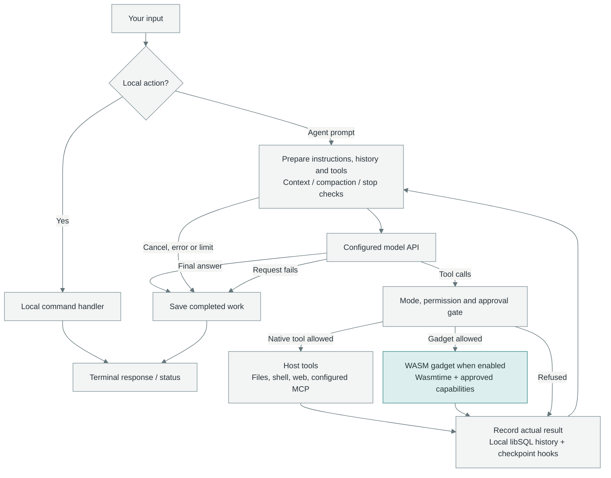
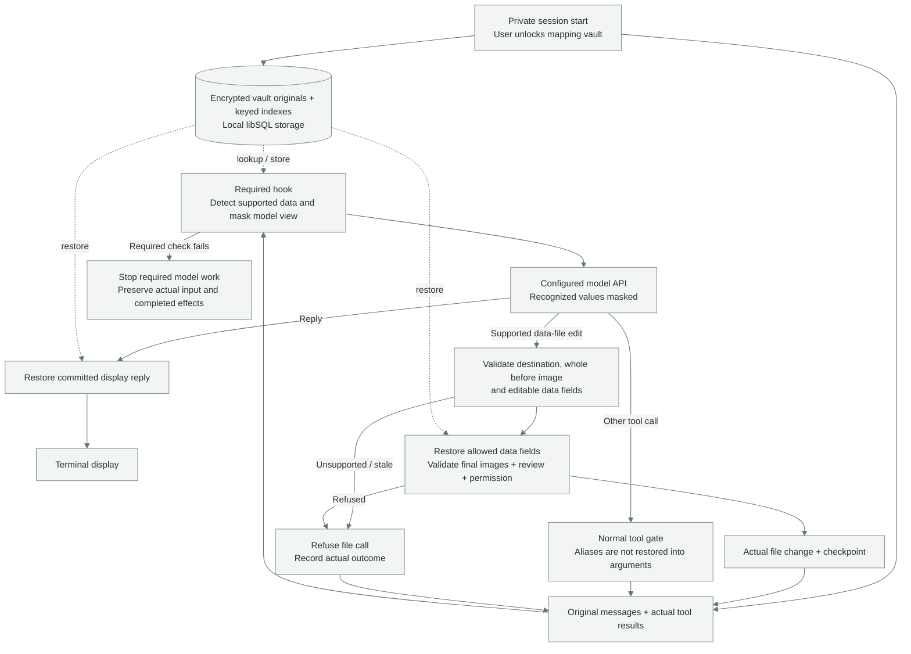
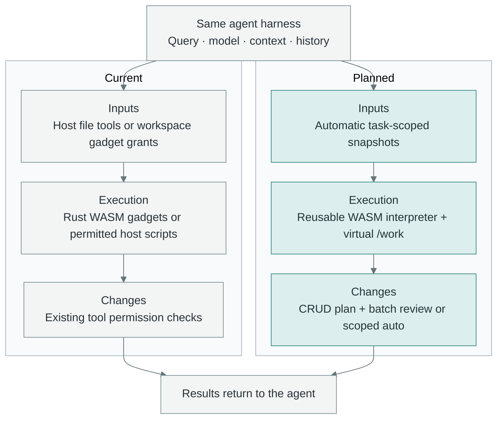

<h1 align="center">
  <picture>
    <source media="(prefers-color-scheme: dark)" srcset="docs/assets/craftsman-logo-dark.svg">
    
  </picture>
</h1>

<p align="center"><strong>A coding agent that builds its own tools.</strong></p>

Craftsman is a Rust terminal coding agent that reads your code, makes edits,
runs commands and carries work across sessions. Bring your own configured model
connection.

Its superpower: turn a useful routine into a **reusable WebAssembly gadget**,
then use it as a tool in the next model round.


## Harness flow

This is the current interactive path. Local commands handle setup, pickers and
inspection; commands that expand into prompts enter the same agent loop.



The model can repeat the tool loop before answering. Replies stream through the
terminal UI; configured verification and failure controls can request more work
or stop the turn. WASM contains **gadget code**; host tools keep their own
execution and permission boundaries. Models and MCP use configured connections;
web requests come from web-tool calls. Session data uses the local libSQL/Turso
core with no remote Turso replica.

Code entry points: [submission routing](crates/craftsman-rs/src/tui/commands.rs),
[session construction](crates/craftsman-rs/src/agent.rs),
[agent loop](crates/craftsman-harness/src/agent.rs).

## From a task to a new tool

> “Build a gadget that totals CSV numbers, then use it on `10, -4, 7`.”

Craftsman can write the Rust code, compile it into a WASM component and discover
its typed functions without a restart. The tool stays available for future tasks
instead of being rewritten each time.

1. **Create** — the embedded SDK and authoring skill scaffold the gadget.
2. **Build** — compile and validate its component interface.
3. **Use** — approve its capabilities, then call it from the agent.

Gadgets run in Wasmtime with no inherited filesystem, sockets or environment.
Declared capabilities and user approval govern host access. Native builds and
shell commands retain their separate permission checks.

Text statistics, slug generation, checked CSV totals and JSON inspection have
already been built and used in [live model sessions](docs/live-gadget-evaluation.md).

## Privacy flow — prototype, off unless your own configuration enables it

The unmerged privacy work adds a required hook around model requests. It keeps
the original local records and gives the model a separate masked view. On this
branch the interactive `craftsman` startup takes this path only when your own
user configuration enables a privacy policy; every other session is unchanged.



**The password belongs to this prototype's mapping vault.** It unwraps the
vault key at private-session startup; private `/clear` retires the old session
and asks again. Model access uses your configured API keys. The vault encrypts
stored originals and uses keyed lookup indexes; original messages, tool results,
history and checkpoints keep their existing plaintext form. Workspace files
keep their current contents. Only recognized supported values are masked;
unrecognized content is sent as written. `craftsman privacy status` reports the
local state, `craftsman privacy init` creates the key, and `craftsman privacy
enable --detector <id>` adds the policy to a user file that has none; nothing
is enabled without that explicit command or your own edit. The private
terminal is narrower than the ordinary one: read-only local commands such as
`/help` and `/status` work, but there is no voice, no settings change, no
shell escape and no session resume. This prototype has local test evidence
only; it is not merged, installed or validated on hosted runners.
Supported file restoration is limited to validated
Contact data; shell commands, paths, source code and arbitrary MCP arguments
are not restoration destinations. See [privacy development](docs/privacy-hooks.md)
and [startup, status, init and enable](docs/privacy-startup.md).

## Planned WASM enhancement

Rust gadgets already run in Wasmtime. Work has resumed on a common sandbox for
compatible **Python, JavaScript and TypeScript** skill/plugin scripts, followed
by a file-change review layer. The session and model loop stay shared; the
[script runner](docs/wasm-script-runner.md) is not yet shipped.

<details>
<summary>Planned script sandbox — what changes</summary>



- **Inputs:** Craftsman finds relevant files automatically and supplies scoped
  snapshots, without a mandatory file picker.
- **Changes:** scripts create, update and delete in a virtual `/work` overlay;
  the host computes the change plan against retained original files.
- **Approval:** review the whole batch once, or use a user-authorized scoped auto
  policy. The host checks permissions and stale files before applying changes.

Script/source approval remains separate. Native build/shell commands and MCP
connections retain their own execution boundaries; the proposed script sandbox
does not contain those host operations. See [current runtime details](docs/runtime-status.md).

</details>

## Built for your workflow

- **Work in the terminal** — streaming replies, file edits, shell tools, planning
  and persistent sessions.
- **Choose your model** — provider-owned catalogs and per-model reasoning controls.
- **Extend the agent** — reusable WASM gadgets and MCP server connections.
- **Connect an editor** — standard ACP over stdio or a WebSocket bridge.
- **Keep control** — permission modes, explicit gadget grants and local storage.

The repository also includes the lightweight **`craftsman-harness`** Rust
framework and the gadget SDK/macros for building your own integrations.

## Get started

Install Rust through rustup and CMake. Linux also needs ALSA development headers;
see the [build guide](docs/production-readiness.md).

```sh
git clone https://github.com/kaobei-alabo/craftsman-harness.git
cd craftsman-harness
rustup toolchain install --no-self-update
./install.sh
craftsman setup
craftsman
```

The CLI command is `craftsman`. Run `./install.sh --upgrade` to update an older
installation and remove its retired compatibility launcher.

Configure your endpoint, API key and model using setup or the
[example config](examples/config/multi-provider.json). Enable `gadgets.enabled`
to use the gadget authoring tools and catalog. `/model` opens the grouped model
catalog, then its effort picker; `/effort` adjusts the current model directly.

For editor integrations, run `craftsman acp-serve`. Use `craftsman acp-bridge`
when the client needs WebSocket transport.
Compatible terminals can monitor work and approval waits through OSC 7501.

Start Craftsman in the folder where you want to work. Git is optional;
documents and folders containing several projects are supported too.

## Explore

[Gadget authoring](docs/gadgets.md) ·
[Models and configuration](docs/provider-models.md) ·
[Local state and connections](docs/connections.md) ·
[File checkpoints and rewind](docs/workspace-checkpoints.md) ·
[Long tasks and turn limits](docs/terminal-turn-limits.md) ·
[Legacy one-shot output](docs/runtime-status.md#4-legacy-one-shot-versus-accepted-headless-v1) ·
[Terminal lifecycle and recovery](docs/terminal-recovery.md) ·
[Durable manual compaction](docs/terminal-compaction.md) ·
[ACP integration](docs/acp.md) ·
[Terminal status reporting](docs/terminal-status.md) ·
[Architecture and current limits](docs/runtime-status.md) ·
[Harness improvement progress](docs/harness-improvements.md) ·
[Coding evaluations](docs/coding-evaluation.md) ·
[Fresh evaluation preparation](docs/coding-evaluation-preparation.md) ·
[Owned-terminal synthetic evaluation v2](docs/owned-terminal-evaluation.md) ·
[Task workflow](docs/task-workflow.md) ·
[Declared verification](docs/verification.md) ·
[Task context](docs/context.md) ·
[Failure controls](docs/failure-controls.md) ·
[Privacy hook development](docs/privacy-hooks.md) ·
[Private send guard](docs/privacy-send.md) ·
[Development and native validation](docs/production-readiness.md)

MIT licensed. See [LICENSE](LICENSE) and [third-party notices](NOTICE).
