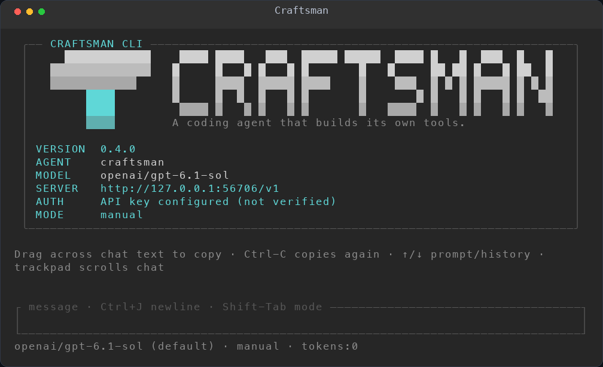
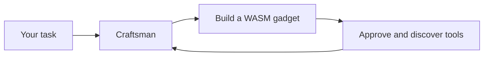

# Craftsman

**A coding agent that builds its own tools.**



Craftsman is a Rust terminal coding agent that reads your code, makes edits,
runs commands and carries work across sessions. Bring your own GPT, Claude,
Gemini or OpenAI-compatible model connection.

Its superpower: turn a useful routine into a **reusable WebAssembly gadget**,
then use it as a tool in the next model round.

## From a task to a new tool

> “Build a gadget that totals CSV numbers, then use it on `10, -4, 7`.”

Craftsman can write the Rust code, compile it into a WASM component and discover
its typed functions without a restart. The tool stays available for future tasks
instead of being rewritten each time.



1. **Create** — the embedded SDK and authoring skill scaffold the gadget.
2. **Build** — compile and validate its component interface.
3. **Use** — approve its capabilities, then call it from the agent.

Gadgets run in Wasmtime with no inherited filesystem, sockets or environment.
Declared capabilities and user approval govern host access. Native builds and
shell commands retain their separate permission checks.

Text statistics, slug generation, checked CSV totals and JSON inspection have
already been built and used in [live GPT and Claude sessions](docs/live-gadget-evaluation.md).

## Built for your workflow

- **Work in the terminal** — streaming replies, file edits, shell tools, planning
  and persistent sessions.
- **Choose your model** — provider-owned catalogs and per-model reasoning controls.
- **Extend the agent** — reusable WASM gadgets and MCP server connections.
- **Connect an editor** — standard ACP over stdio or a WebSocket bridge.
- **Keep control** — permission modes, explicit gadget grants and local storage.

The repository also includes the lightweight **`craftsman-harness`** Rust
framework and the gadget SDK/macros for building your own integrations.

## Get started

Install Rust through rustup and CMake. Linux also needs ALSA development headers;
see the [build guide](docs/production-readiness.md).

```sh
git clone https://github.com/kaobei-alabo/craftsman-harness.git
cd craftsman-harness
rustup toolchain install --no-self-update
./install.sh
craftsman setup
craftsman
```

Configure your endpoint, API key and model using setup or the
[example config](examples/config/multi-provider.json). Enable `gadgets.enabled`
to use the gadget authoring tools and catalog. `/model` opens the grouped model
catalog, then its effort picker; `/effort` adjusts the current model directly.

For editor integrations, run `craftsman acp-serve`. Use `craftsman acp-bridge`
when the client needs WebSocket transport.

## Explore

[Gadget authoring](docs/gadgets.md) ·
[Models and configuration](docs/provider-models.md) ·
[Local state and connections](docs/connections.md) ·
[ACP integration](docs/acp.md) ·
[Architecture and current limits](docs/runtime-status.md) ·
[Development and validation](docs/production-readiness.md)

MIT licensed. See [LICENSE](LICENSE) and [third-party notices](NOTICE).
