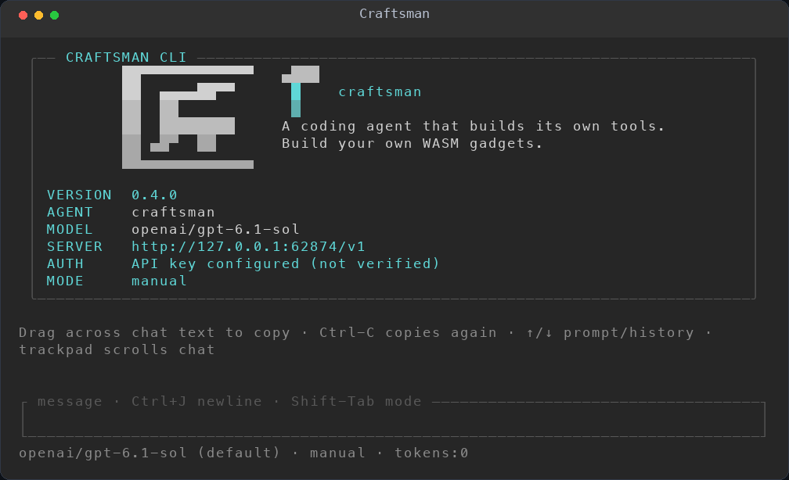
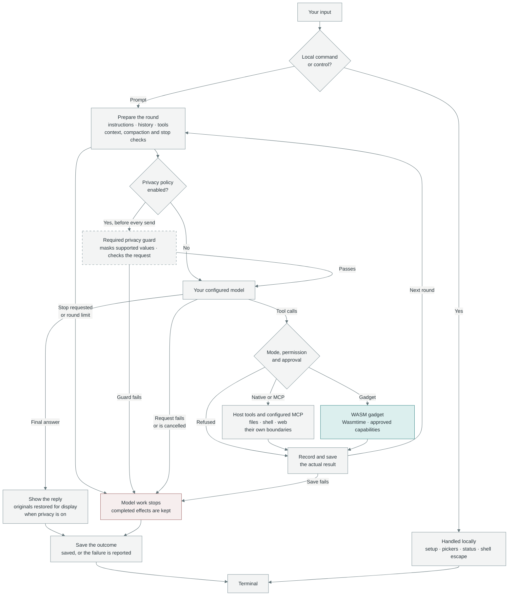

<h1 align="center">
  <picture>
    <source media="(prefers-color-scheme: dark)" srcset="docs/assets/craftsman-logo-dark.svg">
    
  </picture>
</h1>

<p align="center"><strong>A coding agent that builds its own tools.</strong></p>

Craftsman is a Rust terminal coding agent. It reads your code, edits files,
runs commands and carries work across sessions, on the model connection you
configure.

Its signature move: turn a useful routine into a **reusable WebAssembly
gadget**, then call it as a tool in the next model round.



## What you get

- **Gadgets that last.** Ask for a tool. Craftsman scaffolds it with the
  embedded SDK, compiles it to a WASM component and discovers its typed
  functions without a restart. Text statistics, slug generation, checked CSV
  totals and JSON inspection were built and used this way in
  [live model sessions](docs/live-gadget-evaluation.md).
- **A contained place for gadget code.** Gadgets run in Wasmtime with no
  inherited filesystem, sockets or environment. Declared capabilities and
  your approval govern what a gadget may reach.
- **Your models.** Configure your own endpoint, key and model. Named
  connections, a grouped model catalog and per-model reasoning effort are
  described in [models and configuration](docs/provider-models.md).
- **A terminal that keeps you in control.** Streaming replies, file edits,
  shell tools, planning, permission modes with approvals, per-turn file
  checkpoints, and sessions stored locally with no remote replica.
- **Open ends.** Configured MCP servers, standard ACP for editors, and the
  lightweight `craftsman-harness` Rust framework with the gadget SDK for
  your own integrations.

## Get started

Install Rust through rustup, and CMake. Linux also needs ALSA development
headers; see the [build guide](docs/production-readiness.md).

```sh
git clone https://github.com/kaobei-alabo/craftsman-harness.git
cd craftsman-harness
rustup toolchain install --no-self-update
./install.sh
craftsman setup
craftsman
```

`craftsman setup` configures your endpoint, key and model; you can also start
from the [example configuration](examples/config/multi-provider.json). Set
`gadgets.enabled` to use gadget authoring and the gadget catalog. In a
session, `/model` opens the model catalog and `/effort` changes the reasoning
effort.

Start Craftsman in the folder you want to work in; Git is optional. For
editors, `craftsman acp-serve` speaks ACP over stdio and `craftsman
acp-bridge` adds a WebSocket bridge. `./install.sh --upgrade` updates an
older installation.

## How a request runs

Local commands and controls are answered in the terminal. A prompt enters the
agent loop, which can repeat tool rounds before it answers. The diagram shows
what runs today.



- **Boundaries.** WASM contains gadget code. Native shell commands and MCP
  servers keep their own execution and permission boundaries.
- **Privacy.** With a policy enabled, the guard is required before every
  model send. If it fails, the request is not sent.
- **Stops.** A cancel, a failed request or a failed save stops model work;
  what was already done stays. At the round limit the turn pauses, and a
  follow-up continues it.
- **Saving.** The terminal saves each tool result and the final outcome as
  work completes. A save that fails is reported as a failure, not shown as
  saved.

Code: [submission routing](crates/craftsman-rs/src/tui/commands.rs) ·
[session construction](crates/craftsman-rs/src/agent.rs) ·
[agent loop](crates/craftsman-harness/src/agent.rs)

## Privacy mode: experimental and opt-in

Privacy mode is off unless your own user configuration enables a policy, and
then it applies to the interactive `craftsman` start only. It keeps your
original records locally and gives the model a separate masked view.

- **Vault password.** Asked at startup, after `/clear`, and when you change
  the model, effort or mode. The vault encrypts the original values and uses
  keyed lookup indexes. Local messages, history and checkpoints keep their
  existing plaintext form.
- **What is masked.** Supported email addresses and phone numbers. Anything
  else is sent as written. A policy that declares further values to mask is
  refused at start for now.
- **What is restored.** The reply you read, and validated Contact data fields
  in a supported file write. Shell commands, paths, source code and other
  tool arguments are not restored.
- **Restrictions.** It runs in the `manual` or `plan` permission mode, with a
  model connection whose items can be inspected; others are refused. In this
  version the interactive privacy start and the restoration into files exist
  on Unix systems only: on Windows a start with a privacy policy is refused,
  and the ordinary file tools work as they always do.
- **Voice.** In a build with voice input, cancelling a dictation retires the
  voice controller, so the next start loads the model again. Finishing a
  dictation normally keeps it.

Privacy mode is experimental. It does not make all data private and is not
supported on every model connection; what has been validated, and on which
platforms, is in the [current status](docs/runtime-status.md). Activation,
commands and limits:
[startup and commands](docs/privacy-startup.md) ·
[hook design](docs/privacy-hooks.md) ·
[send guard](docs/privacy-send.md) ·
[voice and shell](docs/privacy-voice.md).

## Documentation

- **Use:** [gadgets](docs/gadgets.md) ·
  [models and configuration](docs/provider-models.md) ·
  [connections and local state](docs/connections.md) ·
  [ACP](docs/acp.md) · [terminal status](docs/terminal-status.md)
- **Long tasks:** [turn limits](docs/terminal-turn-limits.md) ·
  [recovery](docs/terminal-recovery.md) ·
  [compaction](docs/terminal-compaction.md) ·
  [checkpoints and rewind](docs/workspace-checkpoints.md)
- **Task quality:** [task workflow](docs/task-workflow.md) ·
  [verification](docs/verification.md) · [context](docs/context.md) ·
  [failure controls](docs/failure-controls.md)
- **Project:** [architecture and current limits](docs/runtime-status.md) ·
  [evaluations](docs/coding-evaluation.md) ·
  [build and native validation](docs/production-readiness.md) ·
  [planned script runner, not shipped](docs/wasm-script-runner.md)

MIT licensed. See [LICENSE](LICENSE) and [third-party notices](NOTICE).
