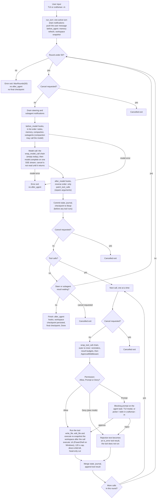
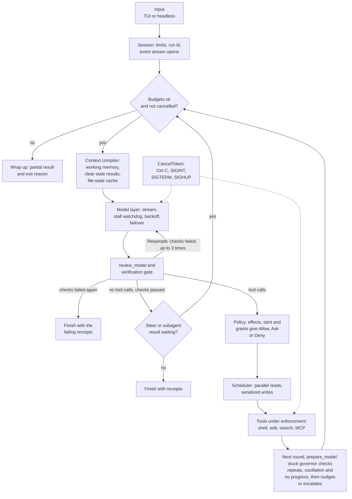
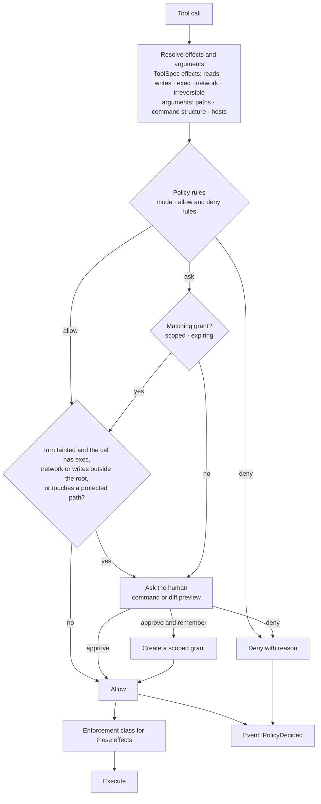
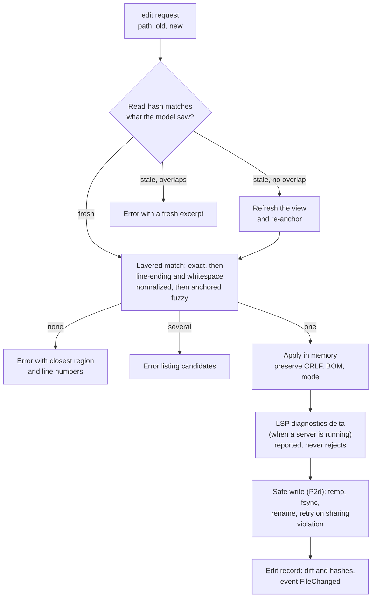
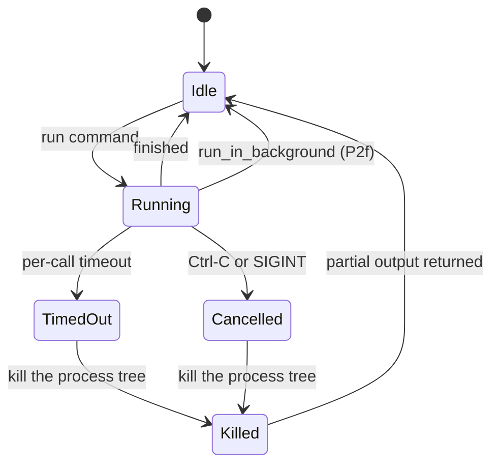
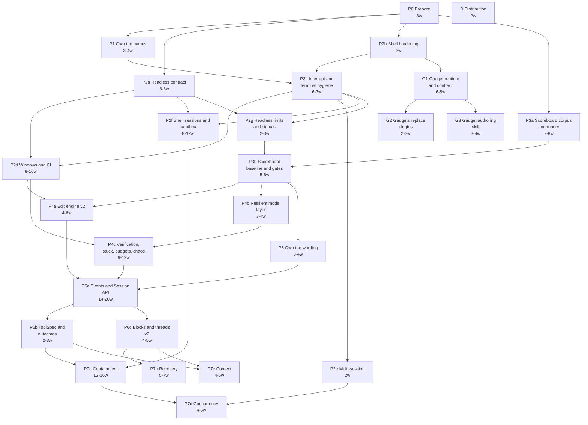

# Craftsman Harness: plan, design and diagrams

> **Identity migration (November 4, 2026):** names/paths in this document use
> current Craftsman identifiers. Historical dates, hashes, counts, accepted
> semantics and failure outcomes remain original evidence, not a new run or
> proof of release. The schema/ACP/WIT namespace change is breaking; see
> [repository-name.md](repository-name.md).

> **Status:** accepted implementation plan; historical baseline at `main` commit
> `0b77980` (October 16, 2026, after #70). Amendments cover gadgets (October 19–20)
> and explicit headless R1–R7/schema acceptance in #95 (October 20).
> **Current implementation:** `runtime-status.md` tracks what is implemented,
> private-but-unwired or still planned. Renamed framework/TUI, shell mechanisms,
> gadgets and partial headless code have progressed beyond the baseline below.
> This document's baseline diagrams are not the latest runtime architecture.
> **Scope:** the current `crates/craftsman-harness` framework and `crates/craftsman-rs`
> terminal agent. Existing servers, desktop/workspace adapters, ACP and service
> runtime remain deferred from redesign; they keep compiling and their contracts
> are preserved. P1's historical naming map remains in Appendix B.
> **How to read:** section 3, the baseline column of section 6 and Appendix A
> describe the October 16 baseline (plus explicitly dated P0 evidence), not current
> code. Sections 4–10 describe accepted target designs, with dated progress notes
> where implemented; they do not make every target a shipped feature. Section 11
> records decisions; *(idea)* remains unscheduled. Terms are in Appendix C.
> **Decisions:** the original 17 defaults were adopted October 16; G1–G3 source
> and their documented defaults are implemented. Headless approval is recorded in
> `headless-mode.md`, but its command/runtime gates remain open. OSS review,
> live-evaluation and published-release gates are not cleared by source merges.
> **Reading paths:** current behavior: `runtime-status.md` and README; safety:
> 5.1, 5.3, 5.11, P2f/G1/P7a and headless implementation limits; plan: section 7;
> historical evidence: Appendix A.

## 1. Summary

At the October 16 baseline, the loop, middleware, resumable threads and per-turn
checkpoints worked with the limits recorded in section 3 and Appendix A. The
plan targeted owned names, stronger containment/recovery, verification and
measurement. By October 20, framework naming/TUI splitting, shell mechanisms,
gadgets and the first private headless layers are implemented; full unattended
execution, OS containment, verification and live measurement remain open. Use
`runtime-status.md` for the current architecture rather than interpreting the
historical gap diagram as today's code.

**Where Craftsman came from.** The framework crate began as a Rust port of an open-source Python agent framework (LangChain's `deepagents`; decision 6 confirms its licence). Some names, comments and 20 prompt constants still follow it (A19, A29). That is why P0 includes an OSS-compliance review and a `NOTICE`, P1 renames the crate and removes the lineage text, and P5 rewrites the model-facing wording from a Craftsman behavior spec.

- **Thesis.** A coding agent you can trust with a repository: *contained* (macOS and Linux: an OS sandbox for the shell from P2f and for stdio MCP and LSP servers from P7a; in-process tools are held by path and URL checks, which are not an OS boundary, unless decision 14 picks a helper process; Windows: not contained, only approvals, a scrubbed environment and Job Object tree kill), *verified* (when checks are declared, done carries receipts, P4c), *recoverable* (safe writes P2d, chaos suite P4c, turn changesets P7b), *auditable* (typed events P6a, flight recorder P7b) and *measured* (a per-model scoreboard, P3b).
- **Targets.** macOS, Linux and Windows Terminal; several sessions side by side in tmux; and a headless mode for CI, cron and the scoreboard itself. **Headless mode is a must-have.**
- **Approach.** Keep the middleware extension style; own the names, prompts and contracts; from P3b on, gate model-visible changes on a live suite run (5.9).
- **Gadgets.** User-installed WASM components under `~/.craftsman/gadgets/` that the agent calls through one dispatcher tool, `gadget_call`. Authors write them with the `#[gadget_call]` macro, and the agent can write and build one itself with a built-in skill. They replace the declarative plugins (5.11, G1 to G3).
- **Plan.** Phases P0 to P7, G1 to G3 and D in [section 7](#7-plan). The phase sizes add up to 130 to 171 engineer-weeks for one engineer; the longest dependency chain (P0 → P1 → P2c → P2g → P3b → P4b → P4c → P6a → P6b → P7a → P7d) is 63 to 83 weeks, which is the earliest finish if each phase is done by one engineer as sized. Sizes are judgment, with a confidence column in section 7, and are re-estimated three times.
- **Phase key.** P0 Prepare · P1 Own the names · P2 Terminal core: P2a Headless contract, P2b Shell hardening, P2c Interrupt and terminal hygiene, P2d Windows and CI, P2e Multi-session, P2f Shell sessions and sandbox, P2g Headless limits and signals · P3 Scoreboard: P3a Scoreboard corpus and runner, P3b Scoreboard baseline and gates · P4 Reliability: P4a Edit engine v2, P4b Resilient model layer, P4c Verification, stuck, budgets, chaos · P5 Own the wording · P6 Contracts: P6a Events and Session API, P6b ToolSpec and outcomes, P6c Blocks and threads v2 · P7 Governed: P7a Containment, P7b Recovery, P7c Context, P7d Concurrency · G Gadgets: G1 Gadget runtime and contract, G2 Gadgets replace plugins, G3 Gadget authoring skill · D Distribution.

```text
BASELINE HARNESS   (October 16, 2026; ! = then-verified gap; current: runtime-status.md)

+----------------------------------------------------------------------------+
| FRONT-ENDS                                                                 |
|   TUI (ratatui), one ~7k-line file                                         |
|   ! Drop-only terminal restore; no signal or panic handling      [P2c]     |
|   ! nothing reads $TMUX; no title or bell                        [P2e]     |
|   craftsman -m (one-shot)                                                      |
|   ! text only; approvals read stdin; accidental exit codes       [P2a]     |
|   Deferred, keep compiling: serve, desktop-serve, acp-serve,               |
|   acp-bridge, service-agent                                                |
+----------------------------------------------------------------------------+
                                      |
                                      v
+----------------------------------------------------------------------------+
| SESSION                                                                    |
|   build_session_ext: route, profiles, prompt, tools, middleware            |
|   returns a Session (agent + handles)                                      |
|   ! queue and approval wiring is repeated per front-end          [P6a]     |
+----------------------------------------------------------------------------+
                                      |
                                      v
+----------------------------------------------------------------------------+
| CORE (deepagents-rs)                                                       |
|   DeepAgent loop, up to 50 rounds; steering                                |
|   ! tool calls run one at a time                                 [P7d]     |
|   ! cancel is a flag read at loop boundaries                     [P2c]     |
|   ! no stuck detection; the only budget is the round cap         [P4c]     |
|   Middleware, outer to inner: Patch, Todo, Memory, Compaction,             |
|   Reminders, ResultBudgets, WorkspaceCheckpoint*, SubAgents, Approval*     |
|   (* defined in craftsman-rs; the other seven are in deepagents-rs)            |
|   AgentState: plain-string messages, todos, custom map, files              |
|   Subagents: task tool, registry, notifications                            |
|   Model (craftsman-rs): StreamingLlmProvider x3 (main, subagent, compaction)   |
|   over an OpenAI-compatible SSE endpoint                                   |
|   ! one retry after 250 ms, before first output; no backoff,               |
|     Retry-After or failover                                [P2a, P4b]      |
|   ! subagents run bare: no chain, no checkpoint                  [P6a]     |
|   ! a foreground subagent ignores the cancel flag                [P2c]     |
|   ! checkpoints precede tool results; no reconciliation on load  [P4b]     |
+----------------------------------------------------------------------------+
                                      |
                                      v
+----------------------------------------------------------------------------+
| POLICY AND SAFETY (craftsman-rs)                                               |
|   ApprovalMiddleware (innermost), SubagentGate, permission modes           |
|   Approvals are inline prompts; the shipped chain never suspends           |
|   ! gating by tool name; MCP tools ungated; no OS sandbox   [P2f, P7a]     |
|   ! Windows: no command allow-list; plan mode denies all         [P2d]     |
+----------------------------------------------------------------------------+
                                      |
                                      v
+----------------------------------------------------------------------------+
| EXECUTION (craftsman-rs)                                                       |
|   Tools: execute, read_file, write_file, edit_file, ls, glob, grep,        |
|   web_fetch, web_search, LSP, MCP, ask_user (+ write_todos, task)          |
|   ! shell: fresh sh -c (PowerShell on Windows), 120 s cap, kills           |
|     the direct child only, head-only cut, env inherited   [P2b, P2f]       |
|   ! edits: exact match + plain fs::write, CRLF-blind     [P2d, P4a]        |
|   ! grep: literal substring, ignores .gitignore                  [P4a]     |
|   Backend: RealFs + /memories routed to StoreFs                            |
|   Integrations: MCP http + stdio, LSP, skills, plugins, AGENTS.md          |
+----------------------------------------------------------------------------+
                                      |
                                      v
+----------------------------------------------------------------------------+
| EVENTS                                                                     |
|   jsonl journal: ts + kind + free JSON (only when threads.db opened)       |
|   ! no typed, versioned events                                   [P6a]     |
+----------------------------------------------------------------------------+
                                      |
                  +-------------------+-------------------+
                  |                                       |
                  v                                       v
+------------------------------------+  +------------------------------------+
| STATE (~/.craftsman)                   |  | QUALITY                            |
|   threads.db (libsql):             |  |   unit + mock-server e2e           |
|   checkpoints (full state,         |  |   tests, run locally               |
|   newest 50), memory files,        |  |   ! no PR test CI           [P0]   |
|   workspace checkpoints            |  |   ! no scoreboard          [P3b]   |
|   ! each snapshot reads every      |  |                                    |
|     non-ignored file         [P2c] |  |                                    |
|   sessions-rs/*.jsonl              |  |                                    |
+------------------------------------+  +------------------------------------+
```

```text
TARGET HARNESS  (planned end state; not all implemented; current: runtime-status.md)

+----------------------------------------------------------------------------+
| FRONT-ENDS (terminal first) - extended                                     |
|   macOS, Linux, Windows Terminal, inside tmux                              |
|   TUI: attention signals [P2e], hunk review [P7b], /context [P7c]          |
|   Headless CLI (new): craftsman exec [P2a]; limits and signals [P2g]           |
|   Deferred, keep compiling: serve, desktop-serve, acp-serve,               |
|   acp-bridge, service-agent                                                |
+----------------------------------------------------------------------------+
                                      |
                                      v
+----------------------------------------------------------------------------+
| SESSION API (library) - rebuilt [P6a]                                      |
|   submit, steer, queue, cancel, approve, resume, limits                    |
|   one implementation for the TUI and headless                              |
+----------------------------------------------------------------------------+
                                      |
                                      v
+----------------------------------------------------------------------------+
| CORE (craftsman-harness) - rebuilt                                             |
|   Agent loop + CancelToken: stream and process tree abort [P2c, P2b]       |
|   Middleware (renamed) [P1]: turn_start, prepare_model, around_model,      |
|   review_model, around_tool, turn_end; review_model returns a Flow [P1],   |
|   prepare_model returns one too [P4c]                                      |
|   AgentState: content-block messages [P6c], todos, files                   |
|   Governors, as middleware [P4c]: budgets, stuck governor,                 |
|   verification gate + receipts                                             |
|   Context compiler [P7c]: working memory, stale-result clearing,           |
|   file-state cache, artifacts                                              |
|   Model layer [P4b]: provider contract v2 (deltas, finish reason),         |
|   backoff, stall watchdog, failover (interim Retry-After: P2a)             |
|   Prompt registry [P3b, P5]: versioned, Craftsman-authored model text          |
+----------------------------------------------------------------------------+
                                      |
                                      v
+----------------------------------------------------------------------------+
| POLICY AND SAFETY - rebuilt                                                |
|   Scrubbed environment [P2b]; shell sandbox, macOS + Linux [P2f]           |
|   ToolSpec effects [P6b] -> policy engine: modes, grants, taint [P7a]      |
|   -> OS sandbox for child processes, path and URL checks for               |
|   in-process tools [P7a]; Windows: Job Object tree kill [P2b]              |
+----------------------------------------------------------------------------+
                                      |
                                      v
+----------------------------------------------------------------------------+
| EXECUTION - rebuilt                                                        |
|   Shell: timeouts, tree kill, tail-aware cut, spill files [P2b];           |
|   background jobs, persistent session, PTY option [P2f]                    |
|   Edit engine: safe write, CRLF/BOM [P2d]; layered match, read-hash,       |
|   diagnostics delta, gitignore-aware search [P4a]                          |
|   Tool scheduler: parallel reads, serialized writes [P7d]                  |
|   LSP, MCP, skills; gadgets replace plugins [G1-G3]; event hooks [P7d]     |
|   Subagents: inherited chain [P6a]; worktrees, attenuation [P7d]           |
+----------------------------------------------------------------------------+
                                      |
                                      v
+----------------------------------------------------------------------------+
| EVENTS: typed, versioned event stream - new [P6a]                          |
|   every box emits; consumers: TUI, JSONL feed (exec: P2a),                 |
|   event log, flight recorder, scoreboard; notify command [P2e]             |
+----------------------------------------------------------------------------+
                                      |
                  +-------------------+-------------------+
                  |                                       |
                  v                                       v
+------------------------------------+  +------------------------------------+
| STATE - rebuilt                    |  | QUALITY - extended                 |
|   Event log [P6a]: source          |  |   Scoreboard per model [P3b]       |
|   of truth; the jsonl              |  |   Record / replay [P3b]            |
|   journal is a projection          |  |   Chaos + fault injection          |
|   Threads v2 [P6c]                 |  |   [P4c]                            |
|   Changesets, hunk review,         |  |   CI on three OSes [P0, P2d]       |
|   /report [P7b]                    |  |                                    |
+------------------------------------+  +------------------------------------+
```

## 2. Goals, non-goals, principles

**Goals**

1. A terminal coding agent whose interrupt latency and startup time meet the targets in section 9, whose tmux behavior passes the P2e test, and whose containment, verification and recovery are the ones in the thesis.
2. Works on macOS, Linux and Windows Terminal, inside tmux, and unattended in CI.
3. Keeps the middleware style as the harness's internal extension surface; every name, prompt and contract is Craftsman's own.
4. Every claimed improvement has a number: on the scoreboard for model-visible changes, in a named test suite or CI job otherwise (section 9).
5. Users and the agent itself can add capabilities without a new Craftsman release: gadgets, WASM components with declared and approved capabilities (5.11).

**Non-goals (for now)**

- Server, daemon or attach modes; the desktop app; workspace pods; the ACP server; the service-agent runtime. They get mechanical updates and thin adapters, no redesign.
- IDE integrations, provider protocols beyond OpenAI-compatible. (WASM extensions were a non-goal until 2026-10-19; they are now gadgets, 5.11.)
- Gadgets in languages other than Rust, a gadget registry or marketplace, and gadgets in the deferred modules. The WIT contract is open, so another language can target it later without a contract change.

**Principles**

- Approvals reduce risk but are not a security boundary; containment is. Until the child-process sandboxes ship (the shell in P2f, stdio MCP and LSP servers in P7a) there is no boundary on any OS, and on Windows there is none in this plan; the protections are approvals and a scrubbed environment (P2b). Containment of every tool comes last because choosing a tier needs the declared tool effects of P6b.
- Every action is an event and every policy decision carries a reason (from P6a).
- Done means verified: when checks are declared, a completion claim carries receipts (P4c).
- Measure before tuning: from P3b on, a change to a prompt, a tool description, a model-visible output format, a default or a model profile must link a live suite run (5.9) for every affected model before it merges. P2 changes that alter what the model sees ship behind flags that stay off until a live suite run clears them: the P2b output format after P3b, the P2d edit matching after P4a; the P2f persistent shell is opt-in and never flips.
- Additive first. A breaking change is anything a user, script or stored file can observe: CLI flags, config keys, on-disk layout, thread schema, headless output. Renaming Rust items inside the workspace is not breaking. Existing data is not modified in place: migrations copy (`sessions-rs/` to `sessions/` in P6c), schema changes add columns and tables, and the only in-place change is the `user_version` stamp (P0). Section 8 lists the accepted behavior changes and how to opt out.
- Terminal first, headless always: every capability is reachable through the Session API. Headless v1 omits LSP, MCP, durable memory, project instructions (opt in with `--trust-workspace`) and human input (5.5); lifting each is a later, additive change that this plan does not schedule. A TUI-only feature (attention signals, hunk review) is marked TUI-only.

<a id="3-the-harness-today"></a>

## 3. Historical harness baseline — October 16, 2026

The main gaps are tagged `!` in the diagram at the top; section 6 lists all of them, with evidence in Appendix A.

**Worth keeping:** per-turn workspace checkpoints with conflict-checked rewind (SHA-256 fingerprints, pre-images in `threads.db`, never changes git refs); resumable threads; LSP diagnostics after edits; automatic compaction (a token trigger when the model's `context_window` is configured, a message count otherwise); steering and a follow-up queue; background subagents with notifications; fail-closed plan mode for the built-in shell and edit tools (network tools keep their own prompt); capped command output; OSC 52 clipboard; per-model harness profiles (general, openai, claude, nemotron), which the scoreboard will measure; declarative plugins (#70); the control-character filter in the TUI (#70); the middleware chain itself.

<a id="31-a-turn-today"></a>

### 3.1 A turn in the historical baseline



Cancelled exit (four places above): any tool calls not yet run get a "Tool call cancelled by the user." result, the transcript ends with an assistant message "Stopped by the user.", and the turn finishes through `after_agent`, a checkpoint and Done. The cancel flag is read only at the points shown; it does not interrupt a model stream or a running tool.

Approvals are inline: `ApprovalMiddleware` and `SubagentGate` block on a callback. Nothing in the shipped chain suspends a turn.

### 3.2 Four facts the design must work around

These surfaced while verifying this document (Appendix A, A21 to A23):

1. **Subagents run bare.** They have an empty middleware chain (no argument repair, result budget, compaction or approval middleware; only the tool-level `SubagentGate`), no checkpointer, no journal, and a foreground `task` call is not interrupted by the parent's cancel flag. Until P6a, governors and the policy engine do not apply to a subagent's tool calls; only `SubagentGate` does.
2. **`resume` bypasses the middleware chain.** `DeepAgent::resume` runs an approved call with the chain skipped. A policy engine built as `around_tool` middleware, or an approve/resume API, must not reuse that path.
3. **The suspend/resume machinery is unused.** The shipped chain never suspends, so approvals can be designed fresh in the Session API.
4. **There is a crash window.** Checkpoints are written after each assistant message but not after tool results, and loading a thread does no reconciliation, so a crash mid-round can leave an assistant message with tool calls and no results.

<a id="4-the-harness-after"></a>

## 4. Target harness architecture — not current availability

The headline "after" diagram above uses the same eight slots as "today". Everything in it is a proposal.

### 4.1 What each box does

- **Front-ends.** The TUI and the headless CLI are thin: they talk to the Session API and read the event stream.
- **Session API.** One library implementation of threads, the follow-up queue, steering, approvals, resume and limits. Headless v1 (P2a) reuses `build_session_ext` directly and moves onto the Session API in P6a; until then the TUI and headless are separate paths.
- **Core.** The loop owns one `CancelToken` that reaches the model stream and every running tool, including foreground subagents. The six lifecycle stages keep today's shape under Craftsman's names, with one signature change: `prepare_model` returns a `Flow` (`Proceed`, or `Finish(reason)` for a budget or limit stop) that the loop routes through `turn_end` and a final checkpoint. Today `before_model` can stop a turn only by returning an error, which skips both; `after_model` already returns a `Decision` whose `End` finishes the turn normally. Governors run in `prepare_model`, built with a context object (registry, notifications, approvals, model router, clock, events). `review_model` runs after every model reply: when the reply has no tool calls, or it returns `Finish`, the verification gate runs the declared checks (a `Finish` from `prepare_model` does not run the gate); on failure it returns `Resample` with the failing output as evidence, at most three times per turn, and the next failure ends the turn with the failing receipts attached. The policy engine runs in `around_tool`.
- **Policy and safety.** Tools declare *effects*; the policy engine decides Allow, Ask or Deny from the effects, turn-level taint, permission mode and scoped grants; enforcement has two classes (5.1): OS sandboxes for child processes, path and URL checks for in-process tools. An approved call goes through the same chain as any other.
- **Execution.** Shell, edit and search tools are rebuilt for reliability. A scheduler runs allowed calls: reads in parallel, writes serialized. Subagents get isolated worktrees and a subset of their parent's capabilities.
- **Events and state.** Every action is an event (5.4). A turn leaves a changeset (5.8) that can be reviewed hunk by hunk and rewound.
- **Quality.** The scoreboard, replay and chaos suites gate each change (5.9); CI keeps three operating systems honest.

### 4.2 Where each box lives

The crate boundary does not move: `craftsman-harness` stays free of HTTP, database and UI dependencies (`crates/deepagents-rs/tests/dep_guard.rs`).

| Lives in `craftsman-harness` (logic and traits only) | Lives in `craftsman-rs` (or crates split from it) |
|---|---|
| Loop, `CancelToken`, lifecycle stages and `Flow`, governors, tool scheduler, `ToolSpec`/`Effects`/`Verdict` types, event types, content-block messages, context-compiler and policy-engine logic | The SSE client and providers, libsql stores (`Checkpointer`, event log), OS sandbox backends and Job Objects, the TUI, the headless CLI, host tools, MCP, LSP, skills, plugins, the gadget host (wasmtime, behind the `gadgets` cargo feature; G1). The gadget authoring crates `craftsman-gadget` and `craftsman-gadget-macros` are crates of their own that gadgets depend on; Craftsman itself does not link them |

Retry policy, the stall watchdog and failover need stream progress, so P4b gives `ModelProvider` a richer contract (deltas, finish reason, cancel and progress callbacks); the transport stays in `craftsman-rs`.

### 4.3 A turn after



## 5. Key designs

Sketches are design intent, not final APIs. Names follow the [rename map](#appendix-b-rename-map-strawman).

### 5.1 Effects and policy

```rust
// sketch, not final
struct ToolSpec {
    name: String,
    description: String,          // Craftsman-authored, versioned (prompt registry)
    parameters: JsonSchema,
    effects: Effects,             // declared, not inferred from the name
    origin: Origin,               // Builtin | Mcp(server) | Lsp
}
struct Effects {
    reads: PathScope, writes: PathScope, exec: bool,
    network: HostScope, irreversible: bool, idempotent: bool,
    state: StateScope, interactive: bool,   // todos, custom keys, registry, memory; asks the human
}
enum Verdict { Allow, Ask(Reason), Deny(Reason) }
```

MCP annotations (read-only, destructive, idempotent, open-world) are hints, and the MCP specification says clients should not trust them from untrusted servers. Annotations from a server the user has not marked trusted can only tighten policy: an unannotated tool gets the most restrictive effects (exec, network, writes, irreversible). For a server listed as trusted in user-level config (the key is to be decided; project config cannot set it), `readOnlyHint` may also relax the effects to read-only.

**Enforcement has two classes (decision 14).** Child processes (`execute`, stdio MCP servers, LSP servers) can run under an OS sandbox. In-process tools (`read_file`, `write_file`, `edit_file`, `ls`, `glob`, `grep`, `web_fetch`, `web_search`, HTTP MCP) run inside the `craftsman` process on shared threads, where there is no per-call OS boundary: seatbelt attaches to a process, landlock to a thread, and neither can express a network host scope. They are held by canonicalised-path checks that resolve symlinks component by component (on Unix with `openat` and `O_NOFOLLOW`, as `workspace_checkpoint.rs` already does today, A24; Windows needs a handle-relative equivalent, P2d) and by an in-client host allow list. The alternative is to run them in a sandboxed helper process (`craftsman tool-host`), which gives one boundary at the cost of IPC and 3 to 4 more weeks in P7a.

**Taint** is defined at turn level. A workspace is trusted when the user has marked it so: a first-run trust prompt stored in user-level config in the TUI (P7a), `--trust-workspace` in headless runs (P2a). In an untrusted workspace every file read is untrusted content; in a trusted one only files outside it are. Deny rules and the mode are final. Otherwise, after any tool result whose origin is an MCP server, a web fetch or search, or untrusted file content, any call with exec, network or writes outside the root becomes Ask even if an allow rule or a grant covers it, until the next user message. Protected paths (`.git/`, `.craftsman/`, CI configs, build scripts, `.env*`, the config directory) are Ask even inside the root in every case, and grants never cover them. In headless runs an `--allow` rule that names the exact command or path answers such an Ask.



Grants are explicit, scoped (for example "`cargo test --locked` in this directory for 30 minutes"), revocable and logged. They replace the name lists and cut approval fatigue.

### 5.2 Edit engine v2



The safe-write helper (CRLF, BOM and mode preserving) and CRLF-tolerant exact matching ship early (P2d); the rest of the pipeline is P4a. A stale read-hash *overlaps* when the lines changed since the read intersect the old text of the edit. The diagnostics delta needs an in-memory buffer for the language server. Also in P4a: all-or-nothing multi-file batches, overwrite with a read-hash precondition instead of refusing, unified-diff patches, a post-edit formatter hook, and `grep` that honors `.gitignore` and supports regular expressions. *(idea)*: a symbol index, and a tree-sitter syntax check.

### 5.3 Shell, interrupt and signals



- **Hardening (P2b).** Per-call timeout; process-tree kill (a process group on Unix, a Job Object with kill-on-close on Windows), owned by the foreground call so dropping it kills the tree; head-and-tail truncation that keeps stderr and the exit code and spills the full output to a file under `$TMPDIR/craftsman-<run>/`; the environment scrubbed of secret-named variables with hints (`NO_COLOR`, `PAGER=cat`, `GIT_TERMINAL_PROMPT=0`); ANSI and carriage-return cleanup. An allow-list scrub would break real toolchains, so it is a deny-pattern scrub with a pass list.
- **Sessions and sandbox (P2f).** Background jobs are owned by a per-session job registry, not by the call that started them. A persistent shell session has its own lifetime owner and runs in exactly one sandbox tier, chosen at session start. A sandbox is applied at spawn on macOS (seatbelt) and Linux (landlock, bwrap optional), with a default-allow table and a startup capability probe; `sandbox = auto|required|off`, and `required` refuses to run `execute` when the sandbox cannot be applied (nested seatbelt, restricted user namespaces, container seccomp profiles; decision 13). Network containment for `execute` is per call and all-or-nothing (decision 17). On Windows: Job Object tree kill plus approvals; there is no OS sandbox.
- **Windows shell (decision 3).** PowerShell 7, then Windows PowerShell, unless the user configures Git Bash; WSL bash is excluded until paths are mapped between the two filesystems. The model is told which shell it has (the host block in the system prompt).
- **Interrupt.** One `CancelToken` aborts the model stream, kills running tools (foreground subagents included), resolves pending approvals and `ask_user` prompts as cancelled, appends synthetic results for in-flight calls, checkpoints, and returns control. The workspace snapshot must stay off the cancel path (incremental stat cache; no snapshot hashing in `after_agent` when cancelling).
- **Signals under raw mode.** One idempotent `shutdown()`, callable from a signal task for SIGINT, SIGTERM, SIGHUP and Windows console events: restore the terminal (raw mode, alternate screen, mouse, bracketed paste, cursor), cancel the turn, kill the process groups, checkpoint. A panic hook restores the terminal first and then prints the message on the primary screen.

### 5.4 Typed events

One versioned stream feeds the TUI, the JSON-lines emitter, the event log and the scoreboard. The event log (libsql, P6a) is the stored source of truth: the JSONL journal is written from it as a projection (same events, one writer), and the flight recorder and the audit trail are queries over it. Conversation checkpoints (full state for resume) stay a separate store and are not derived from events.

| Event | Carries |
|---|---|
| `TurnStarted` / `TurnFinished` | input; ACP stop reason (`end_turn`, `max_tokens`, `max_turn_requests`, `refusal`, `cancelled`) with the Craftsman detail (limit kind, `verification_failed`, `approval_required`, `provider_failure`, `interrupted`) in `_meta.craftsman.reason` (plus `retryable` for provider failures); receipts |
| `ModelRequested` / `ModelDelta` / `ModelCompleted` | round; text, reasoning or tool-call deltas; usage; finish reason; prompt ids |
| `Retry` / `Failover` / `ModelRetracted` | attempt, reason, delay; from and to; round and bytes dropped |
| `ToolPlanned` / `PolicyDecided` | call, effects; verdict, rule, reason |
| `ApprovalRequested` / `ApprovalResolved` | preview; decision; grant created |
| `ToolStarted` / `ToolOutput` / `ToolFinished` | call id; chunk; status, duration, bytes, truncated, artifact |
| `FileChanged` | path; hash before and after |
| `MessageAppended` / `TodosChanged` / `Compacted` | role, source (user, assistant, tool, steer, synthetic) and content reference; the todo list; replaced range and summary reference |
| `SubagentSpawned` / `SubagentFinished` | agent path |
| `BudgetWarning`, `StuckDetected`, `Verification*` | kind, action taken; check results |

Rules: every event has `schema`, `seq`, `ts`, `run_id`, `thread_id` and an agent path; fields are only ever added; consumers ignore unknown events. The vocabulary is ACP-compatible: `TurnFinished` carries an ACP `stopReason` (a failed request is an error, not a stop reason), tool events map onto `tool_call` and `tool_call_update`, and Craftsman-only fields live under `_meta.craftsman`; the headless exit reason and exit code are derived from `_meta.craftsman.reason`. The `exec` JSONL feed of P2a uses this envelope and vocabulary from its first release, with the events that exist before P6a (run, message, tool and result events); from P6a it is produced from this stream. `ToolStarted` for any call with write or exec effects, `PolicyDecided` and `ApprovalResolved` are committed synchronously before the tool runs; deltas and read-only output are batched.

### 5.5 Headless mode (must-have)

Unattended use in CI, cron, scripts and the scoreboard runner. The concrete contract lives in `docs/headless-mode.md`: the user/maintainer explicitly accepted R1–R7 and its schemas in the development thread on October 20, 2026. Merge that accepted spec after green CI before runtime implementation. The accepted contract supersedes earlier wording below where clarified; acceptance is not a shipped CLI or live-evaluation approval.

- **Entry point.** A new subcommand of the existing `craftsman` binary, `craftsman exec [PROMPT]` (like `craftsman serve` or `craftsman setup`), with one fixed contract that does not depend on TTY state, CI variables or ambient config. `craftsman -m` stays as it is, apart from three fixes. Today a bare Enter or `y` on a non-TTY stdin approves a command, and an idle pipe blocks the prompt forever (A9); fix: a prompt on a non-TTY stdin denies. Today subagent and compaction output is streamed to stdout next to the answer (A11); fix: silence it. Today a broken stdout pipe panics `print!` and exits 101 (A30); fix: end the run quietly. Both paths share `build_session_ext`.
- **Input.** The instruction comes from the argument, `--prompt-file`, or stdin only when it is named (`-`), read with a first-byte timeout, so an idle open pipe cannot hang a run. Files given with `--file` are delimited and labelled as data to make instruction forging less likely; the policy engine (P7a), not the framing, is the control. Oversized input is an error, never a silent truncation.
- **Output.** `--output-format text|json|jsonl`, optionally to `--output-file`. `text` prints the answer only on exit 0 or 1. `json` is one result object (schema id `craftsman-harness/exec-result@1`, every key always present). `jsonl` is an event feed that ends with the result and uses the envelope and vocabulary of section 5.4 from its first release, so P6a changes where events come from, not what they look like. JSON is ASCII-only, so output is identical across code pages and PowerShell 5.1 redirection. Text that CI runners interpret as commands (`::`, `##vso[`) is defanged on human channels and escaped in JSON. stderr is for humans and is not contract. A trace file is written even under `--ephemeral` (trace schema v1, defined in P0); it feeds the scoreboard.
- **Permissions without a human.** Explicit only: `--permission-mode`, `--allow`, `--deny` and `--on-unapproved deny|fail`. Ambient settings (`permission_mode`, `auto_approve`, shell allow lists) are ignored with a warning, so a leftover config cannot widen a CI job. The default is manual mode that denies and continues, and `ask_user` returns an error result. `execute` allow rules match plain tokens only, and git rules always apply a forbidden-option list, because `git log --output=FILE` writes files. File tools are confined to the workspace (symlink-safe); config-directory/`.env*` reads and writes, and `.git`/`.craftsman` writes, are hard-denied; only R3’s overridable CI/build inputs accept an exact `path:` allow plus write/edit tool permission; project instructions (`AGENTS.md`, skills, plugins) load only with `--trust-workspace`; LSP, MCP and durable memory are off in headless v1.
- **Limits, isolation, secrets.** `--max-rounds` is the accepted shared all-role logical-request admission cap (default 50, max 10000; `rounds` separately counts main requests), `--timeout` (30 minutes, P2g only) and `--token-budget`; there is no cost limit (`Session::cost_usd()` returns nothing today and no phase adds a price table to Craftsman; the scoreboard computes dollars itself). `--config-dir` (skill discovery ignores `CRAFTSMAN_CONFIG_DIR` today, A27, and must follow it), `--cwd`, `--ephemeral` (no thread store, memory, snapshots or journal), `--session` and `--continue`; thread ids gain random bits so two containers cannot collide. One usage meter covers the main, subagent and compaction providers (three separate providers today, A11); a redactor seeded with the resolved keys and tokens covers every output channel and tool result; tool subprocesses lose the API-key variable (the wider scrub is P2b). SIGINT, SIGTERM, SIGHUP and the Windows console events stop the run gracefully (P2g).
- **Delivery.** JSON Schemas for the result and the events under `docs/schemas/`, validated in tests, and a Linux release asset built with `--no-default-features`, because the default binary links ALSA through the voice feature and does not start on a minimal CI image.

| Exit | Meaning | `_meta.craftsman.reason` |
|---|---|---|
| 0 | completed | `end_turn` |
| 1 | structured provider refusal in P2a, not arbitrary final-answer phrase matching | `refusal`; verification outcomes are deferred to the implemented P4c gate |
| 2 | usage error (clap's own code), before any run | none |
| 3 | a limit stopped the run | `max_turn_requests`, `max_tokens` or the limit kind |
| 4 | approval required | a call was refused under `--on-unapproved fail` |
| 5 | provider failure, retryable | `provider_failure` with `retryable: true` |
| 6 | provider failure, not retryable | `provider_failure` with `retryable: false` |
| 7 | internal error | none |
| 129, 130, 141, 143 | signal (SIGHUP, SIGINT, SIGPIPE, SIGTERM) | `interrupted`; the JSON reports the code, and on Unix the process then re-raises the signal and dies by it |

Today's exit codes are accidental: 0 when the turn ends, 2 at the round cap, 101 on a panic, otherwise 1 (A14); `craftsman -m` keeps them.

### 5.6 Verification gate, stuck governor, budgets

- **Verification gate.** When the model tries to finish, the harness runs the project's declared checks, but only if the turn changed at least one file, judged by a tree hash that differs from the last passing run and does not depend on the checkpoint store. Checks come from a `verify` list in user-level config or from `--verify` in headless runs. A repository file (for example `Build:`, `Test:` and `Lint:` lines in `./.craftsman/AGENTS.md`, or a repository-root `AGENTS.md` once P4c reads it) may only *propose* commands; they run after a one-time approval of that exact list (keyed by its hash) and, once approved, without asking again until the list changes. With no checks declared the gate is off, the final answer says "no checks declared" and the headless JSON carries `verification: none_declared`. A failure returns to the model as evidence and it resamples at most three times per turn; the next failure ends the turn with the failing receipts attached and exit reason `verification_failed`. Each check runs as an ordinary `execute` call with a timeout. Receipts (command, exit code, summary) attach to the final answer.
- **Test-integrity guard.** Deleted or ignored tests, weakened assertions and edits to protected test paths are flagged and need an explicit justification or approval.
- **Stuck governor.** Detects the same call and arguments repeated, the same failing output twice, oscillating file hashes, and rounds with no state change. Escalation ladder: nudge, force a new hypothesis, switch model, spawn a fresh-context diagnosis subagent, ask the human.
- **Budgets.** Rounds, tokens, wall-clock and tool calls per turn (and per agent from P6a), with graceful wrap-up.
- **Without a human.** In headless runs the stuck ladder ends with the turn finishing as stuck, the test-integrity guard denies the change and reports it, and a repository-proposed verify list is ignored unless `--verify` names it.

### 5.7 Context compiler

Typed content-block messages (text, reasoning, tool use, tool result, image); a pinned working memory the harness maintains (goal, plan, decisions, touched files, test commands); stale tool-result clearing with stubs; a file-state cache (unchanged files are not re-read, changed files return a diff); large outputs spilled to artifacts; cache-aware ordering (stable prefix first); compaction scored with probe questions on recorded sessions; a `/context` view that explains what is in the window and why.

### 5.8 Turn changesets and hunk review

A **changeset** is a turn's workspace-checkpoint diff, its edit records and its receipts. `/changes` shows it as hunks you accept or reject from the keyboard; it complements `/diff` (the working-tree diff), `/checkpoints` and `/rewind`. Rejected hunks are restored from the snapshot, and files someone else changed since are reported as conflicts rather than overwritten. The existing checkpoint machinery is the substrate, with limits that exist today (A24, A12): it reads and hashes every file git lists (tracked plus untracked, minus ignored) at turn start, turn end and after each shell, write or edit call; files git ignores are neither recorded nor restorable; pre-turn contents are held in memory and written to the database only when a mutating tool finishes or the turn ends, so a SIGKILL during the first mutating call leaves no checkpoint; contents are kept only up to 5 MiB per file and 25 MiB per scan; and it cannot tell this session's edits from a concurrent session's. P2c fixes the hashing cost (the stat cache); P7b fixes the rest.

### 5.9 Scoreboard

A **task** is a repository snapshot, a prompt and a grader: a command that must exit 0 after the run, usually the task's tests. Held-out grader tests are overlaid after the run so the agent cannot edit them, and each task ships a visible `verify_cmd` (a public subset of its tests) for the verification gate. There is no model judge at first. An **eval run** is one run of one task with a fixed config and model; every task runs at least five times per model. A **suite run** is all tasks times repeats for the listed models. The **scoreboard** is the table of pass rate, first-try edit-apply rate (with wrong-place edits per 100 applied edits), tool-error rate, stuck rate, tokens by role, wall time and exit reason per (model, suite), reported as paired per-task results with 95% intervals.

- **Reference builds.** R0 is `baseline-0.4.0-instrumented` (the tag plus a trace writer for `-m`, P0), driven by the runner with `craftsman -m`. R1 is the first headless build (P2g done), driven with `craftsman exec`. Both write the trace file, so every metric is computed from it by the same code. A candidate is compared with R1; R0 anchors the comparison of the P2a build. The reference is re-run in the same nightly window as the candidate, because hosted models change under a fixed name.
- **Decision rule.** Per model, a paired per-task comparison (repeats averaged within a task) with a bootstrap over tasks. *Non-inferior* means the one-sided 95% lower bound of (candidate minus reference) pass rate is at least minus the margin, which is fixed before the run: 10 points per model unless the owner of decision 11 sets another. "Every model" means every per-model test passes; no multiplicity correction is applied, because the claim is an intersection. The suite is sized so that an A/A comparison passes the joint gate (all k models) at least 80% of the time; with independent noise each model's test then needs a pass probability of 0.8^(1/k), about 95% for four models, which needs a standard error of at most margin/3.2. A simulation puts the standard error near 9 points at 25 tasks and 5 repeats and near 3 at 100 tasks and 10 repeats, so the 30-task corpus catches only gross regressions (a margin near 30 points for four models) unless it grows. P3b publishes the measured standard errors and the joint A/A pass rate; if the funded suite cannot reach 80%, the gate is advisory (or only one declared primary model is gated and the others are reported), and every exit that cites it says so. The per-event bounds (apply rate, wrong-place edits, tool errors) are set from the A/A run in the same way. One live run per commit is pre-registered, a re-run needs a new commit, and all runs are published. Five tasks are held out and used only at phase exits.
- **What gates what.** Every PR: unit and end-to-end tests plus the five-task replay smoke gate (required; it checks harness behavior such as tool dispatch, the edit engine and policy, not model quality). A PR that changes anything the model sees (a prompt, tool description, output format, edit matching, the persistent shell, a default, a model profile) must also link a live suite run (a manual dispatch of the nightly job) for every affected model; a reviewer checks the link, nothing enforces it. Phase acceptance adds numbers: P4a needs the per-event metrics and the live-suite margin; the P2b output-format flag flips after the first live suite run after P3b clears it, and the P2d matching flag (`edit.match`) after P4a's; the P2f persistent shell is opt-in and never flips; the behavioral phases (P4c, P5, P7c) are gated by the live suite.
- **Metric definitions.** *Wrong-place edit*: an applied edit whose changed lines lie outside every range changed by the task's reference solution. *Stuck*: the four 5.6 rules (same call and arguments repeated, same failing output twice, oscillating file hashes, rounds with no state change) applied offline by the collector. *Tool error*: a tool call whose result is an error (`is_error`); reported, not gated. *First-try apply*: an edit that is not followed by a retry, where a retry is the next `edit_file` or `write_file` call on the same path after a failed edit, within the next 3 calls.
- **Data.** The trace file (P2a) plus the final JSON; the trace schema carries what these metrics need (tokens by role, finish reason, output hashes, changed ranges, tree hashes). Every run records the prompt-registry versions and hashes it used.
- **Replay.** `ReplayModel` serves recorded responses captured with `--record-model`, keyed by turn index with a tolerant tool-result match; a named person re-records when tool descriptions change.
- **Isolation and scope.** Each eval run executes in a throwaway container or VM with only the task directory mounted, a per-run network policy and provider keys injected by the runner. Scoreboard runs use the headless feature set of their phase; LSP- and MCP-dependent metrics start when headless gains them.

### 5.10 Scheduler and subagent worktrees

Parallel tool calls need a commit protocol the loop does not have. Today `merge_dispatch_result` overwrites the committed messages, todos and custom state with the finishing call's clone of the pre-dispatch state (A6), so two overlapping dispatches would erase the first call's result message and leave an orphaned tool call. The design: each call returns a state delta that is merged per key in call order; results are appended in call order; any call with writes, exec or irreversible effects, and any interactive, spawning or state-writing call, is a barrier; a read after a write on the same path is ordered. The stages are explicit: resolve the effects of the batch, decide verdicts (prompting serially through the existing modal queue), schedule, run. A subagent worktree's output returns as a patch applied to the parent tree; a conflict becomes a tool error; stale worktrees are garbage-collected at startup.

### 5.11 Gadgets

A gadget is a WebAssembly component, plus a manifest, that adds functions the agent can call. It follows the Craftsman platform's module system (wasmtime, the component model, WASI 0.2, a proc-macro entry point, a TOML manifest) with a smaller host surface, because it runs on the user's machine next to their repository. Gadgets replace the declarative plugins: a gadget manifest also carries the plugin surfaces (slash commands, subagents, a prompt block), so a data-only gadget is a plugin under its new name (G2).

- **Layout and discovery.** `~/.craftsman/gadgets/<id>/` (honouring `CRAFTSMAN_CONFIG_DIR`) and `./.craftsman/gadgets/<id>/`. Each directory holds `gadget.toml`, optionally `gadget.wasm`, and the source when the gadget was built locally (`Cargo.toml`, `src/`). The id matches `^[a-z][a-z0-9-]{0,62}[a-z0-9]$` and the directory name. Discovery has the plugin loader's bounds: at most 64 gadgets per directory, a 256 KiB manifest, a 32 MiB component. A bad gadget is reported by `gadget_list` and `/gadgets` and never breaks the session.
- **Contract.** WIT package `craftsman:gadget@0.1.0` (`crates/craftsman-gadget/wit/gadget.wit`). The guest exports `describe() -> string`, a JSON list of its functions with name, description and input schema, and `call(function, args-json) -> result<string, call-error>`. The host imports are `log`, `read-file`, `list-dir`, `write-file` and `http-request`, each checked against the gadget's granted capabilities. WASI 0.2 is linked with no preopened directories, no sockets, no inherited environment, and stdout and stderr captured into the gadget log. So a gadget reaches files and the network only through the host functions, never through WASI.
- **Entry point.** Authors depend on `craftsman-gadget` and mark each function `#[gadget_call]`: `fn summarize(args: Summarize) -> Result<Summary, GadgetError>`, where the argument implements `Deserialize` and `JsonSchema` and the result implements `Serialize`. The macro registers the function with its doc comment as the description and its schemars schema as the input schema. The SDK emits the component export that dispatches `call` to the registered functions. The G1 source-built fixture confirmed the exports can live in the SDK: authors need only `#[gadget_call]`, with no `export!()` call. Native tests cover the same registration and dispatcher. The build is plain `cargo build --release --target wasm32-wasip2`; `cargo-component` is not needed.
- **Agent surface.** Two fixed tools, `gadget_list` and `gadget_call { gadget, function, args }`. The tool list never changes when gadgets come and go, so a gadget built mid-session is callable on the next round and the prompt cache survives. `gadget_list` returns each gadget's id, version, status (`ready`, `needs-approval`, `broken` with the reason), capabilities and source. Function schemas are returned only after approval: even `describe()` is code execution and must not run an unapproved component. Approved metadata discovery has no filesystem or HTTP capabilities. The `gadget_call` result is the function's JSON. Its errors are tool errors with a kind: not found, needs approval, invalid arguments, denied capability, trap, timeout, out of memory. These kinds go into `ToolOutcome.meta` (P2b) next to the duration and byte counts.
- **Deterministic discovery (2026-10-20).** Before every main or delegated model round, harness code rescans the gadget directories and compares a catalog fingerprint (id, source, component hash, manifest, capabilities and approval status). It appends a bounded catalog notification only on additions, changes or removals; an unchanged catalog adds nothing, and compaction restores the current catalog if its notification was removed. Newly installed approved gadgets include function schemas, so the agent calls `gadget_call` directly without a `gadget_list` polling round. Interactive discovery asks for first-load approval once per new identity; declined and headless-unapproved components remain unexecuted. The tool definitions and system prefix stay fixed. `gadget_list` remains a manual-inspection tool.
- **Live loading.** Every `gadget_list` and `gadget_call` rescans the gadget directories by `stat` (the mtime and size of `gadget.toml` and `gadget.wasm`), so there is no file watcher. A changed component is compiled on a blocking thread and cached in memory by its SHA-256, with wasmtime's on-disk compile cache under `~/.craftsman/cache/gadgets/`. Each call gets a fresh `Store` and instance, so no state carries between calls. A call already running keeps the component it started with.
- **Capabilities.** The manifest declares `[capabilities]`: `read = ["workspace"]`, `write = ["workspace"]`, `http = ["api.example.com"]`. `log` is always allowed. Paths resolve inside the workspace, symlink-safe, with the P2a protected paths (`.git/`, `.craftsman/`, CI configs, `.env*`) excluded from writes. HTTP is HTTPS only, to exactly the listed hosts. Every `write-file` goes through the approval gate as a `write_file` call would under the active permission mode. Network calls are bounded (30 s, 10 MiB response) and counted.
- **Approval on first load.** A gadget with a component must be approved before its first call. The approval key is the id, the canonical source directory, the component's SHA-256 and the capability set. A project gadget with the same id never inherits a user gadget's grant. The TUI shows the manifest, the capabilities and the source path, and grants are recorded in `~/.craftsman/gadgets/.grants.json` (user level only, mode 0600). A rebuilt gadget whose capabilities are equal or narrower inherits the grant; wider capabilities ask again. Agent-built gadgets, user-installed gadgets and project gadgets all take the same path; a project gadget also needs `--trust-workspace` in headless runs. Headless runs cannot prompt, so an unapproved gadget returns `needs-approval` unless `craftsman exec --allow-gadget <id>` names it. A data-only gadget needs no approval, as plugins today.
- **Limits.** A call's wall clock is bounded by epoch interruption (`gadgets.timeout_secs`, default 30 s; one engine ticker thread). Memory is bounded by `StoreLimits` (256 MiB, one memory, 10,000 table elements). Arguments and results are capped at 1 MiB and the captured stdout and stderr at 64 KiB, so a trap, timeout or oversized result costs only that call.
- **Authoring by the agent (G3, implemented 2026-10-20).** `craftsman gadgets new <id>` scaffolds a locked standalone package from a template embedded in the binary. The SDK source is embedded too and written to `~/.craftsman/gadgets/.sdk/<craftsman-version>-<source/toolchain-hash>/`; it is content-addressed and modified copies are never overwritten. The scaffold depends on it by path, so building a gadget needs no private registry. `craftsman gadgets build <id>` uses the scrubbed-environment `ShellRunner`/`ProcessTree`, validates the component and WIT ABI by pre-instantiation only, then atomically publishes `gadget.wasm`. It never executes the guest or checks `describe()` before first-load approval; a failed build preserves the previous component. `--project` explicitly selects project sources instead of silently executing a project shadow. `craftsman gadgets doctor` queries already installed toolchains/targets without auto-installing them and reports the precise rustup fix. The built-in `build-gadget` skill is listed for main and delegated agents in opted-in terminal sessions. It teaches typed functions, least capabilities, native-build approval and separate first-load approval. The deterministic catalog announces a successful build on the next model round, without list-tool polling.
- **MSRV evidence (2026-10-20).** The unchanged P2b baseline already fails `cargo +1.85.0 check --locked --no-default-features -p craftsman-rs` because existing `darling`, `home`, ICU, `idna_adapter` and `instability` lockfile versions need newer Rust. G1 must preserve that baseline dependency set and test the standalone SDK/macros on 1.85, but the full-app 1.85 exit remains blocked on a separate dependency audit; do not report it as green.
- **Security patch pin.** G1 uses wasmtime 48.0.6 rather than the initially proposed 48.0.5, because 48.0.6 fixes component-start and async-call-cancellation host panics (GHSA-26c4-8g52-rhj9 and GHSA-3r89-v5mq-j5xf). The engine stays pinned exactly; later bumps remain reviewed changes.
- **Model visibility.** The two tools and the skill change what the model sees, so they ship behind `gadgets.enabled` (default off until a live suite run clears it after P3b). With the flag off, the request is byte-identical. The CLI subcommands work either way.
- **Relation to later phases.** A gadget's capabilities are its declared effects: P6b maps them onto `ToolSpec` effects, and P7a's policy engine then governs gadget calls like any other tool, with taint and grants. Until then the capability checks and approvals above are the boundary. The host functions are in-process path and URL checks, not an OS sandbox, but the component has no other way out of its sandbox.

<a id="6-what-changes-component-by-component"></a>

## 6. Baseline-to-target changes, component by component

This table preserves the original gap/evidence mapping. Its baseline column is
not a current-status report; `runtime-status.md` tracks completed and private
implementation work, and dated phase notes below record progress.

| Area | October 16 baseline | Target | Evidence | Phase |
|---|---|---|---|---|
| Names and lineage text | `deepagents-rs`, `DeepAgent`, hooks `before_agent`, `before_model`, `wrap_model_call`, `wrap_tool_call`, `after_model`, `after_agent`; comments that describe the code as a port | `craftsman-harness`, `Agent`, Craftsman lifecycle stages and `Flow`; no lineage text | A19, A29 | P1 |
| Model-facing text | Hard-coded in 20 named constants in 14 files (base prompt, per-model suffixes, todo prompt and reminder, task-tool description, memory and summary prompts, general-purpose prompt) plus every tool description | A `ModelText` registry; Craftsman-authored; changes gated by the live suite | A19 | P3b (registry), P5 |
| Interrupt | A flag read at loop boundaries; a foreground subagent ignores it | `CancelToken` reaching stream, tools, approvals and subagents | A6, A7, A21 | P2c |
| Signals and terminal | `Drop`-only restore | One idempotent shutdown path; panic hook | A8 | P2c |
| Shell | Fresh `sh -c`, 120 s, direct-child kill, head-only cut, env inherited | Hardened (P2b); background jobs, persistent session, sandbox (P2f) | A1 to A3 | P2b, P2f |
| Edits | Exact match, plain write, CRLF-blind | Safe write and CRLF-tolerant match (P2d); edit engine v2 (P4a) | A4 | P2d, P4a |
| Search | Literal `grep` that ignores `.gitignore`; no index of its own | Gitignore-aware search with regex | A15 | P4a |
| Provider | One retry after 250 ms before first output | Interim `Retry-After` in `llm.rs` (P2a); provider contract v2, resilient layer, reconciliation (P4b) | A5, A22 | P2a, P4b |
| Completion | Model decides; 50-round cap | Verification gate, stuck governor, budgets | A6 | P4c |
| Tool contract | `ToolDef` + `ToolOutcome { content, is_error }` | `ToolSpec` with effects; structured outcomes | A13 | P6b |
| Messages | Plain strings | Content blocks including reasoning | A13 | P6c |
| Events | Free-form journal lines | Typed, versioned stream | A12, A13 | P6a |
| Sessions | Wiring repeated per front-end | Session API | A14 | P6a |
| Approvals | Name lists, modes, allow-list; MCP and LSP tools ungated | Policy engine over effects, taint and grants | A9 | P7a |
| Containment | No sandbox; approvals and a small `web_fetch` URL guard; env inherited | Scrubbed environment (P2b); shell sandbox (P2f); policy engine with two enforcement classes (P7a) | A2, A9 | P2b, P2f, P7a |
| Scheduling | Sequential tool calls | Effect-aware parallel reads | A6 | P7d |
| Context | Compaction and result budgets | Context compiler | A10, A13 | P7c |
| Recovery | Per-turn workspace snapshots (every non-ignored file) | Stat-cache snapshots (P2c); turn changesets, hunk review (P7b) | A24 | P2c, P7b |
| Subagents | Bare, shared filesystem, inherit the host, web, LSP and MCP tools (plugin agents may name a subset) | Inherited governor, approval and event chain (P6a); worktree isolation, capability attenuation (P7d) | A21 | P6a, P7d |
| Extensibility | Declarative plugins, MCP, skills | Gadgets: WASM components with declared, approved capabilities behind one dispatcher tool, replacing plugins (G1 to G3); event hooks (P7d) | A28 | G1, G2, G3, P7d |
| Headless | `-m` only: prompt from the argument, approvals read stdin, accidental exit codes (the deferred servers `acp-serve`, `serve` and `desktop-serve` are other non-TTY entry points; `service-agent` speaks JSON but has no shell or real filesystem) | `craftsman exec` with a fixed contract | A9, A14 | P2a, P2g |
| Windows | Windows PowerShell; no command allow-list; unsigned binary | Classifier, ConPTY test, required CI, signing | A25 | P2d, D |
| tmux | Nothing reads `$TMUX` | Attention signals, passthrough-aware | A26 | P2e |
| Quality | Local unit and mock-server tests; workflows that only build and publish | PR CI (P0, Windows required from P2d), scoreboard and replay (P3b), chaos (P4c) | A16 | P0, P2d, P3b, P4c |
| Per-model profiles | Four presets (general: base prompt only; claude, openai and nemotron add hand-written suffixes), unmeasured | Measured per model; text rewritten | A19 | P3b, P5 |

## 7. Plan



The diagram is the transitive reduction of the dependencies (an edge implied by a chain is omitted); the table also lists dependencies a phase uses directly. Labels follow execution order: a phase depends only on lower labels. Sizes are engineer-weeks of judgment for one engineer, and the confidence column marks the weakest; the sizes add up to 130 to 171 engineer-weeks. The longest chain (P0 → P1 → P2c → P2g → P3b → P4b → P4c → P6a → P6b → P7a → P7d) takes 63 to 83 weeks, which is the earliest finish if each phase is done by one engineer as sized. Re-estimate three times: when the P0 spikes are written up (done on 2026-10-17: no threshold was triggered and no size changed; see the P0 entry), when P2a, P2b and P2c are done (P3b starts), and at the exit of P3b. D is calendar-bound and starts in P0.

| Phase | Depends on | Size (weeks) | Confidence | What it delivers |
|---|---|---|---|---|
| **P0 Prepare** | none | 3 | high | Baseline tag and instrumented build, formatting commit, PR CI, golden frames, OSS review, spikes |
| **P1 Own the names** | P0 | 3-4 | medium | Rename the crate and types, rewrite lineage text, delete dead files, split the TUI file |
| **P2a Headless contract** | P0 | 6-8 | medium | `craftsman exec`: a fixed, scriptable contract (spec first) |
| **P2b Shell hardening** | P0 | 3 | high | Timeouts, tree kill, output spill, scrubbed environment |
| **P2c Interrupt and terminal hygiene** | P1, P2b | 6-7 | medium | One `CancelToken`, signal handling, panic hook, stat-cache snapshot, PTY test rig |
| **P2d Windows and CI** | P2c, P2a | 8-10 | low | Required Windows CI, ConPTY test, command classifier, safe writes, Windows confinement |
| **P2e Multi-session** | P1, P2c | 2 | medium | tmux signals, worktrees, session warning |
| **P2f Shell sessions and sandbox** | P2c, P2a | 8-12 | low | Background jobs, persistent shell, shell sandbox with a support matrix |
| **P2g Headless limits and signals** | P2a, P2c | 2-3 | medium | `--timeout`, signal exits, graceful stop ordering |
| **P3a Scoreboard corpus and runner** | P0 | 7-8 | medium | Hermetic task corpus, graders, isolated runner, statistics code |
| **P3b Scoreboard baseline and gates** | P3a, P2g, P2b | 5-6 | medium | Baseline reports, A/A runs, replay, smoke gate, benchmark job |
| **P4a Edit engine v2** | P3b, P2d | 4-6 | medium | Layered match, read-hash, batches, diagnostics delta, better search |
| **P4b Resilient model layer** | P3b | 3-4 | medium | Provider contract v2, watchdog, failover, orphan reconciliation |
| **P4c Verification, stuck, budgets, chaos** | P3b, P4b, P2d | 9-12 | low | Verification gate, stuck governor, budgets, chaos suite |
| **P5 Own the wording** | P3b, P0 | 3-4 | medium | Typed model text, prompt rewrite, A/B gated |
| **P6a Events and Session API** | P4a, P4b, P4c, P5 | 14-20 | low | Typed events, event log, Session API, inherited subagent chain |
| **P6b ToolSpec and outcomes** | P6a | 2-3 | medium | Declared effects on every tool |
| **P6c Blocks and threads v2** | P6a | 4-5 | medium | Content blocks in a side table, additive thread schema |
| **P7a Containment** | P6b, P2f | 12-16 | low | Policy engine, grants, taint, protected paths, two enforcement classes |
| **P7b Recovery** | P6a, P6c | 5-7 | medium | Write-ahead pre-images, changesets, flight recorder |
| **P7c Context** | P6c, P6b | 4-6 | low | Context compiler, working memory, file-state cache, `/context` |
| **P7d Concurrency** | P6b, P7a, P2e | 4-5 | medium | Parallel reads, subagent worktrees, event hooks |
| **D Distribution** | none (decisions 9 and 16) | 2 | low | Signed Windows binary, installer |
| **G1 Gadget runtime and contract** | P2b | 6-8 | medium | WIT contract, `#[gadget_call]` SDK, wasmtime host, live loading, capabilities, approval on first load, `gadget_list` and `gadget_call` |
| **G2 Gadgets replace plugins** | G1 | 2-3 | medium | Plugin surfaces in the gadget manifest, `craftsman gadgets migrate`, plugin loader deprecated then removed |
| **G3 Gadget authoring skill** | G1 | 3-4 | medium | Embedded SDK and template, `craftsman gadgets new/build/doctor`, the `build-gadget` skill, an agent-builds-a-gadget end-to-end test |

### 7.1 Schedule assumptions and cut order

- **Tracks.** Three engineers could run: track A, P0, P1, P2b, P2c, P2g; track B, P3a then P3b; track C, P2a, P2d, P2e, P2f and D. Gadgets (G1, then G2 and G3) are off the longest chain and can run as a fourth track once P2b has merged. The chain, not the sum, then bounds the calendar; with one engineer the sum does.
- **Lead-time items outside engineering:** the OSS review (decision 6; its written outcome gates P5), the provider terms review and runner host (gate the first live run in P3b), the headless spec reviewer (decision 15; gates P2a), the signing certificate (decision 16; gates D), and the desktop and workspace owners' sign-off on golden frames (before P2c). Each live gate costs one nightly slot; P5 alone needs about eight.
- **Cut order if the chain slips by more than 25% at the end of P2:** P7d first, then P7c, then P6c and P7b (keeping write-ahead pre-images); P7a keeps the in-process path checks before the MCP and LSP sandboxes. The gadget track does not share the chain; if it slips, G2's removal of the plugin loader moves to a later release (plugins keep loading, with a warning).
- **Releasable boundaries (proposal):** after P2a, P2b and P2g (`craftsman exec`, hardened shell); after P4c; after P6c.

### 7.2 Phase details

#### P0 Prepare

**Depends on:** none. **Size:** 3 engineer-weeks (high confidence). Plugins are already merged (#70). Nothing later is trusted until P0 is done.

*Deliverables*

- `git tag baseline-0.4.0 0b77980` (crate version 0.4.0, unreleased; the latest release tag is v0.3.0), pushed before any other P0 commit. Then `baseline-0.4.0-instrumented`: the tag plus only a trace writer for `-m` that implements trace schema v1 (below), shown to be behavior-neutral by comparing the requests the mock server receives with and without it; its binary and checksum are kept as a release asset so the baseline is never rebuilt later.
- One `cargo fmt` baseline commit (23 diff hunks in 7 files today, A16); the toolchain pinned in `rust-toolchain.toml` (CI installs a floating `stable` today) and bumped monthly by PR.
- A PR workflow running `cargo test --locked --no-default-features` on ubuntu-24.04 and macos-14 (required) and windows-2025 (informational until P2d), first-party actions only.
- Golden frames recorded from the baseline for the frozen protocols (protocol v4 and ACP: `initialize`, permission request, `tool_call` updates, `/healthz`, `/stats`) and replayed in the PR workflow, so later phases cannot change them silently; the desktop and workspace owners sign off on any release that contains P2c or P6a.
- An OSS-compliance review of the inherited text (decision 6), with an interim `NOTICE` carrying the upstream copyright merged before the next release tag: the repository has no `LICENSE` or `NOTICE` file today, `deepagents-rs` declares MIT, and the release workflow publishes binaries.
- A schema version (`PRAGMA user_version`) in `threads.db`, and a fixture corpus generated by running the tagged binary against the mock server plus two sanitised real databases.
- A cost note: tokens and dollars per eval run measured on 3 tasks and 3 models, the runs per gate (5.9), the nightly cap, per-provider rate limits and concurrency, and who may dispatch a live run (decision 11).
- Trace schema v1, reviewed here and adopted unchanged by P2a: the exact fields, hashing and redaction rules for `-m` and `exec`. Fields that need the P2a redactor or usage meter (a hash of the redacted result, `usage_source: estimated`) are optional and absent from R0.
- Four one-day spikes whose results re-size later phases: the test suite on Windows (more than 50 failing tests adds 3 weeks to P2d); ConPTY plus Job Object hello-world (a custom spawn path adds 1 week to P2b); `CancelToken` through one tool end to end, including the synchronous approval callback; stat-cache snapshot timing on a 100k-file repository (above 300 ms adds 2 weeks to P2c).
- The distribution track (D) starts, because certificate procurement has a long lead time.

*Spike results (written up 2026-10-17; no threshold was triggered, so no size in section 7 changes)*

| Spike | Threshold | Result | Write-up |
|---|---|---|---|
| Test suite on Windows | more than 50 failing tests adds 3 weeks to P2d | 2 tests fail on every `windows-2025` run and 2 more fail intermittently, of about 570 (A31) | not triggered; this table and A31 |
| ConPTY plus Job Object | a custom spawn path adds 1 week to P2b | `process-wrap`'s Job Object killed every process tree, also when the parent died; `portable-pty` hosted PowerShell 5.1, PowerShell 7 and cmd on x86_64 | not triggered; `docs/spikes/p0-windows-jobobject-conpty.md` |
| `CancelToken` through one tool | none (sizes P2c deliverable 1) | threads through the loop, the model call, every tool, `execute`, the approval and `ask_user` prompts and foreground subagents with no new dependency; p95 39 ms from the key to no process left, under a pseudo-terminal | P2c keeps 6-7 weeks, upper end likely; `docs/spikes/p0-canceltoken.md` |
| Stat-cache snapshot, 100k files | above 300 ms adds 2 weeks to P2c | 166 to 277 ms warm and with one changed file (today's snapshot: 15.6 s) | not triggered; `docs/spikes/p0-stat-cache.md` |

The spikes changed scope, not size: the P2b, P2c and P2d entries below carry their rules, and A24, A31 and A32 record the facts they found.

*Exit criteria*

- The tag exists on `0b77980` and is pushed; the instrumented build writes trace schema v1 and its checksum is published.
- Owners and dates are named for decisions 1, 5, 6, 9, 10, 11, 15 and 16. The OSS review has an owner and a date and the interim `NOTICE` is merged; its written outcome is due before P5 starts.
- Every failure in the three-OS run has an issue and an owner, and the results are recorded in Appendix A.
- The spike results are written up, the thresholds above are applied, and the sizes in this section are revised; the cost note exists.
- The golden frames pass in the PR workflow.

#### P1 Own the names

**Depends on:** P0. **Size:** 3-4 engineer-weeks (medium confidence). P1 merges first: P2c, P2d and P2e start from the renamed and split tree. P2a and P2b may proceed (they touch `exec`, `tools.rs`, `llm.rs` and `main.rs`) and rebase over the rename.

*Deliverables*

- One scripted rename commit: crate to `craftsman-harness`, `DeepAgent` to `Agent`, the six hooks to lifecycle-stage names, `Decision` to `Flow` (Appendix B); crate descriptions in the manifests (`deepagents-rs/Cargo.toml` says "Rust port of LangChain deepagents").
- A hand-written lineage pass (A29): reword or delete the 29 comment lines that name the upstream project and the 66 lines that say "Python"; triage the 74 lines that match parity, mirror, byte-matched, upstream or "port of" (reword when they describe this project as a port, keep when they describe another product or the network sense of "upstream"); the legacy-database migration code (`SchemaKind::Python`) and the config round-trip comments say "legacy".
- Delete the three uncompiled files `repl.rs`, `repl_input.rs` and `status_bar.rs` (nothing compiles them, A18); `repl.rs` is the only non-test caller of `resume` (A23).
- Rewrite the README (the rename, its parity matrix and mapping table), `docs/xm-10-agent-capability.md` and `docs/platform-token-refactor.md`; update `AGENTS.md`.
- A `PROVENANCE(P5)` marker above each of the 20 prompt constants (A19).
- `scripts/check-lineage.sh` (patterns in A29) with an allow-list file in which every entry names a path and a reason; run locally now and a required CI check from P2d.
- A pure-move split of `tui_repl.rs` into `tui/{app,input,render,modals,commands,session_bridge,terminal}.rs`.

*Exit criteria*

- The suite is green and `cargo test -- --list` yields the same set of test names modulo module path.
- A golden `ModelRequest` JSON (system prompt plus tool list) per harness profile is byte-identical before and after; that is what "no behavior change" means for a rename.
- A script that strips visibility, `use` and `mod` lines and compares the remaining moved item bodies reports no differences.
- `scripts/check-lineage.sh` prints nothing except its allow list: `PROVENANCE(P5)` markers, the billing-origin value, the LSP language id `python`, the legacy archive name `threads-python-legacy`, the network sense of "upstream", `docs/superpowers/` and this plan.

#### P2a Headless contract

**Depends on:** P0. **Size:** 6-8 engineer-weeks (medium confidence). The spec comes first and takes about two weeks of the size, including its review. Timeouts, signal handling and the interrupted exit are P2g.

**Progress, October 20, 2026:** the explicitly accepted R1–R7/schema specification
merged as #95 after green formatting/Linux/macOS/Windows checks. The first runtime
slice adds private immutable selector/matcher foundations and the three legacy
`-m` fixes. `craftsman exec` is not exposed: input/config/session/confinement/admission/
usage/result/redaction/trace/provider work and the phase exit criteria remain open
(`docs/headless-mode.md` section 11). No live-quality/default-on gate is cleared.

The next slice implements the private handle-relative `ConfinedFs` backend with
immutable policy, protected-path/discovery checks, bounded blocking IO and
adversarial filesystem tests (section 12 of the headless document). Mandatory
frontend/guest-host selection, usage/output/trace/provider work remain; neither
the CLI nor the full phase is declared shipped. The next private preparation
slice adds bounded explicit config/discovery, no-store ephemeral and canonical
read-only resume/continue selection (`headless-mode.md` section 13), not the
mandatory run-loop adapter or OS-specific instruction input at that slice.

**Private adapter progress, October 21, 2026 (Asia/Taipei):** after #99's green
merge, `exec::runtime` consumes preparation through the same `build_session_ext`
construction core, selects retained `ConfinedFs`, shares immutable tool policy and
all-role approval-fail guards, omits MCP/LSP/memory/background/guest callables,
uses memory-only shell capture and keeps raw checkpoint/journal writers and
human sinks disconnected (`headless-mode.md` section 14). Existing frontend
behavior/goldens stay unchanged. Strict guest-host/source grants, bounded input,
shared admission/usage (#97), seeded storage/output redaction, real result/events/
trace and typed provider/asset checks remain open; no CLI or phase completion is
claimed. The same slice removes a pre-existing Windows bridge-test startup race
with a native readiness fixture and a strict bounded close assertion; production
frames and the historical Appendix A measurements are unchanged.

**Byte-facet progress, October 21, 2026 (Asia/Taipei):** #101 merged after #100
and success in all four final-head CI jobs. Its private typed raw `ConfinedFs`
operations and `ConfinedGuestFs` preserve binary
bytes and apply declared read/write scopes plus invocation policy to read/create/
list (`headless-mode.md` section 15). This facet is not yet selected by HostState
or GadgetRuntime and is not a source/hash grant; callable headless gadgets stay
absent pending source-approved host construction, shared fail-latch/call-budget
and redaction composition. Ordinary text tools, terminal gadget defaults, SDK/WIT,
request/frame goldens and trace-v1 stay unchanged. Cold G3 CLI/model-driven test
builds explicitly share a 240 s fixture budget inside a 300 s process bound;
production shell defaults are unchanged and this is not a live/performance gate.

**Source-snapshot progress, October 21, 2026 (Asia/Taipei):** #102 merged after
#101 and all four final-head jobs passed. Preparation retains its selected config source handle and the same
ConfinedFs workspace authority. Private `gadgets::sources` returns owned complete
manifest/component byte snapshots with current hashes and distinct explicit/
source-bound-user-grant origins (`headless-mode.md` section 16). Approvals cannot
widen capabilities or cross sources; user grants are bounded/read-only and their
version-1 format is unchanged. No guest is compiled/instantiated/described and no
grant/cache/SDK is written. Neither HostState nor the private runtime selects
these foundations yet: owned-snapshot host construction, HTTP/log/FS policy,
empty-capability describe, all-role approval-fail/call-budget observation, seeded
provenance/output redaction and callable visibility remain open. Deterministic
terminal discovery, SDK/WIT, frontend defaults, goldens and trace-v1 are unchanged.
This is not a CLI/phase completion, native OS containment or live/default-on gate;
#97 still precedes shared usage admission. The October 16 baseline/Appendix A
remain historical, and target diagrams remain targets.

**Private host progress, October 21, 2026 (Asia/Taipei):** merged as #103 after
all four exact-head jobs passed; `gadgets::headless`
consumes owned approved source bytes plus original ConfinedFs/policy through the
actual runtime's opaque GuestScope lease (`headless-mode.md` section 17). A separate
WASI host selects strict FS/HTTPS/log imports, empty-capability describe, typed
caught-import/inner-tool approval observation and SAME all-role stop notification,
operation/CPU/WASI/memory bounds and fixed errors; no legacy host/default change
or grant/cache/SDK write. An app-only adversarial source guest and synthetic
provider/HTTP cases test these boundaries without modifying SDK/WIT/old fixtures,
goldens/trace or model-visible tools. Raw guest results/logs/provenance are private,
NOT seeded redaction. Automatic callable/catalog registration, redaction and
compatible public provenance still precede input/usage/result/trace/CLI completion;
#97 remains before the shared meter. No live/default-on/OS/P2g/full-phase gate is
claimed, and historical baseline/target diagrams remain unchanged.
A Linux/Windows CI follow-up separates bounded cold compilation/instantiation
from the unchanged strict caught-import stop assertion; production limits/code
stay unchanged and final-head checks were rerun successfully, not bypassed.

**Seeded-foundation progress, October 21, 2026 (Asia/Taipei):** merged as #104
after all four exact-head jobs passed (review-only admin override); private credential
capture runs before service clearing/storage and freezes provider auth for main/
child/compaction with the SAME literal redactor seed (`headless-mode.md` §18).
Known configured/fallback/default-header/MCP sources are bounded/read once, not
an ambient environment/repository scan. Private byte/text/structured redaction
covers overlapping/chunked values, preserves UTF-8/binary data and detects member
collisions/resource overflow with fixed errors. At #104 no channel selected it;
the private guest-only adapters below now do. Other model/tool/shell/storage/trace/
public writers remain open: not callable registration or CLI. Legacy routes/host/catalog/defaults, SDK/WIT/framework,
goldens/trace/schemas/old fixtures and historical baseline/targets are unchanged.
#97 still gates shared admission; publication, bounded inputs, providers and
phase-specific shutdown/live/default-on/release work remain open.

**Private guest-output progress, October 21, 2026 (UTC):** the existing actual-runtime
scope now supplies #104's frozen seeds to private guest JSON and shared stdout/stderr/
log views (`headless-mode.md` §19). Original arguments/authority and trusted latch/
counts stay separate. Redaction plus delayed rendered-literal verification precede
64 KiB retention; native synchronous gated WASIp2 avoids queued post-finalization writes.
UTF-8/member/scalar/syntax/size failures are fixed and fail closed; no lossy/raw spill.
Original approval/description metadata remains private, not a ToolOutcome/public schema;
other channels, compatible provenance, input/usage/output/trace/provider/shutdown gates
still precede registration/exec. SDK/WIT/framework/legacy host/grants/catalog/defaults,
frames/goldens/schemas/trace/old fixtures and October 16 baseline/targets stay unchanged.

**Private shell-output progress, October 22, 2026 (UTC):** after #105's corrected
four-job green merge, the actual shared-builder ShellScope pairs frozen seeds/scrub
settings with the SAME invocation latch (§20). Original pipes are redacted/verified
before bounded head/tail cuts and model text; raw commands and ToolMeta byte/status/
duration facts stay separate. Existing ProcessTree rules, read ceilings, legacy
frontend formats/defaults and no-spill private behavior remain. Unsupported
post-capture clean_output is rejected privately before execution; strict UTF-8,
EOF/abort distinctions and late literal checks fail closed. No public exec, other
tool/provider/storage/output guarantee, usage meter (#97), or P2g/OS/live/release
completion is implied. Source SDK/WIT/framework/lock/pin/frames/schemas/goldens/trace/
old fixtures and historical baseline/target diagrams are unchanged.

**Private filesystem-view progress, October 22, 2026 (UTC):** after #106's verified
four-job green merge, the actual shared builder selects FilesystemScope/TextFs over
retained original IO (§21). Complete original-byte coverage precedes page/hit cuts;
original line/query/path/mutation authority and typed byte/failure facts remain separate.
Names are checked non-alias views, and fixed gate denials select captured seeds before
short-circuit publication. Original IO/search/walk bounds, byte guest facet, framework/
SDK/WIT/lock/pin, frontend defaults/definitions, schemas/frames/goldens/trace/old fixtures
and historical baseline/target diagrams stay unchanged. Web/framework/provider/state/
storage/public producers, compatible gadget origin/registration, bounded input, #97's
meter contract and P2g/live/release gates remain open; no public exec or OS guarantee.

**Private web-view progress, October 22, 2026 (UTC):** after #107's verified
four-job green merge, the actual builder selects WebScope/frozen literal search auth
and the same latch (§22). Original bytes precede fetch/parser/output cuts; bounded
HTML transformation is redacted again, and complete search JSON/normalized fields
are checked before result/snippet selection. Original URLs/queries, initiated attempts
and received-byte/status facts stay separate. No ambient proxy/auth/redirect defaults,
raw spill/store, public exec/gadget registration, #97 meter or P2g/OS/live guarantee.
Shared private text publication preserves FS semantics; legacy web/frontends/framework/
SDK/WIT/lock/pin/frames/schemas/goldens/trace/old fixtures and historical targets stay
unchanged. Framework/provider/state/storage/public/origin/input gates remain open.

**Private concrete-framework view progress, October 22, 2026 (UTC):** after
#108's four-job green merge, FrameworkScope and a SAME-gate opaque concrete subagent
source select built-in todo/task/message results before framework cuts (§23). Original
typed state/dispatch/file merge/message delivery and metadata stay separate. Whole todo
JSON/content/status checks precede encoding/retention; known todo context is checked too.
No arbitrary-name producer selection, caller gate/seeds, raw spill/writer or universal
post-budget scrub. Unknown profile/hooks, registry/progress/inbox/provider/state/storage/
public/origin/input/#97/P2g/live/release boundaries remain open. Framework/SDK/WIT/root
deps/lock/pin, normal frontends/definitions, schemas/frames/goldens/trace/old corpus and
historical baseline/targets are unchanged; no public exec or callable gadgets enabled.

**Private provider-request view progress, October 22, 2026 (UTC):** after
#109's verified four-job merge, actual ProviderScope binds original route/effective
options/model/identities/seeds/gate for main/child/direct compaction (§24). Copied text/
decoded arguments/schema annotations precede escaping and final checked client-bound
bytes; identities/keys/schema/generation constraints remain original or refuse. Every
send/retry/response release checks the SAME source/gate. Original dispatch/state/auth,
legacy transport/parser/retry fixtures and normal frontends remain unchanged; no raw
writer/public exec/gadget registration/meter/OS or response/publication claim. Response/
transport/alternative-state/storage/origin/input/#97/P2g/live/release remain separate
open gates; historical baseline/targets and framework/SDK/WIT/deps/lock/pin/protocol/
goldens/old corpus remain untouched. Documentation stays part of each partial slice.
The initial #110 Windows gadget-enabled check caught three existing private real-ready/
partial-output fixture failures (878 passed / 3 failed / 3 ignored). Its follow-up uses
flushed original stdout and direct .NET ready-file/sleep calls only in those Windows
fixtures. Original bytes/readiness/assertions, six-second partial budgets, 20-second
startup and strict ten-second post-readiness stop bounds remain; no production change
or failed-check override. #110's corrected final head passed all four jobs and mandatory
steps on October 23 UTC (main units Linux/macOS770/911, Windows751/881; zero failed).
Missing review alone was overridden; tested/merged tree identity was verified.

**Private provider HTTP/error diagnostic progress, October 23, 2026 (UTC):** after
#110's verified merge, actual-client Sent/Received plus a per-checked-request lease select
frozen literal/strict UTF-8 error-body views before retention/400-scalar cuts (§25). Only
real EOF finishes; unsafe cuts/errors/stops discard all detail. Source-bound original
attempt/status/read facts remain separate in one bounded last failure per client, not
public receipts, billing, an all-role meter or seeded persistence. Same typed latch
wins without dropping facts; no string authority or manufactured reads/requests.
Ordinary transport/error/SSE behavior, successful private control/state and legacy
fixtures remain unchanged. Successful-response/transport/state/storage/public/origin/
input/#97/P2g/live/release remain open; no public exec/gadget callables or raw writers.
Framework/SDK/WIT/deps/lock/pin/process limits/schemas/frames/goldens/trace/corpus and
historical baseline/targets remain untouched. Docs and all-four final-head CI remain
mandatory for each partial implementation slice.

**Independent private input progress, October 23, 2026 (UTC):** `exec::input` and
`PreparedInput` admit explicit instruction/UTF-8 attachment sources through the SAME
retained confined policy before thread/store assignment. Original data/byte facts,
ordered labels and bounded framing remain separate from grants/public records;
one owned input uses the existing shared-builder runtime and retains failed partial
state. Named stdin, full frontend/flag/output-path validation and other run/output/
usage/response/storage/provenance/P2g gates remain open. `headless-input.md` documents
1 MiB instruction/file and8 MiB attachment bounds plus private count/label/frame caps.
No CLI/guest visibility, native limit, framework/SDK/WIT/dependency/lock/toolchain,
ordinary frontend/frame/schema/golden/trace/corpus or historical baseline/target change
is inferred. Pending provider response PR #112 remains independent, not merged or
check-bypassed by this work. Documentation and all-four exact-final-head CI with every
mandatory step, Windows included, remain prerequisites for review-only admin merge.
#115 satisfied all-four exact-head CI/mandatory steps and merged with tested/merged
tree identity verified; missing review was the sole override.

**Private retained-message view progress, October 23, 2026 (UTC):** actual Runtime
MessageScope pairs retained main state/frozen seeds/SAME gate. Whole source/argument
admission before copies and bounded finite encoding happen under that state lock;
original ids/names/keys/scalars/flags/order stay original or refuse, never aliases.
Input Run selects it without raw state cloning. This is a finite retained-state
snapshot, not an all-role/concurrent ledger, whole-message reducer, terminal/public
result or storage/provenance writer. Other state/control/producer/#97/P2g/live/release
boundaries and ordinary framework/SDK/WIT/dependencies/pin/frames/schemas/goldens/
trace/corpus/historical targets remain unchanged. Docs and all-four exact-head CI
plus every mandatory step, Windows included, remain gates for this partial slice.

#119 passed all FOUR exact-head jobs/mandatory steps (Linux/macOS856/997,
Windows833/963; zero failed), with missing-review-only override and identical
tested/squash-merged tree6a43802 verified after a fresh audit.

**Private message-selection progress, October23 UTC / October24 Asia/Taipei:**
only an admitted actual-runtime View can mint Selection. Newest whole-message suffix
selection uses exact encoded bytes/omission counts and a final SAME literal check;
unsafe/unadmitted source cannot be hidden or private caps widened. Original state/
control/outcome and terminal/public/R2/ASCII/storage/provenance/#97/P2g/live/release
boundaries remain separate. Framework/SDK/WIT/deps/lock/pin/frontends/limits/frames/
schemas/goldens/trace/corpus and historical targets remain unchanged. Documentation
and all FOUR exact-final-head jobs/every mandatory step, Windows included, accompany
this partial slice; see `message-selection.md`.

#120 passed all FOUR exact-head jobs/mandatory steps (Linux/macOS895/1036,
Windows872/1002; zero failed), with missing-review-only override and tested/merged
f99ef83 tree/parent identity verified after a fresh audit.

**Private terminal authority progress, October24,2026:** only consumed actual Run
can issue the actual-runtime terminal scope. SAME execution gate closes deny-only,
original return/outcome/state is retained and a separate revocable publication
lease checks typed approval epochs before/after work/every read. Checked original
final text and whole retained messages remain conservative private fragments,
not public outcomes/ASCII/IO/usage/all-role shutdown or process containment. No live
view/selector latch exemption, raw error echo, alias, synthetic final answer or
unadmitted-source rescue is added. Source/bounds/remaining gates are documented in
`terminal-publication.md`; framework/SDK/WIT/deps/lock/pin/hosts/limits/frontends/
frames/schemas/goldens/trace/corpus/historical targets remain unchanged. Documentation
and ALL FOUR final-head jobs/every mandatory step including Windows gate this slice.

#121 passed all FOUR exact-head jobs/mandatory steps (Linux/macOS938/1079,
Windows915/1045, zero failed), with missing-review-only override and identical
7d48ddd tested/squash tree/audited-parent proof after a fresh audit.

**Private terminal-message selection progress, October24,2026:** actual terminal
lease only; complete original channel admission before combining budgets, checked
answer/facts retained and largest newest whole-message suffix selected. Exact
omission/framing/literal checks cannot repair, alias, drop output, hide unsafe
source or reopen execution. Original whole-snapshot/live-selector/codec/layout
behavior and all remaining public IO/outcome/R2/#97/P2g/provenance/live/release gates
remain separate. Docs (`terminal-message-selection.md`) and ALL FOUR exact-head
jobs/every mandatory step Windows included accompany this private slice. Framework/
SDK/WIT/deps/lock/pin/hosts/limits/frontends/frames/schemas/goldens/trace/corpus and
historical baseline/targets remain unchanged.

#122 passed all FOUR exact-head jobs/mandatory steps (Linux/macOS981/1122,
Windows958/1088; zero failed), with missing-review-only override and identical
825cf09 tested/squash tree/audited-parent proof after a fresh audit.

**Private terminal ASCII progress, October24,2026:** actual terminal scope only;
complete original/UTF-8 channel checks before bounded ASCII projection, SAME KMP
stream checks before any omission, mapped unchanged whole-record offsets and
post-escape exact budget. Checked answer/private facts remain complete, selected
records/ids/keys/scalars remain decode-identical, and lease/epoch/seal are unchanged.
No raw parser/constructor/alias/repair/normalization, public schema/human rendering/
OS/IO/result/meter/#97/P2g/provenance/live/release claim is added. Source caps and
framework/SDK/WIT/deps/lock/pin/hosts/native limits/frontends/old tests/frames/schemas/
goldens/trace/corpus/historical targets remain intact. Docs (`terminal-ascii.md`)
and ALL FOUR exact-head jobs/every mandatory step Windows included gate this slice.

#123 subsequently passed all FOUR exact-head jobs/every mandatory step: Linux/macOS
main1028/1169, Windows1005/1135; zero failed and all47 new cases in both builds.
Missing-review-only override followed a fresh audit; squashb901d6f has the identical
four-job tested tree and audited825cf09 sole parent (`terminal-ascii.md`).

**Private human-display progress, October24,2026:** actual terminal scope and
immutable original final output only, not retained-state/ASCII decoding. Whole
original redaction/checks precede visible control/backslash/every-adjacent-colon/
hash defanging; complete two-channel UTF-8/escape/LF size precedes allocation.
Preserve whole answer/fixed actual private facts or refuse. SAME bounded KMP checks
both complete channel orders/joins; SAME lease/typed epoch before/after failures/
every read, no reopening, raw error or public outcome/exit/stdout eligibility/
usage/IO/TTY/PowerShell claim. Old source caps/codecs/ASCII/live selectors/authority/
SafeBackend/framework/SDK/WIT/deps/lock/pin/hosts/limits/frontends/tests/frames/schemas/
goldens/trace/corpus and historical baseline/targets remain intact. Docs
(`terminal-human.md`) and ALL FOUR exact-final-head jobs/every mandatory step,
Windows included, gate this partial slice; IO/public/R2/storage/provenance/#97/
P2g/live/release boundaries remain separate.

#124 passed all FOUR exact-final-head jobs/every mandatory step: Linux/macOS
main1088/1229, Windows1065/1195, zero failed and all60 cases in both builds.
Only missing review was overridden after a fresh audit; squash875056f has the
identical tested tree/auditedb901d6f sole parent. Additional complete local builds
passed without warnings; `terminal-human.md` records verified evidence.

**Private guarded-file progress, October 24, 2026:** immutable explicit external
sink capture accompanies whole same-bootstrap input before sessions/IDs/store;
only its actual FileRun pairs original Terminal/target, with one attempt. Whole
checked record/LF joins precede native private staging; bounded guarded writes/
flush/sync/content/identity checks plus create-only link never replace an existing
entry. Preserve only actual own-link returned-success observation on failure,
not complete result/public outcome/usage/receipt or fake absence. Old paths/Options/
FS/core/codec/lease/seal/assertions/deps/hosts/limits/frontends/SafeBackend/contracts/
corpus/targets stay intact. Blocking IO/Windows inherited ACL/best-effort/external-
race/CAS/rollback/process/P2g limits are explicit (`guarded-output.md`); public
exec/stdin/inside-workspace output/stdio/JSONL/R2/storage/provenance/#97/live/release
remain separate/off. Docs and ALL FOUR exact-head jobs/every mandatory step,
Windows included, gate this partial implementation. Two PR125 Windows runs failed;
the second cleared native publication/cleanup but exposed three new rename-fixture
assumptions. Real rename attempts now prove unchanged authority on native denial
or retain the original identity-based refusal after actual rebinding; production
opens/limits and all older assertions stay unchanged. Full final-head CI is still
required before merge, not inferred from informational-Windows rollup success.
The final IO audit counts seek/payload/EOF inside each unchanged4096-call pass
ceiling, with66 native fixtures (64 on Windows). No source/public budget is widened.
Failed native cleanup and every early result also recheck SAME actual lease/epoch
before fixed classification; original native-link observation/foreign entries survive.

**Private named-stdin progress, October25 (Asia/Taipei):** a separate exact-`-`
route now owns native byte-pipe reads/mode restoration without blocking reader
threads. Whole original1MiB /10s-first-byte/30s-total EOF/UTF-8/attachment/framing
admission precedes sessions/store/providers through SAME Bootstrap and ConfinedFs.
Old input/file-output/frontends stay unchanged; console/regular-file/full flags and
public outcome/result/trace/#97/P2g gates stay separate. Unsupported modes refuse,
never generic blocking fallback; scoped mode sharing/external/OS limitations remain
truthful (`named-stdin.md`). Documentation and ALL FOUR fresh final-head jobs/every
mandatory step, including Windows, accompany this incomplete implementation.
The first PR128 revision50cec5 failed BOTH Windows test steps (12 failures each),
not an informational exemption. The native correction preserves real-stdin and
unchanged deadlines/limits, separates Pending from actual EOF and verifies
readable byte-pipe/synchronous ownership before direct ReadFile. Exact final-head
all-platform/every-step evidence is required independently of earlier39 local
passes; no public/callable/usage gate or historical baseline changes.
The second3c0f3da revision passed the old false-EOF cases but failed five actual
stdin cases in EACH Windows build (1165/5/3 and1295/5/4). Current same-access
ownership preserves original grants; supported owned NOWAIT or narrowly bounded
native availability precedes read-only data/real EOF probes. No access upgrade,
blind idle read or worker/config/error fallback is added. Synchronous peek/foreign
readers can defeat prompt native completion; exclusive public input/P2g remain
open. Seven read-only cases add to, not replace, the old42 fixtures; every mandatory
step in ALL FOUR fresh final-head jobs still gates merge (`named-stdin.md`).
Native #128 later merged as72abf26 after all48 cases passed EACH build/OS and
all FOUR exact-head jobs/every mandatory step/tested-tree proof, with only old
unchanged Windows warnings and review requirement overridden. NEW private
stdin/file composition (`stdin-file-output.md`) captures the guarded target before
stdin and rechecks retained identity/absence after whole source admission before
IDs/store/providers. Only opaque pre-run preparation constructs the old paired
file controller; readers/writers/record/epoch/native bounds stay exact. No public
flags/stdin/exclusive-lifecycle/R2/usage/P2g/callable gate or historical baseline
is changed. Fresh composed-source final-head/every-step evidence is independent.
First composition CI40147790277 failed BOTH Windows test steps: only the NEW
verbatim dot/parent fixture is corrected by preserving original OsString spelling.
Two unchanged feature-off shell timeout/output failures remain preserved; no
old assertion/limit or historical baseline is changed. Run-level informational
success cannot replace ALL FOUR corrected-head jobs/EVERY mandatory step.
Composition #129 subsequently merged as87b357d after ALL FOUR corrected-head
jobs/EVERY mandatory step in CI40155545193, all42 composed/all48 native cases in
BOTH builds/OSes and exact tested/merged tree/sole-parent proof. Only missing
review was overridden; old shell failures and identical Windows warnings stay
preserved. A NEW private instruction-argv parser now validates only source/file
flags BEFORE IO and selects the same four concrete factories, returning old
Run/FileRun. Unsupported whole-frontend/usage/deadline/output/gadget flags refuse,
not ignore; no reader/writer/public gate or historical diagram changes. Current
source-local/final-head/every-step evidence remains independent (`input-arguments.md`).
Its first hosted head ed0c2c9 failed TWO unchanged Linux guest load cases, despite
all58 argv/old48 native/old42 composition tests passing every mode/OS. Only a NEW
focused source input now replaces the broad input in those two old IO/deadline
tests; all original assertions/load/call/post-ready/outer budgets and old fixture/
SDK/WIT/host remain exact. Native Cargo input construction is coordinated before
any guest budgets, not an approval/component cache or widened production limit.
Failed evidence and fresh every-step/all-four-head checks remain explicit
(`guest-fixture-loads.md`); no historical baseline/target or public gate changes.
Control/source argv follow-up (`control-arguments.md`) selects supported absolute
scope/trust/permission/env/session flags before IO and composes the old source
parser/factories. Old Bootstrap owns physical/config/credential/source/session
checks; provisional selector grammar is not a grant. Relative/ambiguous scopes
and unimplemented output/trace/usage/gadget/wall flags refuse before effects.
No old body/fixture/SDK/WIT/native limit/host/format/historical diagram change;
source-local/fresh final-head ALL FOUR jobs/EVERY mandatory step gate merge.

*Deliverables*

- `docs/headless-mode.md`, revised (5.5), explicitly accepted with R1–R7/schemas on October 20, 2026; merge it first after green CI. Acceptance is a spec gate, not completion of this phase.
- `craftsman exec`: input rules; `text`, `json` and `jsonl` output; the exit codes of 5.5 that need no cancellation; explicit-only permissions with protected paths and symlink-safe workspace confinement; `--max-rounds` and `--token-budget`; a usage meter; redaction; `--config-dir`, `--cwd`, `--ephemeral`, `--session`, `--continue` and `--env-pass NAME` (passes a variable through the P2b scrub once it exists). Text that CI runners interpret as commands (`::`, `##vso[`) is defanged on human channels and escaped in JSON, with unit tests that re-implement the GitHub Actions and Azure Pipelines matchers.
- Confinement is a `ConfinedFs` wrapper over `RealFs` that covers read, write, edit, ls, glob and grep, resolves symlinks component by component and, on Unix, opens relative to a root fd with `O_NOFOLLOW`.
- Usage: when a model call returns no usage, count with the existing `TiktokenCounter`, mark `usage_source` as `estimated` in the JSON and the trace, and enforce `--token-budget` on the estimate.
- JSON Schemas for the result and the events under `docs/schemas/`. The trace file (schema v1 from P0), written even under `--ephemeral`: one line per tool call (tool, argument hash, `output_sha256` of the redacted result, start and end times, status, bytes) with, for `write_file` and `edit_file`, the path, hashes before and after and the changed line ranges; one line per model call (role, tokens, `usage_source`, finish reason); a tree hash per round from a helper that does not depend on the checkpoint store.
- An `Event` enum and `EventSink` trait carrying the events `exec` emits (P6a extends them).
- The three `-m` fixes (5.5), each with a regression test; typed provider errors and an interim bounded retry that honours `Retry-After`, inside `llm.rs` (P4b replaces it); extra CA roots from `SSL_CERT_FILE`.
- A Linux release asset built with `--no-default-features`.

*Exit criteria*

- JSON Schemas validate real output in tests; there is one test per exit code P2a produces; a test holding stdin open and idle still exits; every stdout line parses in `jsonl` mode.
- Turn and token limits stop the run with exit 3 and the partial transcript in the JSON; a mock that omits usage still trips `--token-budget`.
- The usage ledger equals the mock server's reported usage across main, subagent and compaction calls.
- A seeded key is absent from stdout, stderr, the JSON, the trace file and the journal.
- Without `--trust-workspace`, project plugins, skills and `.craftsman/AGENTS.md` are not loaded and MCP tools are not offered; a skill under `--config-dir` is discovered.
- Confinement tests refuse a symlink, a dangling symlink and a parent-directory swap on Unix; on Windows confinement is best-effort until P2d, and the docs say so.
- `Retry-After: 2` delays the retry by at least 2 s; `--ephemeral` creates no thread store, memory file, snapshot or journal.
- The no-default-features Linux binary passes the contract tests on a minimal image. The suite is green on Linux and macOS, and on Windows for the contract tests that need no POSIX shell.

#### P2b Shell hardening

**Depends on:** P0. **Size:** 3 engineer-weeks (high confidence). Model-visible parts ship behind config flags that stay off until a live suite run clears them (P3b).

*Deliverables*

- A per-call timeout (default 120 s) that returns the partial output; on timeout the whole process group or Job Object is killed, not the direct child only.
- Process-tree kill: a process group on Unix, a Job Object with kill-on-close on Windows, owned by the foreground call. On Windows use `process-wrap` (pinned to an exact version) behind one type in `platform_os.rs` that enforces the four rules the P0 spike reproduced: register the `CreationFlags`, `JobObject` and `KillOnDrop` shims and never set flags on the `Command` itself; on timeout or cancel call `kill()` and then read the pipes with a short deadline; do not rely on `wait()` to wait for the job; never call `wait()` after `try_wait()`.
- The process group must not ship ahead of the signal routing: with a group of its own and no handler, an interrupted `craftsman -m` leaves every process of the command running (1 today) and a closed terminal leaves the TUI's command running (0 today). P2b therefore ships the group together with the `-m` SIGINT hook, and with P2c's `shutdown()` for SIGHUP and SIGTERM, or lands it behind P2c (CancelToken spike, section 4).
- Head-and-tail truncation that keeps stderr and the exit code, with the full output spilled to `$TMPDIR/craftsman-<run>/` (removed at exit under `--ephemeral`). The new format ships behind `shell.output_format`, off until cleared.
- A scrubbed environment: variables whose names match a deny pattern (`*_KEY`, `*_TOKEN`, `*_SECRET`, `*PASSWORD*`, `AWS_*`, `DATABASE_URL`) and the configured key variables are removed; a pass list (`PATH`, `HOME`, `CARGO_HOME`, `SSH_AUTH_SOCK`, proxies and similar) is kept; `shell.env_pass` in user-level config lets a scrubbed name through, and the scrub is on by default only once that list exists; hints `NO_COLOR`, `PAGER=cat`, `GIT_TERMINAL_PROMPT=0`. An allow list would break real toolchains.
- ANSI and carriage-return cleanup; `[Console]::OutputEncoding` set to UTF-8 for PowerShell 5.1 and 7, at the front of the `-Command` string before anything is printed (a child started with `CREATE_NO_WINDOW` starts at the OEM code page, A32); `ToolOutcome.meta` (exit code, duration, bytes, truncated, error kind), `#[non_exhaustive]` with a constructor, as the single extension point (P6b adds fields to it).

*Exit criteria*

- A 3 s sleep with a 2 s limit fails with a timeout error naming the limit, and completes with `timeout=10`; a timeout kills grandchildren on all three OSes and the output printed before it is returned.
- The four `process-wrap` rules each have a Windows test (the spike's `b` series is the model), and an interrupted `craftsman -m` leaves no process of its command.
- 200 kB of output keeps head and tail and names the spill file; stderr and the exit code survive.
- A variable named like `*_KEY` is absent from `printenv`, while `PATH`, `HOME` and `CARGO_HOME` are present; `SSH_AUTH_SOCK` survives and `ssh-add -l` works against a test agent; `cargo --version` and `npm --version` still work.

#### P2c Interrupt and terminal hygiene

**Depends on:** P1, P2b. **Size:** 6-7 engineer-weeks (medium confidence). The `CancelToken` spike puts the expected value near the upper end (6.5 to 7.5 weeks): two items below were not in the original list (the synchronous file tools and the kill escalation).

*Deliverables*

- `CancelToken` threaded through the loop, the model call, `ToolCtx`, `Backend::execute`, approvals, `ask_user` and foreground subagents, and reachable from every modal (today Ctrl-C does not cancel from an approval or `ask_user` modal, A7). The synchronous approval and `ask_user` callbacks stay, bridged through the blocking pool and released by the front end on cancel, until P6a redesigns approvals; foreground subagents get child tokens. ACP `session/cancel` and the desktop sidecar cancel through the same token (golden frames re-recorded with the owners' sign-off).
- Synchronous file tools (`grep`, `glob`, `ls`, `read_file`) become interruptible (`spawn_blocking` with a token check per directory or chunk); today a cancel during a `grep` over 30,000 files waits for the whole grep.
- Kill escalation: SIGTERM, a short grace, then SIGKILL of the group (a SIGKILLed `git add` leaves `.git/index.lock` behind).
- One idempotent `shutdown()` for SIGINT, SIGTERM, SIGHUP and Windows console events, and a panic hook; the terminal is restored (raw mode, alternate screen, mouse, bracketed paste, cursor). It must land with, or before, P2b's process group (see P2b).
- The incremental workspace snapshot (stat cache), kept off the cancel path; P2c owns it and its tests, and P7b builds on it. From the P0 spike: key on size, mtime and ctime (ns), inode and mode from `lstat`, and re-read any file whose newest timestamp is within 2 s of the scan that recorded it (the plain size-mtime-inode-mode key serves a stale hash when an edit restores the old mtime); an fd-relative walk with `O_NOFOLLOW`; four threads for the stat and read passes, no parallel hashing; the first scan of a session as a background warm-up, no cache across sessions; a symlink among the listed paths no longer disables workspace checkpoints (A24); a cancelled turn skips or defers the turn-end scan.
- A PTY test rig (`portable-pty` plus `vt100`).

*Exit criteria*

- Cancel latency, measured from the key write to the PTY until the composer is live and no process-group descendant remains, over 50 runs each for a streaming reply, `sleep 60` with a child `sleep 60`, a pending approval, a pending `ask_user` and a foreground subagent running a shell: p95 under 1 s in CI (the gate) and under 300 ms on a developer machine (reported). The runs use a workspace of the size the product will see, because the snapshot dominates the cancel path above about 800 files today; a descendant that left the group (`setsid`) is out of scope until P7a.
- After SIGTERM, SIGHUP and a render-loop panic, the emulated screen is on the main buffer with mouse, paste and cursor modes reset, and termios is restored.
- An injected panic during a turn shows an error block.
- A rewind after a cancelled turn still reports conflicts correctly: the stat cache did not change the post-turn-hash check.

#### P2d Windows and CI

**Depends on:** P2c, P2a. **Size:** 8-10 engineer-weeks (low confidence). Before this size is revisited, a small spike runs the stat-cache scan on `windows-2025` with a 100,000-file NTFS repository: `std` gives no inode or ctime there without opening the file, so the key differs, and the snapshot risk has moved here (stat-cache spike).

*Deliverables*

- The Windows job becomes required; a no-new-warnings clippy gate (a clippy allow-list file); `scripts/check-lineage.sh` as a required check. The tests failing on Windows today (A31) are fixed first.
- A ConPTY smoke test, and a PowerShell and bash command classifier so plan mode and the allow-list work on Windows. The rig uses `portable-pty` on x86_64 only (it crashes in a 32-bit build), answers the cursor-position query `ESC[6n` (or the child never starts), closes the pseudo-console to clean up (`child.kill()` kills only the direct child), and drives interrupts as a `0x03` byte: a CI step shares its console with the runner, so no console control event goes to group 0.
- The safe-write helper: temp file, fsync, rename; keeps CRLF, BOM and mode; a symlinked or hard-linked target keeps its link; retries on sharing violations. And CRLF-tolerant exact matching, behind `edit.match`, which stays off until P4a's live suite run clears it.
- Windows shell selection per decision 3, shown in the system prompt's existing host block (today the shell name is hard-coded).
- Multi-line paste on Windows: check, then fix. Ctrl+J with CapsLock on (crossterm's Windows parser upper-cases Ctrl chords then).
- Windows confinement for `craftsman exec`: handle-relative open plus a `GetFinalPathNameByHandle` check.

*Exit criteria*

- CI is green on three OSes.
- The ConPTY test launches `craftsman` against the mock server, types a prompt, asserts streamed text, interrupts mid-stream and checks the console mode is restored.
- A classifier corpus of at least 50 allow and 100 deny or bypass cases per shell (aliases `rm`, `del`, `ri`; `&`; `iex`; `$()`; here-strings; redirection; `Out-File`; `Set-Content`); on Windows plan mode denies a write and an allow-listed read-only command runs without a prompt.
- `write_file` and `edit_file` call named failpoints after the temp write and before the rename; a test aborts the process at each and asserts old or new content; a symlinked and a hard-linked target keep their link; mode, CRLF and BOM are preserved; an LF `old_string` edits a CRLF file and keeps CRLF and BOM.
- A multi-line paste inserts text and does not submit; Ctrl+J inserts a newline with CapsLock on.
- Confinement tests on Windows refuse a symlink, a junction and a dangling link.

#### P2e Multi-session

**Depends on:** P1, P2c. **Size:** 2 engineer-weeks (medium confidence).

*Deliverables*

- Attention signals: pane title (OSC 2), BEL and a `notify` command; `$TMUX` handling; mouse capture off by default inside tmux.
- `--worktree`, and a session registry that warns when another session is active in the same repository (stale entries after SIGKILL are detected).
- Title and notify payloads pass through the same control-character filter as `SafeBackend`; `notify` receives data through environment variables, never shell interpolation, and is read from user-level config only.

*Exit criteria*

- A tmux end-to-end test: two sessions in one repo, the bell flags the window, the warning shows, `--worktree` isolates edits; closing the pane (SIGHUP) cleans up the worktree and the registry entry.
- A thread titled with an OSC 52 sequence produces no OSC 52 output.

#### P2f Shell sessions and sandbox

**Depends on:** P2c, P2a. **Size:** 8-12 engineer-weeks (low confidence).

*Deliverables*

- Background jobs (`run_in_background`) owned by a per-session job registry: id, process-group or Job Object handle, log file; kill and tail through the same tool.
- A persistent shell session (cwd and environment persist) with its own lifetime owner and an optional PTY. It is opt-in (`shell.persistent`) and never becomes the default, so no live-run gate applies to it. It runs in exactly one sandbox tier, chosen at session start (default: workspace-write with network); a call that needs another tier runs as a one-shot process.
- A shell sandbox applied at spawn: seatbelt on macOS, landlock on Linux, bwrap optional (decision 13). A capability probe at startup with a one-line status and a tested support matrix (macOS versions, kernels, container types). `sandbox = auto|required|off`: `required` for `craftsman exec` and CI, `auto` for interactive use (a banner when unsandboxed); `--no-sandbox` sets `off` and is recorded in the exec result and the trace (in the event stream after P6a).
- A default-allow table: the workspace root, `$TMPDIR`, toolchain caches, package registries; read-only `~/.ssh/config`, `~/.ssh/known_hosts`, `~/.gitconfig` and the socket named by `SSH_AUTH_SOCK`; denied `~/.ssh/id_*`, `~/.aws` and `~/.craftsman/config.json`.
- Network containment for `execute` is per call and all-or-nothing; host allow lists apply only to in-process tools (5.1). P2f ships only the all-or-nothing tier; a filtering proxy would be a new tier added in P7a (decision 17).

*Exit criteria*

- An escape suite for the shell on macOS and Linux is denied: write outside the root, read private keys under `~/.ssh` and `~/.craftsman/config.json`, symlink escape, environment leak. On Linux a fork bomb is bounded by a pids cgroup or `RLIMIT_NPROC`; on macOS cancel kills the tree within 1 s and no process-count bound is claimed.
- `cd` and `export` persist across calls; a background job survives its call and is killed when the session ends.
- `cargo test`, `npm ci` (from a local registry mirror), `pytest` and `git commit` succeed under the sandbox as scripted tests on a macOS CI runner and on a Linux VM runner (not a container).
- The capability probe is tested in a container where the sandbox cannot be applied: `required` refuses to run `execute`, and `auto` shows the banner.

#### P2g Headless limits and signals

**Depends on:** P2a, P2c. **Size:** 2-3 engineer-weeks (medium confidence).

*Deliverables*

- `--timeout` (wall clock, 30 minutes by default) that returns the partial transcript and caps an in-flight `execute` at the remaining budget; the interrupted exit.
- Signal handling for SIGINT, SIGTERM, SIGHUP and the Windows console events on top of P2c's `CancelToken`: one result is still written, child processes are killed, and on Unix the process re-raises the signal after the result is flushed.
- Graceful-stop ordering: the aborted turn task is awaited under a bound before the turn is sealed; the emitter has a closed flag so nothing follows the result; persistence is bounded inside the shutdown budget (about 1 s of 5 s, the busy timeout shortened, replica sync skipped); the exec runtime has at least two worker threads and runs synchronous file operations through `spawn_blocking`.

*Exit criteria*

- SIGINT, SIGTERM and SIGHUP each produce exactly one result and exit within 5 s with no leaked child process; a test pinned to one CPU with a deliberately slow `grep` still meets it.
- `--timeout` stops a run with exit 3 and the partial transcript in the JSON; a run killed with SIGKILL leaves no result line, which is the documented crash evidence.
- A broken pipe on stdout stops the run gracefully with exit 141.

#### P3a Scoreboard corpus and runner

**Depends on:** P0. **Size:** 7-8 engineer-weeks (medium confidence). The runner is written against the headless spec merged in P2a and integrated when `craftsman exec` lands.

*Deliverables*

- About 30 hermetic tasks (this repository's history plus public tasks; pinned toolchains, dependency caches, validated graders). Held-out grader tests are overlaid after the run; each task ships a visible `verify_cmd` (a public subset of its tests), distinct for at least 15 tasks. Overlapping strata: at least 10 edit-heavy tasks, 15 long-horizon tasks (they cross the compaction threshold), 5 run with a restrictive `--allow` set, and 5 held out for phase exits.
- A stuck-prone stratum of at least 8 scripted-trap tasks (an unfixable test, a misleading error, a flaky dependency), counted separately from the pass-rate corpus and excluded from the pass-rate statistics. Its validity rule is a deterministic failure by construction; success means a hand-off or a graceful stop within a budget, and the reference-solution rule does not apply to it.
- A runner: each eval run executes in a throwaway container or VM with only the task directory mounted, a per-run network policy and provider keys injected by the runner; it drives `craftsman exec` and, for R0, `craftsman -m`.
- The metric collector and statistics code (5.9). From the trace file the collector computes first-try apply, wrong-place edits (using the changed ranges of each task's reference solution), tool errors, stuck (the four 5.6 rules) and tokens by role; the statistics are paired per-task results, a bootstrap over tasks and an A/A mode.

*Exit criteria*

- Every task's grader fails on the unmodified snapshot and passes on its reference solution.
- The runner executes the corpus end to end against a scripted model in a container.
- The collector has unit tests on synthetic traces for every metric, including each of the four stuck rules; the statistics code has unit tests on synthetic data, including an A/A comparison that passes at its nominal rate; each stuck-prone task fails deterministically for a scripted agent that retries blindly.

#### P3b Scoreboard baseline and gates

**Depends on:** P3a, P2g, P2b. **Size:** 5-6 engineer-weeks (medium confidence).

*Deliverables*

- Baseline reports for R0 (`baseline-0.4.0-instrumented`) and R1 (the P2g build); an A/A run per model; the nightly job and its budget; cost by role computed by the runner from the usage ledger and its own price table.
- `ReplayModel` and `--record-model` (replay keyed by turn index with a tolerant tool-result match, and a named person who re-records); a five-task replay smoke gate as a required check.
- The prompt-registry skeleton (id, version, hash) and its inventory test.
- A benchmark job: time to first frame (cold and warm, with 0 and 2 stdio MCP servers) and the RSS slope of a 200-round session served by the mock server and looped for 30 minutes; thresholds are set from the first three nightly runs.
- A provider terms review (retention, benchmarking) with an owner; keys scoped to the scoreboard.

*Exit criteria*

- Reports exist for R0 and R1. For pass rate, first-try apply, wrong-place edits and tool errors the measured A/A standard error per model is published together with the joint A/A pass rate of the gate (all models); the suite is sized so that rate is at least 80%, the per-event bounds are set from the A/A run, and any gate an A/A run would fail more than 20% of the time is declared advisory (5.9).
- The live suite run for the P2b output format, behind its flag, is non-inferior to R1; the flag then flips on, otherwise the change is reverted or fixed before P4 starts. Until P2f lands the runs are unsandboxed and the report says so; afterwards the runner image grants the sandbox its capabilities or the report says so.
- The smoke gate blocks PRs. The plan is re-estimated.

#### P4a Edit engine v2

**Depends on:** P3b, P2d. **Size:** 4-6 engineer-weeks (medium confidence).

*Deliverables*

- The section 5.2 pipeline: layered match, read-hash precondition, all-or-nothing multi-file batches, overwrite with a precondition, unified-diff patches, a post-edit formatter hook, and the LSP diagnostics delta reported in the edit record (it warns and never rejects).
- Gitignore-aware regex `grep` and `glob`.

*Exit criteria*

- First-try apply rate, bootstrapped over tasks: the lower 95% bound of (candidate minus R1) is above 0 and the candidate is at least min(R1 + 5, 97) points. A retry is the next `edit_file` or `write_file` call on the same path after a failed edit, within the next 3 calls.
- Wrong-place edits per 100 applied: the upper 95% bound of (candidate minus R1) is at most a bound set from the A/A run (initially 1). A gate that P3b found an A/A run would fail more than 20% of the time is advisory here, and the report says which.
- A grep test on a repository with a large ignored directory passes. The diagnostics delta is tested with a fake language server: headless v1 turns LSP off, so LSP-dependent metrics start when headless gains it.
- The live suite is non-inferior to R1 (5.9); `edit.match` then flips on.

#### P4b Resilient model layer

**Depends on:** P3b. **Size:** 3-4 engineer-weeks (medium confidence).

*Deliverables*

- `ModelProvider` contract v2: `complete(req, CallCtx { cancel, progress })` returns the message, usage and finish reason, and the transport reports first byte, delta and stall callbacks. The retry-after-visible-output rule moves into the layer and emits a retraction so the UI drops the aborted partial.
- A stall watchdog; jittered backoff with `Retry-After` (replaces the P2a interim); continuation on `length`; a failover chain; a circuit breaker.
- A scripted fault server (wiremock-based, extending `tests/loop_test.rs`) and reconciliation of orphaned tool calls on load.

*Exit criteria*

- Unit tests with a fault-injecting provider (5xx, 429 with `Retry-After`, stall, mid-stream drop) complete without manual action.
- A SIGKILL between an assistant message and its tool result resumes with a valid transcript.

#### P4c Verification, stuck, budgets, chaos

**Depends on:** P3b, P4b, P2d. **Size:** 9-12 engineer-weeks (low confidence).

*Deliverables*

- Governors built with a context object (registry, notifications, approvals, model router, clock, events; until P6a the events are P2a's `EventSink`), and `prepare_model` returning a `Flow` so a budget hit ends the turn through `turn_end` and a final checkpoint.
- The verification gate (5.6). It runs only when the turn changed at least one file, judged by a tree hash that does not depend on the checkpoint store and differs from the last passing run; checks run through the P2b foreground path (timeout, tree kill, scrubbed environment) and under the P2f sandbox when available. The test-integrity guard; the stuck governor and budgets, measured with P3a's collector; `verification: none_declared` in the headless JSON.
- A chaos suite: a fault-injecting filesystem, SIGKILL and resume, and 4 sessions of 20 turns on one database. Checkpoint save failures are counted, shown in the status line and emitted as an event.

*Exit criteria*

- Gate-on and gate-off arms on tasks with a visible `verify_cmd` (at least 15 tasks with a distinct check): gate-on is non-inferior to gate-off (5.9), and its lift is reported with its interval; no lift is claimed unless the lower bound exceeds 0. A scripted-model unit test shows a final answer never gets through while `verify_cmd` fails: the turn ends with `verification_failed`.
- Zero false blocks in 150 clean runs per declared check; otherwise the check is marked flaky and excluded.
- On P3a's stuck-prone stratum, the median rounds and tokens spent after first detection fall at least 30%, and stuck-flagged runs end with a hand-off or a graceful stop rather than budget exhaustion. The suite-wide stuck rate is reported, not gated.
- A budget hit ends the turn through `turn_end` with the workspace checkpoint saved and exit reason `limit`.
- 200 SIGKILL-and-resume runs leave 0 corrupted files; in the 4-session case any lost checkpoint is surfaced, and busy timeout and retry are exercised.

#### P5 Own the wording

**Depends on:** P3b, P0. **Size:** 3-4 engineer-weeks (medium confidence). P5 does not start before decision 6 (the OSS review) has a written outcome. A/B tests need about eight nightly live-suite slots on top of the engineering time.

*Deliverables*

- A `ModelText` registry entry (id, version, template) as the only constructor for harness-authored text; templates render with named parameters. `ToolOutcome` gets `harness(ModelText, params)` and `data(String)` constructors, and the old string constructors are denied by clippy (`disallowed_methods`) in `craftsman-harness` and `craftsman-rs`. Third-party text (MCP, plugins, skills, files) is outside the registry and carries a distinct `Untrusted` type.
- Each string rewritten from a Craftsman behavior spec and A/B-tested on the live suite; Craftsman-authored tool descriptions; the default subagent rename (both names resolve); the billing-origin header decision (A20); `docs/harness-spec.md`.

*Exit criteria*

- The live suite is non-inferior on every scoreboard model (5.9).
- An overlap report: for each new string, the share of its 6-grams present in the inherited text (taken from `baseline-0.4.0`) is at most 5%, with a reviewer sign-off recorded in `docs/harness-spec.md`.
- An inventory test fails when a model-visible string is created outside the registry (its allow list is in the test) and clippy is clean.
- `scripts/check-lineage.sh` and `git grep -n 'PROVENANCE(P5)'` print nothing except the allow list (`docs/superpowers/` and this plan).

#### P6a Events and Session API

**Depends on:** P4a, P4b, P4c, P5. **Size:** 14-20 engineer-weeks (low confidence). Five milestones, with sizes in weeks: events 6, Session API 5, front-end migration 3, adapters for the deferred modules 2 to 3, inherited subagent chain 2. A two-day spike beforehand wires `ModelDelta` and `ToolFinished` through `SessionExtras` for the TUI to size the migration.

*Deliverables*

- Events: the typed event stream (5.4) with emitters in the loop, the model layer, tools and approvals; the libsql event log (one writer; `ModelDelta` and read-only output batched, at most every 250 ms and at shutdown); the JSONL journal as a projection; the exec JSONL feed produced from the stream; golden tests. `ToolStarted` for any call with write or exec effects, `PolicyDecided` and `ApprovalResolved` are committed synchronously before the tool runs.
- Retention: a per-thread cap or TTL (proposal: 30 days) and a `craftsman gc` command; redaction at write.
- Session API: a Session API that replaces the six sink and callback types in `SessionExtras`; the TUI and headless migrated onto it; approvals designed fresh; adapters for the deferred modules.
- Subagents compiled with the parent's governor, approval and event middleware (an inherited chain, without memory and todos) that emit events with an agent path.

*Exit criteria*

- Both front-ends run on the Session API; the deferred modules compile and their tests keep passing; a diff of the deferred modules' test files shows no changed assert lines.
- Folding the event stream reproduces the final transcript and todo list in every end-to-end test; a `kill -9` test shows the last `ToolStarted` of a write call is in the log; golden tests cover the JSONL feed.

#### P6b ToolSpec and outcomes

**Depends on:** P6a. **Size:** 2-3 engineer-weeks (medium confidence).

*Deliverables*

- `ToolSpec` replacing `ToolDef` (origin: Builtin, Mcp or Lsp); `Effects` includes `state` (todos, custom keys, registry, memory) and `interactive`; `ToolOutcome` extended through P2b's `meta`.
- A list of trusted MCP servers in user-level config; project config cannot set it.

*Exit criteria*

- Every built-in, MCP and LSP tool declares effects, state and interactivity; unannotated MCP tools default to the most restrictive effects.
- A plugin agent can name only tools that declare effects.

#### P6c Blocks and threads v2

**Depends on:** P6a. **Size:** 4-5 engineer-weeks (medium confidence). An older binary re-saves the whole `state_json`, so new fields inside it would be erased by its first save; blocks therefore live in a side table.

*Deliverables*

- Content-block messages stored in a side table keyed by (thread, message ordinal, hash of the string content), and threads v2 (additive columns and tables).
- A migrator that copies the `sessions-rs/` journals to `sessions/` and leaves the originals in place.

*Exit criteria*

- The 0.4.0 fixture corpus opens and round trips pass.
- CI writes a thread with the new binary, opens and saves it with each released binary in the matrix (v0.3.0 and the first release after P0), then opens it with the new binary: no message or string content is lost, every message that existed before the old-binary save keeps its blocks (re-attached on a hash match), and messages the old binary added load as plain text.

#### P7a Containment

**Depends on:** P6b, P2f. **Size:** 12-16 engineer-weeks (low confidence).

*Deliverables*

- The policy engine: modes, rules, scoped grants and turn-level taint (5.1). A workspace is trusted when the user has marked it so: a first-run trust prompt stored in user-level config in the TUI, `--trust-workspace` in headless runs. Deny rules and the mode are final; taint and protected paths only turn an Allow into Ask, and in headless runs an `--allow` rule that names the exact command or path answers such an Ask.
- Protected paths (`.git/`, `.craftsman/`, CI configs, build scripts, `.env*`, the config directory) are Ask even inside the root, and grants never cover them.
- Enforcement in two classes (decision 14): OS sandboxes for child processes (`execute`, stdio MCP, LSP) and canonicalised-path and URL checks for in-process tools, reusing the confinement code written for `craftsman exec`; an in-client host allow list for web and HTTP MCP tools.
- `SubagentGate` replaced by the same engine.

*Exit criteria*

- An escape suite, labelled by mechanism, is denied: write outside the root, read secrets, symlink escape (dangling ones included), environment leak; a call in the no-network tier cannot open a socket (macOS and Linux).
- Effects conformance: each built-in in-process tool runs against a recording backend and a recording HTTP client, and the paths, hosts and programs it touched are a subset of its declared effects for every argument fixture; child processes are covered by the escape suite.
- An injection suite of at least 30 cases (repository file read in an untrusted workspace, MCP output, web content, including through `task` subagents) driven by a scripted model that emits the injected call: N of N reach Ask or Deny. A live-model run of 5 attempts per case is reported, not gated.
- At most 5 approvals per 100 tool calls over 20 recorded sessions; decision-log golden tests pass.

#### P7b Recovery

**Depends on:** P6a, P6c. **Size:** 5-7 engineer-weeks (medium confidence).

*Deliverables*

- Write-ahead pre-images (content-addressed, size-capped) persisted before `write_file` or `edit_file` mutate a file, and a manifest plus pre-images before `execute`.
- Per-session attribution of edits on top of P2c's stat cache; turn changesets.
- `/changes`, which complements rather than replaces `/diff` (working-tree diff), `/checkpoints` and `/rewind`; the flight recorder `/report`, which shows a preview and asks for confirmation before it writes a bundle. `/changes`, `/report` and `/context` are added to `plugins::RESERVED_COMMANDS`; the plugin loader prints a one-line warning naming each shadowed plugin command, and the release notes list the reserved names.

*Exit criteria*

- For generated trees whose files are under the pre-image caps, SIGKILL at any step followed by `/rewind` yields byte-identical content; larger files are listed as unrestorable and never altered; files changed by another process since the turn are reported as conflicts and left untouched.
- A `/report` redaction test passes.

#### P7c Context

**Depends on:** P6c, P6b. **Size:** 4-6 engineer-weeks (low confidence).

*Deliverables*

- The context compiler, working memory, the file-state cache and artifacts; the `/context` view.

*Exit criteria*

- On the long-horizon stratum (at least 15 tasks) the geometric-mean per-task token ratio (candidate over R1) has an upper 95% bound of at most 0.85, and the suite-wide pass rate is non-inferior (5.9).

#### P7d Concurrency

**Depends on:** P6b, P7a, P2e. **Size:** 4-5 engineer-weeks (medium confidence).

*Deliverables*

- Per-call state deltas merged in call order, replacing the working-clone overwrite in `merge_dispatch_result`; an effect-aware scheduler (5.10) in which interactive, spawning and state-writing calls are barriers.
- Subagent worktrees whose output returns as a patch applied to the parent tree (a conflict becomes a tool error; stale worktrees are garbage-collected at startup); capability attenuation.
- Event hooks, read from user-level config only.

*Exit criteria*

- A differential test: 200 random call batches produce the same transcript and file tree as sequential execution; five 200 ms mock reads finish in under 400 ms.
- `kill -9` during a child agent leaves no worktree after the next start.

#### D Distribution

**Depends on:** none. **Size:** 2 engineer-weeks (low confidence). Calendar-bound: certificate procurement and decisions 9 and 16 set the start; the engineering effort is small.

*Deliverables*

- `install.ps1` or a winget manifest, and Authenticode signing through a signing-service command-line step in the release job (signing keys live in an HSM or cloud service, and the action allowlist rules out marketplace actions).

*Exit criteria*

- `signtool verify /pa /v` passes on `craftsman.exe`, the publisher name shows in the UAC prompt, and `winget install` succeeds on a clean Windows 11 VM; the SmartScreen outcome is recorded, not gated.

#### G1 Gadget runtime and contract

**Depends on:** P2b (`ToolOutcome.meta`). **Size:** 6-8 engineer-weeks (medium confidence). The design is 5.11. Everything the model sees ships behind `gadgets.enabled`, off until a live suite run clears it after P3b. The CLI and the host work with the flag off.

*Deliverables*

- `crates/craftsman-gadget/wit/gadget.wit` (`craftsman:gadget@0.1.0`): the `guest` exports `describe` and `call`, and the `host` imports `log`, `read-file`, `list-dir`, `write-file` and `http-request`. A changed WIT is a new package version, and the host keeps loading the old one.
- `crates/craftsman-gadget` (types, `GadgetError`, the host-function wrappers, automatic component exports) and `crates/craftsman-gadget-macros` (`#[gadget_call]`). Both are workspace members that also build natively, so `cargo test --workspace` covers the macro's registration, schema and dispatch logic without a wasm target. The source-built G1 spike confirmed the export lives in the SDK; authors write only `#[gadget_call]`.
- The host in `craftsman-rs` (`src/gadgets/`), behind the `gadgets` cargo feature (default on): wasmtime pinned to `=48.0.6` (a security patch over the platform's 48.0.5 pin) with `component-model`, `async` and `cache`, plus `wasmtime-wasi` at the same version. It provides discovery, stat-based rescan, the compile cache, a fresh instance per call, epoch timeouts, `StoreLimits`, capability checks in every host function and approval on first load with `.grants.json`. wasmtime 48 needs Rust 1.95, so the feature raises the MSRV from 1.85 to 1.95; `--no-default-features` keeps building on 1.85.
- Deterministic catalog refresh before each main and delegated model round, with change-only notifications and current-catalog restoration after compaction. The agent never needs to poll `gadget_list` to notice installation or rebuilds.
- The `gadget_list` and `gadget_call` tools, registered when `gadgets.enabled` is on. Their errors are typed and recorded in `ToolOutcome.meta`.
- In the TUI, a `/gadgets` view (id, version, status, capabilities, last error) and the first-load approval modal. In headless, `craftsman exec --allow-gadget <id>`.
- `rust-toolchain.toml` gains `targets = ["wasm32-wasip2"]`, so the tests build their fixture gadgets from source; no binary is committed.

*Exit criteria*

- A fixture gadget built from source in the test answers `gadget_call` through the agent loop with the mock model. Rebuilding it during a session changes the next call's result, with no restart and an unchanged tool list.
- Escape suite: a gadget that reads outside the workspace, follows a symlink out, writes `.git/config`, calls an unlisted host or plain HTTP, opens a socket or a WASI file, or reads an environment variable is denied every time, each case labelled by its mechanism.
- An infinite loop stops at the timeout; a 1 GiB allocation and a 10 MiB result fail that call only, and the next call succeeds.
- An unapproved gadget returns `needs-approval` and never runs. A rebuild with the same capabilities keeps its grant; a rebuild that adds a capability asks again; in headless, `--allow-gadget` is the only way to run it.
- With `gadgets.enabled` off, the golden model requests are byte-identical. `--no-default-features` builds on the MSRV toolchain.

**Runtime measurement follow-up (2026-10-20):** `scripts/benchmark-gadgets.py`
runs the actual dispatcher and automatic catalog refresh in release mode with
a pure source-built fixture, isolated config/workspace and an ephemeral grant.
It records cold dispatch/runtime/fixture setup separately from warm p50/p95/p99,
mean and max, with source/compiler/component/test-binary identities. The manual
`gadget-benchmark` workflow publishes advisory reports on all three OSs; normal
CI exercises the driver contracts and statistics, not a timing gate. Disk cache
is off and unchanged refreshes append no extra notice; tool definitions remain
fixed, with zero model requests or list-tool calls. This does not clear the
model-visible default. `docs/gadget-validation.md` records the remaining P2a/
P2g/P3a/P3b and release prerequisites; live model-family evidence and the first
three nightly measurements remain distinct follow-ups.

#### G2 Gadgets replace plugins

**Depends on:** G1. **Size:** 2-3 engineer-weeks (medium confidence). Removing the plugin loader is a breaking change (section 8): it ships one release after the deprecation warning.

*Deliverables*

- `gadget.toml` gains `[[commands]]`, `[[agents]]` and `prompt`, with the same validation and bounds as the plugin manifest (`plugins.rs` today). `RESERVED_COMMANDS` and the `submission_route` rule move with them: an expansion is model input only. Gadget agents compile behind `SubagentGate`, and the service-agent runtime never loads gadgets.
- `craftsman gadgets migrate [--project] [--dry-run]` writes the selected root's effective `plugins/*.json` as `gadgets/<id>/gadget.toml` and leaves originals/config/grants untouched. Incompatible legacy names receive bounded deterministic ids; `[migration]` retains their merge names and file order. Existing, changed or symlinked gadgets are never overwritten.
- The plugin loader keeps reading `plugins/` for one release, with a one-line deprecation warning that names `craftsman gadgets migrate`, and is then removed. The references to plugins in P2a, P5, P6b, P7b and P7c apply to gadgets from then on.

*Exit criteria*

- Every plugin test in `plugins.rs`, `tui/commands.rs` and `tests/loop_test.rs` passes against migrated gadget manifests. `examples/plugins/review-flow.json` migrates and behaves the same.
- A command expansion still never reaches the `!shell` or `/command` paths (the existing end-to-end test, ported).

**Implementation evidence (2026-10-20):** `extensions.rs` owns the common
command/agent validation, reserved names, precedence, model-only expansion and
safe bounded menu/help rendering. `gadgets/surfaces.rs` reads manifests only;
`gadgets/migration.rs` and `tests/gadget_migration_test.rs` implement create-only
scoped migration, dry runs, preserved originals, idempotence and conflicts.
The original legacy tests exercise those shared contracts; migrated contract,
TUI-route and real CLI/mock-model tests verify the gadget path too, including
project overrides and delegated writes remaining behind `SubagentGate`.
`examples/gadgets/review-flow/gadget.toml` is checked against the migrated JSON
example. Separate bounded loader reads are coalesced before a shared 512 KiB
effective-surface budget, avoiding double counting retained originals. Full
manifest hashes trigger change-only runtime catalog notices without rewriting
tool definitions. Gadget commands refresh at submission; declarative agents
and prompt blocks retain the legacy session-build lifecycle. Callable
components remain live on the next model round. Frozen/deferred frontends do
not opt in, and an enabled user config still cannot leak gadget instructions
into the service-agent test. The loader's fixed one-line deprecation warning
ships now; **its removal remains a separate breaking change after one published
deprecation release**, not an immediate follow-up commit. `gadgets.enabled`
stays off by default until the already-planned live evaluations.
Validation on the exact Rust 1.99.1 pin passes 661 feature-disabled and
707 gadget-enabled workspace tests (two unrelated tests ignored in each).
Golden fixtures remain unchanged.

#### G3 Gadget authoring skill

**Depends on:** G1. **Size:** 3-4 engineer-weeks (medium confidence). The skill is model-visible and ships behind `gadgets.enabled`.

*Deliverables*

- The SDK source and a locked template embedded in the binary, written to `~/.craftsman/gadgets/.sdk/<craftsman-version>-<source/toolchain-hash>/` on first use. Materialization is resumable, rejects planted symlinks and refuses to overwrite modified SDK files.
- `craftsman gadgets new <id>`, `craftsman gadgets build <id>` and `craftsman gadgets doctor`.
- The built-in `build-gadget` skill. It is listed with the other skills, its `SKILL.md` is materialized next to the SDK, and it carries a worked example and the least-capability rule.
- `examples/gadgets/` with two gadgets, one pure compute and one that reads the workspace.

*Exit criteria*

- End to end, with the mock model: the agent scaffolds, writes and builds a gadget and calls it after one approval, all in one session, and the gadget's result reaches the final answer.
- `craftsman gadgets doctor` names the missing target and the `rustup` command on a toolchain without `wasm32-wasip2`.
- A live run of the skill on each scoreboard model family is reported (not gated) before `gadgets.enabled` flips.

**Implementation evidence (2026-10-20):** `src/gadgets/authoring.rs`, the embedded
`assets/build-gadget/SKILL.md`, and `tests/gadget_authoring_test.rs` implement
the authoring path. The real CLI/mock-model test executes `new`, edits typed
Rust, executes `build`, and calls the newly discovered function for a result
of 6 in five model requests: no `gadget_list`, an unchanged tool-definition
list and an invocation-scoped explicit grant that is never persisted. Other
tests cover create-only scaffolding, immutable SDK materialization, planted
SDK symlinks, failed-build preservation, unapproved components remaining
unexecuted and read-only diagnosis with an empty rustup home. Pure and
workspace-read examples live in `examples/gadgets/`. Validation uses the exact
Rust 1.99.1 pin; the gadget-enabled workspace suite passes 688 tests (two
unrelated manual tests ignored). `gadgets.enabled` remains off by default:
live scoreboard-family evaluations are still required before changing that
default, and are not claimed by the mock-model test.

## 8. Cross-cutting concerns

**Windows**

- Today: release builds already ship an unsigned `x86_64-pc-windows-msvc` binary; `execute` uses Windows PowerShell (5.1 on supported Windows); the shell allow-list and read-only command check are POSIX-only, so plan mode denies every shell command and auto mode prompts for every one.
- Plan: shell choice (decision 3) and a command classifier (P2d); Job Object tree kill (P2b); CRLF and BOM preservation and atomic writes that retry on sharing violations (P2d, P4a); `install.ps1` or winget plus Authenticode signing (D); a required Windows CI job and a ConPTY smoke test (P2d). Windows quality is not on the scoreboard, so the README says Windows is smoke-tested only until a Windows subset joins the nightly run.
- Windows Terminal supports the alternate screen, mouse, bracketed paste and titles, and, per its v1.25 release notes, the kitty keyboard protocol. Craftsman's input library (crossterm 0.28) cannot negotiate it on Windows, so Ctrl+J stays the newline key. The same library delivers bracketed paste only in its Unix parser, so a multi-line paste on Windows is expected to arrive as key events (an Enter could submit it); P2d verifies and fixes this. Legacy conhost is proposed as unsupported (decision 9).
- No OS sandbox on Windows in the first releases: approvals, a scrubbed environment and Job Object tree kill (a Job Object bounds a process tree; it is not a filesystem or network sandbox). Restricted tokens or AppContainer are a later project; WSL2 is the pragmatic route meanwhile.

**tmux and multiple sessions**

- Today nothing reads `$TMUX`, sets a title or rings the bell. Primary signals are the pane title (OSC 2) and BEL, which work in default tmux; passthrough sequences and OSC 52 are used only when the user's tmux options allow them (`allow-passthrough`, `set-clipboard`), otherwise copy falls back to `tmux set-buffer`.
- tmux already provides detach and reattach, so the deferred "attach" feature matters less.
- Today, parallel sessions in one repository collide: each turn's checkpoint is a diff of every non-ignored file, so another session's edits during this turn are recorded as this turn's changes, and a rewind could revert them. P2e warns when another session is active and adds `--worktree`.
- Mouse capture conflicts with tmux's own selection: default it off inside tmux and keep `--no-mouse`.

**Security**

- Untrusted inputs: repository files (AGENTS.md, plugins, skills, project gadgets), web content, MCP output and CI input. Mitigations by phase: a scrubbed environment (P2b), explicit-only headless permissions (P2a), the shell sandbox (P2f), turn-level taint and effect-based policy (P7a).
- Gadgets run model-written or third-party code in-process. Their containment is the wasmtime sandbox: no WASI files, sockets or environment, and host functions checked against approved capabilities. Every component is approved on first load by hash (G1). A gadget's `http` capability is an exfiltration path for anything it can read, so the approval modal shows `read` and `http` together, and P7a's taint covers gadget results.
- The environment is one of several places secrets live: `~/.craftsman/config.json`, `~/.ssh` and `.env` files stay readable by the in-process read tools until the policy engine governs reads (P7a). On macOS and Linux the shell sandbox (P2f) denies shell reads of `~/.ssh/id_*` and `~/.craftsman/config.json`; on Windows any shell command can read them. Other mitigations: the scrubbed environment (P2b), `${ENV_VAR}` placeholders in generated configs, and for headless runs workspace confinement, protected paths and explicit-only permissions (P2a).
- The redactor removes the resolved keys and tokens from events, journals, spill files and `/report` bundles; secrets it was not seeded with are not detected. Headless and scoreboard run outputs exist from P2a, so the redactor ships there.

**Migration and compatibility**

- An upgrade does not modify existing data in place. `threads.db` changes are additive (new columns and tables, a `PRAGMA user_version` bump; P0 and P6a); the `sessions-rs/` journals are copied to `sessions/` by the migrator (P6c) and left in place. Message blocks live in a side table, because an older binary re-saves the whole `state_json` and would erase any new field inside it; the promise that an older binary keeps working covers the released binaries named in the P6c exit.
- A renamed tool or subagent type keeps its old name as an alias so stored threads, journals and plugin manifests (`agents[].tools`, where an unknown name is silently skipped) still resolve. A tool is renamed only if the scoreboard shows no regression.
- Config keys are additive; unknown top-level keys persist (nested typed sections such as `platform` and `lsp_servers` drop unknown keys today, and a new value for a typed enum such as `permission_mode` makes an older binary fail to load the config, so such changes are not additive). Plugin manifest version 1 stays stable until G2 removes the plugin loader; `craftsman gadgets migrate` converts it. The gadget contract is versioned by its WIT package. The headless contract carries a schema version.

**Accepted behavior changes**

| Change | Phase | Default | Opt-out |
|---|---|---|---|
| Secret-named variables removed from shell environments | P2b | on once the pass list exists | `shell.env_pass` (user-level config); `craftsman exec --env-pass NAME` |
| New shell output format (head and tail, spill file) | P2b | off until a live suite run clears it | `shell.output_format` |
| Windows shell selection | P2d | PowerShell 7 if present, else Windows PowerShell | `shell` in config |
| CRLF-tolerant edit matching | P2d | off until P4a's live suite run clears it | `edit.match` |
| Mouse capture off inside tmux | P2e | off in tmux | `--mouse` |
| Sandboxed shell | P2f | `sandbox = auto` interactively (a banner when unsandboxed), `required` for `craftsman exec` and CI | `sandbox = off`, `--no-sandbox` |
| Persistent shell | P2f | opt-in, never flipped | `shell.persistent` |
| New prompts and tool descriptions | P5 | on after P5's exit passes | none: the old text exists only at the `baseline-0.4.0` tag |
| Taint and protected paths turn allow rules and grants into Ask | P7a | on | a rule that names the exact command or path (headless: `--allow`); `--trust-workspace` |
| Reserved slash commands `/changes`, `/report`, `/context` and subagent name `generalist` | P7b, P7c, P5 | reserved | a shadowed plugin command or agent is reported by a one-line warning at load and listed in the release notes |
| `gadget_list` and `gadget_call` tools and the `build-gadget` skill | G1, G3 | off until a live suite run clears it | `gadgets.enabled` |
| Plugins deprecated, then the plugin loader removed | G2 | a warning for one release, then removed | `craftsman gadgets migrate` converts each manifest; none after removal |
| MSRV 1.95 for the default build (wasmtime) | G1 | on | `--no-default-features` builds on 1.85 |

**Deferred modules**

`serve`, `desktop-serve`, `acp-serve`, `acp-bridge` and `service-agent` keep compiling and their existing tests keep passing (the P1 rename touches their test modules mechanically). `desktop-serve` (protocol v4) is frozen: P6a adapters translate new events into the existing frames and add none. New agent-facing capabilities ride the ACP profile (`_meta.craftsman.*` or `_craftsman/*`). `service-agent` builds its own minimal agent and does not use `build_session_ext`.

## 9. Metrics

Targets marked *(after P3b)* are set from the baseline report.

| Metric | Why | Target | Phase | Collected by |
|---|---|---|---|---|
| Task pass rate (per model, per suite) | The headline number | Non-inferior to the reference under the 5.9 rule | from P3b | Scoreboard |
| First-try edit-apply rate; wrong-place edits per 100 applied | The most frequent action, and the gaming check | Apply rate: the lower 95% bound of (candidate minus R1) is above 0 and the candidate is at least min(R1 + 5, 97) points; wrong-place: the upper bound of (candidate minus R1) is at most 1 | P4a | Scoreboard |
| Tool-error rate; stuck rate | Reliability and wasted tokens | Tool errors: the upper 95% bound of (candidate minus R1) is at most a bound set from the A/A run *(after P3b)*; stuck: the seeded-stratum result in P4c, with the suite-wide rate reported | P4c | Scoreboard |
| Tokens and wall time per task, by role | Cost and speed | Flat or down with a non-inferior pass rate; P7c: geometric-mean token ratio, upper 95% bound at most 0.85 on the long-horizon stratum | P7c | Scoreboard |
| Interrupt latency (p95) | Terminal feel | Under 1 s in CI (the gate); under 300 ms on a developer machine (reported) | P2c | PTY test |
| Time to first rendered frame | Terminal feel | In a PTY, cold and warm, with 0 and 2 stdio MCP servers: thresholds from the first three nightly runs; headless: time to first request against the mock server | P3b | Benchmark job |
| Resident memory | No leaks in long sessions | A 200-round session served by the mock server and looped for 30 minutes: RSS slope at most 1 MB per 10 minutes | P3b | Benchmark job |
| tmux behavior | Multi-session use | The P2e end-to-end test passes | P2e | CI |
| Escape suites | Containment | Every case denied, labelled by mechanism | P2f (shell), G1 (gadgets), P7a (all tools) | CI |
| Gadget call overhead | Gadgets must be cheap enough to prefer over the shell | Warm `gadget_call` of a no-op function: p95 reported in G1, threshold set from the first three nightly runs | G1 | Benchmark job |
| Injection cases | Untrusted content | At least 30 cases, N of N reach Ask or Deny | P7a | CI |
| Verification | Done means verified | No final answer while `verify_cmd` fails (unit test); zero false blocks in 150 clean runs per check; gate-on non-inferior to gate-off | P4c | CI, scoreboard |
| Crash consistency | Trust | 0 corrupted files in 200 SIGKILL-and-resume runs per release | P4c | Chaos suite |
| Rewind fidelity | Recoverable | SIGKILL at any step then `/rewind` is byte-identical under the size caps | P7b | CI |
| Provider-outage recovery | Resilience | No manual "continue" for transient failures | P4b | Fault-injection tests |
| Headless contract | Scripts depend on it | 100% of contract tests: Linux and macOS from P2a, Windows from P2d | P2a | CI |

## 10. Risks

| Risk | Mitigation |
|---|---|
| Scope creep across the phases | Exit criteria per phase; model-visible changes gated by the live suite; the deferred list is explicit |
| Estimates are optimistic | Confidence column; re-estimate three times; a cut order (section 7) |
| P2 changes behavior before the baseline exists | `baseline-0.4.0` and its instrumented build (P0) are the reference points; model-visible changes ship behind flags until a live suite run clears them (P3b for the output format, P4a for edit matching) |
| A statistical gate that cannot pass, or cannot fail | The margin is fixed in advance and the suite is sized so an A/A comparison passes at least 80% of the time; otherwise the gate is advisory (5.9) |
| Rewriting prompts regresses model behavior | Baseline first; A/B on the live suite with the 5.9 rule; keep `PROVENANCE(P5)` markers until replaced |
| Licensing of inherited text | OSS review and an interim `NOTICE` in P0; rewrite from a behavior spec with an overlap report (P5); P5 does not start without the review |
| Breaking stored threads | Schema version and fixture corpus (P0); additive changes only; blocks in a side table; the old-binary and new-binary round-trip CI job (P6c) |
| Frozen protocols have consumers outside this repo | Golden frames for protocol v4 and ACP in the PR workflow from P0; the desktop and workspace owners sign off on any release that contains P2c or P6a |
| Terminal left broken by signals under raw mode | One idempotent shutdown path, tested under a PTY (P2c) |
| Interrupt blocked by the workspace snapshot (every non-ignored file is opened, read and hashed: 15.6 s on 100,000 files, A24) | Incremental stat-cache snapshot off the cancel path (P2c); measured under 300 ms warm in the P0 spike |
| Windows process handling with the async runtime | Job Object owned by the foreground call and killed on drop, confirmed by the P0 spike (`process-wrap`; its `wait`/`try_wait` traps are P2b tests); ConPTY smoke test (P2d) |
| A process group of its own lets commands outlive an interrupted `craftsman -m` or a closed terminal | P2b's group ships with the SIGINT hook and P2c's `shutdown()` (P2b) |
| Windows quality unmeasured | The README says Windows is smoke-tested only until a Windows subset joins the nightly run |
| Secrets in headless and scoreboard run outputs | `--ephemeral`, `${ENV_VAR}` placeholders in generated configs, the redactor (P2a); throwaway containers (P3a) |
| A model-driven runner executing arbitrary commands before any sandbox exists | Each scoreboard eval run in a throwaway container or VM with only the task directory mounted (P3a) |
| Scoreboard cost, flakiness and provider terms | Small suite first; replay for deterministic checks; the cost note (P0) and a nightly cap; the terms review before the first live run (P3b); keys scoped to the scoreboard |
| CI red from toolchain drift or flaky tests | Toolchain pinned and bumped monthly (P0); a clippy allow-list file; a retry-once list limited to the two timing-sensitive tests named in Appendix A |
| New timing gates flake on shared runners | Each timing gate runs first in the nightly benchmark job and becomes PR-required only after 30 consecutive green runs; a quarantine rule drops it to informational after 2 reds in 7 days |
| Concurrent sessions lose checkpoints | Save failures are counted, shown in the status line and emitted as an event; a chaos case of 4 sessions of 20 turns on one database; one writer task for events (P4c, P6a) |
| The sandbox cannot be applied where users run `craftsman` | A startup capability probe with a one-line status, a tested support matrix, and a `sandbox` setting of auto, required or off (P2f) |
| The event log grows without bound and holds code and secrets | A per-thread cap or TTL and `craftsman gc`, redaction at write, and a `/report` preview with confirmation (P6a, P7b) |
| SmartScreen reputation builds slowly | Publish through winget, sign from the first release, track the warning rate (D) |
| Headless contract frozen too early | The spec is revised and reviewed before implementation, events follow 5.4 from the first release, and every later addition is additive |
| A 7,000-line TUI file (A17) slows every change, and the rename conflicts with in-flight work | P1 merges first, as a pure move with machine checks; PTY rig (P2c) and ConPTY test (P2d) |
| Cross-team dependency | Only if the billing-origin header is kept: it needs the provider's agreement (decision 2, P5) |
| Model-written gadgets get capabilities nobody read | Approval on first load by hash with the capability list and source path shown; a wider rebuild asks again; headless needs `--allow-gadget`; least-capability rule in the skill (G1, G3) |
| A gadget hangs, exhausts memory or floods output | Epoch timeout, `StoreLimits`, capped arguments, results and captured output; a fresh instance per call (G1) |
| wasmtime raises build time, binary size and the MSRV | The `gadgets` cargo feature; `--no-default-features` stays on 1.85; the version is pinned and bumped by PR with the platform's; size and build time recorded in the G1 PR |
| Agents cannot build gadgets where `wasm32-wasip2` or the crates.io dependencies are missing | `craftsman gadgets doctor`; the SDK is embedded, so only public crates are fetched; the skill tells the agent to fall back to the shell |
| Removing plugins breaks users' manifests | One release of deprecation warnings, `craftsman gadgets migrate`, and the release notes (G2) |

## 11. Decisions

**Made**

- Terminal first; Windows Terminal must work; several sessions in tmux are a first-class use.
- Headless mode is a must-have, and it doubles as the scoreboard runner.
- Servers, the desktop app, workspace pods, ACP and the service-agent runtime are deferred but keep compiling.
- Craftsman's prompts, tool descriptions and contracts are rewritten from a Craftsman behavior spec. Renames (P1, Appendix B) are bookkeeping and do not by themselves remove anything. Comments that describe how another product behaves are fine; comments, README tables and docs that describe this project as a port are not.
- The middleware style stays.
- The three uncompiled files (`repl.rs`, `repl_input.rs`, `status_bar.rs`; A18) are deleted in P1 rather than scrubbed.
- The 17 items below were adopted at their proposed defaults on 2026-10-16.
- Craftsman gets gadgets, WASM extensions modelled on the platform's modules, and they replace the declarative plugins (2026-10-19, decisions 18 to 25).

**Adopted on 2026-10-16** (each item at its proposed default)

| # | Decision | Needed before | Owner | Adopted default |
|---|---|---|---|---|
| 1 | Names in Appendix B | P1 | to be named | Appendix B as written; the two *(open)* rows are decided in P5 |
| 2 | Billing-origin header (A20) | P5 | to be named (provider contact) | Drop the header |
| 3 | Windows shell order | P2d | to be named | PowerShell 7, then Windows PowerShell; Git Bash only if configured; WSL bash excluded |
| 4 | Local or offline fallback model | P4b | to be named | Out of scope |
| 5 | Scoreboard task sources and models | P3a | to be named | This repository's history plus public tasks; one model per profile family |
| 6 | OSS-compliance review | P0 (written outcome before P5) | to be named | P5 does not start without a written outcome |
| 7 | Source of verification checks | P4c | to be named | User-level `verify` list or `--verify`; repository files only propose |
| 8 | Product scope: coding agent only? | P3a | to be named | Coding agent; general use works but is not optimized |
| 9 | Installer choice (`install.ps1` or winget), due in P0; legacy conhost support, due before P2d | P0, P2d | to be named | winget; conhost unsupported |
| 10 | Headless entry point (5.5): a new `exec` subcommand of the `craftsman` binary, or make `craftsman -m` itself the headless mode; and its trust posture | P2a | to be named | New subcommand `craftsman exec` with explicit-only permissions; `craftsman` stays the TUI and `craftsman -m` is unchanged apart from three fixes |
| 11 | Scoreboard budget and runner host: capacity, nightly dollar cap, margin, who is paged | P3a | to be named | Platform team owns the budget; the cost note (P0) sets the cap; margin 10 points |
| 12 | JSONL in headless v1: use the 5.4 envelope now, or ship text and one JSON and defer JSONL to P6a | P2a | to be named | Use the 5.4 envelope now |
| 13 | Sandbox backend and failure mode | P2f | to be named | Seatbelt on macOS, landlock on Linux, bwrap optional; `sandbox = auto` interactively, `required` for `craftsman exec` and CI |
| 14 | Enforcement for in-process tools (5.1) | P6b | to be named | Path and URL checks in-process plus OS sandboxes for child processes; the alternative, a sandboxed helper process, adds 3 to 4 weeks to P7a |
| 15 | Reviewer and sign-off for `docs/headless-mode.md` | P2a | user/maintainer approval in the development thread | Explicit R1–R7/schema acceptance recorded October 20, 2026; spec merged after green CI before implementation |
| 16 | Code-signing certificate: owner, signing service and lead time | D (starts in P0) | to be named | The release owner starts procurement in P0 |
| 17 | Network containment for `execute`: a filtering proxy for registry-only access, or all-or-nothing per call (5.3) | P2f | to be named | All-or-nothing per call; P2f ships only that tier and a proxy would be a new tier in P7a |

**Gadgets, 2026-10-19** (18 to 21 decided by the product owner; 22 to 25 are proposed defaults, adopted unless changed before G1 merges)

| # | Decision | Needed before | Owner | Adopted default |
|---|---|---|---|---|
| 18 | Gadgets and plugins: coexist, or gadgets replace plugins | G1 | product owner | Gadgets replace plugins: the manifest carries the plugin surfaces, `craftsman gadgets migrate`, one release of deprecation (G2) |
| 19 | How the agent sees gadgets: one tool per function, or a dispatcher | G1 | product owner | One dispatcher: `gadget_list` and `gadget_call`, a fixed tool list |
| 20 | What a v1 gadget may touch | G1 | product owner | Declared capabilities (workspace read and write, HTTP to listed hosts, log), approved by the user; writes still pass the approval gate |
| 21 | When an agent-built gadget may run | G1 | product owner | After approval on first load, keyed by component hash and capabilities; a rebuild asks again only when capabilities grow |
| 22 | WASM engine | G1 | to be named | wasmtime `=48.0.6`, the patched 48.x release (the platform currently pins 48.0.5), with the component model and WASI 0.2 |
| 23 | Authoring language and build | G1 | to be named | Rust only, plain `cargo build --target wasm32-wasip2` with `wit-bindgen`; no `cargo-component` |
| 24 | Project gadgets (`./.craftsman/gadgets/`) | G1 | to be named | Discovered, and approved on first load like any gadget; headless also needs `--trust-workspace` |
| 25 | Cargo feature and MSRV | G1 | to be named | `gadgets` feature on by default; the default build's MSRV rises to 1.95, and `--no-default-features` keeps 1.85 |

Still to do: decision 6 needs the written outcome of the OSS review before P5, and decision 11's nightly cap comes from the P0 cost note. Owners for decisions 1, 5, 6, 9, 10, 11, 15 and 16 are named in P0.

## Appendix A: Evidence for the current state

Verified against `main` at `0b77980` on 2026-10-16. `cargo test --locked --no-default-features --workspace -- --test-threads=4` on macOS: 113 framework, 1 dependency guard, 420 unit (1 ignored) and 7 end-to-end tests pass (541 passed, 1 ignored, 0 failed). Counts from `git grep` exclude the three uncompiled files (A18). `inbox_poller::tests::agent_initiated_requests_are_answered_so_the_turn_completes` and `mcp::tests::stdio_transport_round_trips_through_a_child_process` are timing-sensitive and can fail under heavy parallel load. Paths are relative to `crates/` unless they start with `.github/` or `docs/`. Appendix A gives the evidence for each gap in section 6.

| # | Claim | Where |
|---|---|---|
| A1 | `execute` is cut off after a fixed 120 s of wall-clock time (reading output to EOF counts); there is no per-call, config or environment override. On timeout only the direct `sh` or `powershell.exe` is killed, descendants keep running, everything captured so far is discarded, and the model sees only a timeout error | `craftsman-rs/src/tools.rs`: `EXECUTE_TIMEOUT_SECS`, `execute_impl` |
| A2 | Each call is a fresh `sh -c` (Unix) or `powershell.exe -NoLogo -NoProfile -NonInteractive -Command` (Windows PowerShell; 5.1 on supported Windows); stdin is null; `kill_on_drop`; the full environment is inherited | `craftsman-rs/src/platform_os.rs`: `shell_command` |
| A3 | Each output pipe is read for at most 100,000 bytes and then closed (a command that writes more can get SIGPIPE mid-run); the combined stdout, stderr section and exit-code marker is cut to its first 50,000 bytes plus a marker, so when stdout alone is about 50 KB or more, stderr and the exit code are lost; `read_file` uses it on host paths (`/memories/` reads are bounded only by the page size and the result budget) | `craftsman-rs/src/tools.rs`: `execute_impl`, `format_exec`, `clamp`, `MAX_OUTPUT_BYTES` |
| A4 | `edit_file`: UTF-8 text only; exact substring, unique unless `replace_all`; then, on host paths, `std::fs::write` (truncate and write, not atomic; `/memories/` edits go to the libsql store). `read_file` strips CR, so multi-line matches fail on CRLF files and inserted newlines create mixed endings; an existing BOM survives. `write_file` refuses any existing path and creates parent directories | `craftsman-rs/src/tools.rs`: `edit_file_impl`, `write_file_impl`, `read_file_impl`; `store_fs.rs` |
| A5 | Connect timeout 15 s; read timeout 120 s (per read, no overall timeout); at most one retry after a fixed 250 ms pause and only while no assistant text has been streamed (send error, HTTP 5xx, 408 or 429, or a stream that ends with neither a finish reason nor `[DONE]`, while a stream that ends with `[DONE]` alone is accepted as complete; tool-call-only partial output is discarded and retried); explicit failure after visible output; no backoff, `Retry-After` handling or failover | `craftsman-rs/src/llm.rs` |
| A6 | Tool calls in a round are dispatched one at a time (a foreground `task` call runs the child's whole loop inside one call); `max_rounds` defaults to 50 and exhausting it returns `Err(MaxRounds)` with no `after_agent` and no final checkpoint; the cancel flag is read at the top of each round, after the model returns, at the turn boundary when the reply has no tool calls, and before every tool dispatch; only `patch_tool_calls` implements `after_model`, and the `wrap_model_call` chain is empty; `merge_dispatch_result` overwrites the committed messages, todos and custom state with the finishing call's working copy | `deepagents-rs/src/agent.rs`: `drive_from_round`, `merge_dispatch_result`; `middleware.rs` |
| A7 | Mid-turn and outside any modal, Ctrl-C (a raw-mode key event) sets `cancel_requested`, and the main loop calls `request_cancel()`, a flag; with an approval or `ask_user` modal open, voice capture active or a screen selection present, Ctrl-C does something else (in the feedback modals it types a `c`; in the approval picker it does nothing) | `craftsman-rs/src/tui_repl.rs` |
| A8 | `TerminalGuard` restores raw mode, alternate screen, mouse and bracketed paste in `Drop`; there are no signal handlers and no panic hook in the crate; an OSC 52 helper exists (`copy_osc52`; macOS tries `pbcopy` first); drawing goes through `SafeBackend` (#70) | `craftsman-rs/src/tui_repl.rs`: `TerminalGuard`, `SafeBackend` |
| A9 | `ApprovalState::permission` returns Allow, Prompt or Deny, keyed on tool name (`GATED_TOOLS`: execute, write_file, edit_file; `NETWORK_TOOLS`: web_fetch, web_search); for `execute` it also checks the command string (first-token allow-list, metacharacter rejection, a short read-only list in plan and auto modes); every other tool, MCP and LSP included, is allowed in every mode. Prompt blocks on a UI callback or, in `-m`, on a picker or a stdin line (Enter, `y`, `yes`, `a` or `always` approve, case-sensitively; anything else and EOF deny); a rejection becomes an `is_error` tool result; "always" answers stay in memory | `craftsman-rs/src/hitl.rs`, `hitl_middleware.rs`, `subagent_gate.rs` |
| A10 | Middleware order: Patch, Todo, Memory, Compaction, SystemReminders, ResultBudgets (100,000), WorkspaceCheckpoint (only if `threads.db` opened), SubAgents (only if a delegated agent exists), then Approval appended last; protected set `patch_tool_calls`, `subagents`, `workspace_checkpoint`, `hitl`, `hitl_policy`. `WorkspaceCheckpoint` implements only `before_agent` and `after_agent`; snapshot work also happens inside `execute`, `write_file` and `edit_file` | `craftsman-rs/src/agent.rs`: `build_session_ext`; `workspace_checkpoint.rs` |
| A11 | Three `StreamingLlmProvider`s (main, subagent, compaction) over separate clients on one route | `craftsman-rs/src/agent.rs` |
| A12 | `~/.craftsman/threads.db` (libsql) holds `threads`, `thread_project_contexts`, `checkpoints` (full `AgentState` JSON per save, newest 50 per thread, plus a parked suspension the shipped chain never writes), `store_files` (memory) and workspace checkpoints (pre-turn bytes; hash-only past 5 MiB per file or 25 MiB per scan); there is no approvals table. The JSONL journal under `~/.craftsman/sessions-rs/` is written only when the store opened | `craftsman-rs/src/checkpoints.rs`, `workspace_checkpoint.rs`, `store_fs.rs`, `threads_db.rs` |
| A13 | Message content is a plain string (no content blocks); `Usage` is input and output tokens only; `ModelProvider::complete` returns a whole response; a tool is `ToolDef` plus `Tool::call` returning `ToolOutcome { content: String, is_error: bool }`; journal events are `kind` plus free JSON | `deepagents-rs/src/state.rs`, `model.rs`, `tool.rs`, `checkpoint.rs` |
| A14 | `-m` takes its prompt only from the argument; flags `--permission-mode` and `--auto-approve` (`--session` and `--no-mouse` are TUI-only and silently ignored with `-m`, so a headless run cannot resume a thread); exit 0 when the turn ends (including a stray suspension), 2 on `MaxRounds`, 101 if the process panics, 1 on any other error; session wiring is separate in each front-end | `craftsman-rs/src/main.rs` (`run_once`); `craftsman --help` |
| A15 | `grep` is a literal substring search (no regex) that skips directories named `.git`, `node_modules` or `target`, never reads `.gitignore`, reads each file whole, and treats `path` as a directory; Craftsman builds no symbol index of its own (symbol lookup is LSP-only) | `craftsman-rs/src/tools.rs`, `backend_fs.rs` |
| A16 | Workflows are `release.yml` (tags or manual dispatch; builds include `x86_64-pc-windows-msvc`), `publish-workspace-images.yml` and `service-agent-image.yml`; none runs tests, clippy or fmt; the baseline is not rustfmt-clean (`cargo fmt --all -- --check` reports 23 diff hunks in 7 files, mostly `mcp.rs`, `desktop_serve.rs` and `config.rs`) | `.github/workflows/` |
| A17 | Sizes at `0b77980`: `tui_repl.rs` 7,369 lines; `deepagents-rs` 8,343; `craftsman-rs` 37,736 compiled lines | `wc -l` |
| A18 | `repl.rs`, `repl_input.rs` and `status_bar.rs` are not compiled (no `mod` declaration); P1 deletes them | `craftsman-rs/src/main.rs` |
| A19 | Rename blast radius: 38 compiled `.rs` files mention `deepagents_rs`, `deepagents-rs` or `DeepAgent`; 111 lines use `deepagents_rs::` in 26 `craftsman-rs/src` files; 109 lines use one of the six hook names as a whole word; 40 lines in 6 files contain `general-purpose`; 10 non-Rust files name the crate (the three manifests, `Cargo.lock`, `README.md`, `AGENTS.md` and four documents under `docs/`). 20 named prompt constants in 14 files carry model-facing text: in the framework `EMPTY_FILE_REMINDER`, `TODO_REMINDER`, `TASK_TOOL_DESCRIPTION`, `TODO_SYSTEM_PROMPT`, `SUMMARY_SYSTEM`, `SUMMARY_REQUEST`, `MEMORY_GUIDELINES`; in `craftsman-rs` the base prompt, the general-purpose description and prompt, the claude suffix and `OPUS_47_OVERLAY`, the openai and nemotron suffixes, the nemotron `read_file` description, `NONINTERACTIVE_INSTRUCTIONS`, `MEMORY_PROTOCOL`, the A2UI suffix, `DEFAULT_AGENTS_MD` and the service agent's `SERVICE_BOUNDARY`; every tool description is an inline string besides | `git grep` over `crates/`, `*.toml`, `*.md` |
| A20 | Every `nvidia` provider-profile client (main, subagent, compaction, and the service agent's own) sends `X-BILLING-INVOKE-ORIGIN` with a non-Craftsman value (Appendix B) unless the caller sets `default_headers`; `harness_profiles/tests.rs` asserts the profile and `tests/loop_test.rs` the main client; the profile is opt-in | `craftsman-rs/src/harness_profiles/providers.rs` |
| A21 | Subagents run with an empty middleware chain, no checkpointer or journal, and a foreground `task` call is not interrupted by the parent's cancel flag | `deepagents-rs/src/builtin/subagents.rs`; `craftsman-rs/src/agent.rs` (empty `interrupt_on`) |
| A22 | Checkpoints are written after each assistant message but not after tool results; `load_thread` does no reconciliation (only `resume()` repairs a reloaded transcript) | `deepagents-rs/src/agent.rs` |
| A23 | `DeepAgent::resume` runs an approved call with the middleware chain bypassed; its only caller outside tests is the uncompiled `repl.rs`; `HitlPolicyMiddleware`, the only producer of suspensions, is installed only when a spec sets `interrupt_on`, and none does | `deepagents-rs/src/agent.rs`, `builtin/hitl.rs`; `craftsman-rs/src/agent.rs` (empty `interrupt_on`), `craftsman-rs/src/repl.rs` (uncompiled) |
| A24 | Workspace checkpoints read and hash every file git lists (`git ls-files -co --exclude-standard`) at turn start, turn end and after every `execute`, `write_file` and `edit_file`; pre-turn contents are held in memory and persisted only when a mutating tool finishes or the turn ends; one checkpoint per turn (last 20 per thread); rewind skips files whose hash differs from the recorded post-turn state unless `--force`; concurrent edits by another session during a turn are recorded as this turn's changes. Measured in the P0 stat-cache spike on 100,001 files (Apple M5, APFS): one snapshot takes 15.4 to 17.0 s, 97% of it opening, reading and closing files and 2.5% hashing, so a turn with three mutating calls spends about 78 s in five snapshots; and in a git repository any symlink git lists makes the snapshot fail, so such a repository gets no workspace checkpoints | `craftsman-rs/src/workspace_checkpoint.rs`; `checkpoints.rs` (the cap of 20); `agent.rs` (per-tool hooks); `docs/spikes/p0-stat-cache.md` |
| A25 | `release.yml` builds `x86_64-pc-windows-msvc` on `windows-2025` and publishes an unsigned binary with `SHA256SUMS`; the shell allow-list and read-only check are POSIX-only (`platform_os::shell_allow_list_supported`); crossterm 0.28.1 delivers `Event::Paste` only in its Unix parser, and `supports_keyboard_enhancement()` is false on Windows | `.github/workflows/release.yml`, `craftsman-rs/src/platform_os.rs`, crossterm sources |
| A26 | Nothing reads `$TMUX`, sets a terminal title or rings the bell | `grep` over `craftsman-rs/src` |
| A27 | Global skill roots come from the home directory and ignore `CRAFTSMAN_CONFIG_DIR` (skill installs use `config_dir()/skills` and do honor it, so with the variable set installs and discovery diverge) | `craftsman-rs/src/skills.rs`: `search_dirs_at` |
| A28 | The harness reads `~/.craftsman/agents/<agent>/AGENTS.md` and `./.craftsman/AGENTS.md` into the system prompt, not a repository-root `AGENTS.md`; plugins are discovered from `~/.craftsman/plugins` (honoring `CRAFTSMAN_CONFIG_DIR`) and `./.craftsman/plugins` | `craftsman-rs/src/prompt.rs`: `build_system_prompt_at`; `plugins.rs` |
| A29 | Lineage text in compiled sources: 29 comment lines name `deepagents`, Deep Agents, LangChain or LangGraph (13 in `deepagents-rs`, 16 in `craftsman-rs`; 116 more lines use the crate name as an identifier and 3 carry the billing-header value); 66 lines in 21 files say "Python" (capital P); 25 lowercase `python` lines are the language-server id and fixtures, the `threads-python-legacy` archive name and test names; 74 lines match parity, mirror, byte-matched, upstream or "port of" (a few are not lineage, such as "upstream" in the network sense in `llm.rs`). Two are real compatibility code, not comments: `threads_db.rs` archives a legacy LangGraph-schema database instead of overwriting it (`SchemaKind::Python`), and `config.rs` round-trips top-level keys it does not model | `git grep -n -i -E 'deepagents\|deep agents\|langchain\|langgraph'`, `git grep -n Python`, `git grep -n -i -E 'parity\|mirror\|byte-matched\|upstream\|port of'` |
| A30 | A broken stdout pipe makes `print!` panic and `craftsman -m` exit 101; a closed descriptor does not (std treats EBADF as success). `stdout_sink` and `run_once` print with `print!` and `println!` | `craftsman-rs/src/agent.rs`: `stdout_sink`; `main.rs`: `run_once` |
| A31 | Added at P0 exit (2026-10-17). The workspace suite on `windows-2025` (the informational job of `ci.yml`, 10 pull-request runs, #72 to #81, about 570 tests each): `inbox_poller::tests::acp_turn_detects_a_harness_that_exits_early` failed in 10 of 10 runs, `desktop_serve::tests::headless_workspace_switch_does_not_require_a_provider_session` (it wraps the switch in a 100 ms timeout) in 9 of 10, and `acp_bridge::tests::frames_round_trip_verbatim_in_both_directions` and `acp_bridge::tests::harness_exit_closes_the_socket` in 2 of 10; everything else passed, including the fixture corpus and the database tests. Each of the four needs an issue and an owner (P0 exit) | `.github/workflows/ci.yml`; the runs' `test (windows-2025)` logs |
| A32 | Added at P0 exit (2026-10-17), measured on hosted `windows-2025` runners by the P0 Windows spike: today's spawn path (`kill_on_drop`, `CREATE_NO_WINDOW`) leaves every grandchild running after a kill or drop, and the survivors keep the output pipes open, so no partial output can be read; a child started with `CREATE_NO_WINDOW` gets a console at the OEM code page (437 on the runner), so text PowerShell prints loses characters outside it; `CTRL_BREAK_EVENT` does not stop `powershell.exe -NonInteractive -Command`; a CI step's console is shared with the runner's own `Runner.Worker.exe`; the hosted image runs the step in an interactive-style session (session 2, `WinSta0`), not session 0 | `craftsman-rs/src/platform_os.rs`: `shell_command`; `docs/spikes/p0-windows-jobobject-conpty.md` |

## Appendix B: Rename map (strawman)

| Today | Proposed | Phase |
|---|---|---|
| crate `deepagents-rs`, lib `deepagents_rs` | `craftsman-harness`, `craftsman_harness` | P1 |
| `DeepAgent`, `DeepAgentBuilder` | `Agent`, `AgentBuilder` | P1 |
| `before_agent`, `after_agent` | `turn_start`, `turn_end` | P1 |
| `before_model` | `prepare_model` (returns a `Flow` from P4c) | P1 |
| `wrap_model_call`, `wrap_tool_call` | `around_model`, `around_tool` | P1 |
| `after_model` | `review_model` | P1 |
| `deepagents_rs::Decision::{Continue, End, Remodel}` (not `hitl.rs`'s `Decision::{Approve, Reject}`) | `Flow::{Proceed, Finish, Resample}` | P1 |
| `ToolDef` | `ToolSpec` (adds effects and origin) | P6b |
| `ToolOutcome` | extended (status, artifacts, truncation) | P6b |
| `Session` (struct of handles) | Session API (methods; the fields move behind them) | P6a |
| default subagent `general-purpose` | `generalist` (open); both names resolve, and `plugins::valid_agent` (which reserves `general-purpose` today) then reserves both | P5 |
| `sessions-rs/` | `sessions/` with migration | P6c |
| billing-origin header value (`DeepAgents`, sent on the `nvidia` profile) | A Craftsman-registered value, or removed | P5 |
| `HarnessProfile`, `ProviderProfile` | Keep or rename (open) | P5 |

`Flow`: `prepare_model` returns `Proceed` (call the model) or `Finish(reason)`; `review_model` returns `Proceed` (run the tool calls, or end the turn if there are none), `Finish(reason)` or `Resample` (ask the model again).

## Appendix C: Terms

- **Round, turn, run.** A round is one model call plus the tool calls it asked for (capped at 50 for the coding agent); a turn is everything done for one user message; a run is one execution of one submitted input (a TUI turn or a `craftsman exec` invocation) and has a run id.
- **Thread, session, shell session.** A thread is a stored conversation (`threads.db`, `--session <THREAD_ID>`); a session is one running `craftsman` process; the Session API (P6a) is the library interface to both. The shell session is the persistent shell of P2f. A recorded session is a thread captured with `--record-model`.
- **Lifecycle stage, hook.** The six points where middleware acts: before and after the turn; before, around and after a model call; around a tool call. *Event hook* means a user command triggered by an event (P7d).
- **Flow.** The result a stage returns to steer the loop (Appendix B).
- **Steering, compaction.** Steering injects a user message into the running turn at the next round boundary; compaction summarizes old messages when the context window fills.
- **Eval run, suite, suite run, reference build, A/A run.** An eval run is one run on one task. A suite is a named set of scoreboard tasks; a suite run is all its tasks times the repeats for the listed models. R0 and R1 are the reference builds of 5.9. An A/A run compares a build with itself to measure noise.
- **Non-inferior.** See 5.9.
- **Receipt, edit record.** A receipt is the recorded result of a check (command, exit code, summary) attached to a final answer; the edit engine writes an edit record (diff and hashes).
- **Checkpoint, snapshot, changeset.** A conversation checkpoint is the full `AgentState` saved after each assistant message (newest 50 per thread); a snapshot is a scan of the workspace; a workspace checkpoint holds the snapshot diffs and file pre-images of one turn (last 20 per thread); a changeset is a turn's workspace-checkpoint diff, edit records and receipts (5.8).
- **Journal, event log, trace file, JSONL feed, audit trail.** The journal is the per-thread JSONL file under `~/.craftsman/sessions-rs/` (a projection of the event log from P6a); the event log is the libsql store of events (P6a), the source of truth for what happened; the trace file is written by `craftsman exec` (P2a); the JSONL feed is the event stream on stdout; the audit trail is the set of queries over the event log for policy decisions and approvals.
- **Spill file, artifact, run output.** A spill file is the full output of a tool call kept on disk when the model sees only head and tail (P2b); an artifact is a spill file or other large output referenced by id from the context (P7c); run output is the files a headless or scoreboard run leaves behind.
- **Workspace.** The project directory. (Workspace pods, among the deferred modules, are containers.)
- **Profile.** A harness profile is a prompt preset (general, openai, claude, nemotron); a provider profile adds request defaults (nvidia); `model_profiles` is a config table of per-model settings.
- **Prompt registry, `ModelText`.** The versioned store of harness-authored model-facing text (P3b skeleton, P5), and its type.
- **Effect, grant, taint, tier, mode, rule, role.** An effect is what a tool declares it may do; a grant is a scoped, expiring permission the user gave; taint is a turn-level state after untrusted content entered the turn (5.1); a tier (proposal) is none, read-only, workspace-write, or workspace-write plus network; a mode is plan, accept-edits, manual, auto or bypass-permissions; a rule is an allow or deny entry in config; a role is the main, subagent or compaction model.
- **Governor.** Middleware that bounds or checks a turn (budgets, stuck governor, verification gate).
- **Read-hash.** The content hash recorded when the model last read a file; an edit carries it as a precondition.
- **Orphaned call.** A tool call in a checkpoint with no result because the process died mid-tool.
- **Flight recorder.** The `/report` bundle assembled from the event log for a bug report.
- **Capability attenuation.** A subagent receives only a subset of its parent's tools and permissions.
- **Inherited text.** Model-facing strings, comments and names that came from the upstream project (Where Craftsman came from, section 1); a `PROVENANCE(P5)` marker flags model-facing ones until P5 replaces them.
- **ACP, MCP, LSP, SSE, OSS, HITL.** Agent Client Protocol; Model Context Protocol; Language Server Protocol; server-sent events (the model stream); open-source software; human in the loop (the approval prompt).
- **Seatbelt, landlock, bwrap, Job Object, ConPTY.** The macOS and Linux sandboxing facilities (bwrap is bubblewrap), the Windows facility for bounding a process tree (not a filesystem or network sandbox), and the Windows pseudo-console.
- **Deferred modules.** `serve` (workspace chat server), `desktop-serve` (desktop app, protocol v4), `acp-serve` and `acp-bridge` (ACP over stdio and WebSocket), `service-agent` (restricted one-shot runtime). Workspace pods are the container images that run `craftsman acp-bridge`.
- **Box.** A labelled rectangle in the diagrams; not a crate or a process.
- **Gadget, capability, grant file.** A gadget is a directory under `~/.craftsman/gadgets/` or `./.craftsman/gadgets/` holding a `gadget.toml` and, unless it is data-only, a WebAssembly component (`gadget.wasm`) built against `craftsman:gadget`. A capability is what its manifest declares it may reach (workspace read, workspace write, HTTP hosts). The grant file `~/.craftsman/gadgets/.grants.json` records which component hashes the user approved with which capabilities (5.11).


Relative-scope/output-file follow-up (`scope-output-arguments.md`): a separate private
adapter admits bounded normal-relative launch-scoped cwd/config and selected-workspace
output paths before the SAME old control/source/native/file owners. Old physical output
scope still excludes workspace/config; public format/result/event flags remain refused,
not aliases for private previews. Provisional syntax selections are dropped, not IO
sources or grants. Docs/new source/actual native fixtures accompany the slice, preserving
ALL old Rust bodies/assertions/limits/fixtures/framework/SDK/WIT/lock/pin/frontends/frames/
schemas/goldens/trace. Fresh all-four exact-head/every-step/both-mode/Windows proof gates
merge; P2a/P2g/usage/#97/public exec/live/release remain open. Historical baseline/Appendix A
and target diagrams are unchanged, not current runtime claims.


Token-admission contract follow-up (`token-admission.md`, implemented October31,
explicitly accepted November1): the user approved optional pre-exhaustion reservation
detail, strict truthful refusal and v1/older-validator/optional-name compatibility.
Actual usage/call counts/standard stops and all126 baseline cases remain;70 new
cases cover #97's edge. Old semantic validators still need an update and the name
collision risk is acknowledged, not erased. #97's contract decision is resolved;
shared all-role meter/receipt/public producer implementation remains unwired.
Accepting this shape does not amend October20 R1–R7 or approve live/default-on/
release behavior. Exact-head all-four/every-step/both-mode/Windows proof still gates
accepted-artifact merge. Runtime/dependencies/native/guest/SDK/WIT/frontends/frames/
goldens/trace/historical baseline/Appendix A/target diagrams remain unchanged.
Earlier dated progress references to #97 as a prerequisite describe their original
slice, not a current unresolved representation/compatibility decision.


## Private shared logical-request admission — November1 (Asia/Taipei)

[request-admission.md](request-admission.md) records the next bounded R5 slice after
#133's accepted-contract merge/#97 decision closure. One actual-builder source and
opaque ORIGINAL-provider/concrete-role bindings enforce1..10000/default50 calls
across main/subagent/compaction before supplied-inner entry. Same-gate cap refusal
closes execution deny-only, never fake NeedsApproval; true approval dominates the
private runtime before/after classification. Active/actual inner-return/drop facts
never refund admitted calls, and foreign/equal sources and poisoned state refuse.

Forty additive tests (27 owned-builder synthetic +13 actual input/loopback/runtime)
cover all roles, concurrent cap/last-response boundaries, failures/drop/refusal,
source identity, real approval and later same-response tool denial. Original request
histories and partial state/registry stay private, not reset or promoted into usage.
This is NOT token allowance/clamping/usage classification/HTTP receipt/unknown billing,
public flags/results/events/trace/storage/provenance/callables/catalog/P2g/live/release.
An admitted wrapper can fail before traffic; public token admission must combine
both reservations BEFORE the charge point, not refund/hide a refused call later.

Docs/source/tests accompany the incomplete implementation. Old tests/assertions/
readers/writers/native/guest/host limits, SDK/WIT/framework/deps/lock/pin/frontends/
SafeBackend/schemas/frames/goldens/trace/corpus remain unchanged. Initial new adapter
warning/scope/privacy/input-constructor setup failures are retained; fixes do not
suppress warnings, broaden production visibility or weaken old checks/deadlines.
ALL FOUR fresh exact-head jobs/EVERY mandatory step/BOTH modes/Windows and source/
warning/review proof gate merge, not the older #133 contract CI. No independently
blocked provider correction is inspected, executed, changed, retried or worked around.


## Private atomic token reservations — November2 (Asia/Taipei)

[token-reservations.md](token-reservations.md) records a private R5 opt-in foundation.
The SAME builder binds concrete scoped clients/roles to one meter; bounded whole
checked-input estimates and final reply-body checks precede ONE request/token
allocation decision. Default request-only paths remain unchanged; only a separate
typed private factory opts in, with no public flags/CLI. Allocations stay active or
retained unsettled, never inferred measured usage, refunded calls or #97 public
observed/remaining facts. Fifty additive tests cover27 actual-builder/source/client/
concurrency cases,12 real input/runtime/child/compaction cases and11 arithmetic/
estimator cases. Real histories stay intact; initial NEW `--lib` driver failure is
preserved, corrected only by selecting the binary test target.

Receipt/partial-output witnesses, usage-presence/fallback, concurrent settlement/
public ledger and all other producer/P2g/gadget/live/release gates remain separate.
All old assertions, source codecs/response control/native limits/framework/SDK/WIT/
deps/lock/pin/frontends/protocols/schemas/goldens/trace/history remain protected;
additive tests/docs and ALL FOUR fresh exact-head CI jobs/every mandatory step/both
modes/Windows plus source/warning/review proof precede any missing-review-only merge.


### CI image correction — November2 (Asia/Taipei)

The first #135 head's macOS job was cancelled in four seconds BEFORE runner
assignment/checkout/any test. GitHub's official runner-images#13518 and check
annotation identify the macOS14 retirement brownout (November1 14:00–November2
00:00 UTC); full retirement is November2, 2026. That cancellation is preserved,
not a source-test failure or green evidence, and is DISTINCT from the unchanged
local partial-shell readiness failure above.

`ci.yml` now separates stable check ids from actual images: required
`test (macos-14)` retains its exact context name but runs on explicit `macos-15`.
Ubuntu24.04/Windows2025 names/images and EVERY action/test/build/limit/condition
remain unchanged; no ruleset/branch protection mutation, macos-latest alias,
old assertion relaxation or unchanged full-CI retry. Only real image selection
and current docs change; every Rust byte from the50-case implementation/local
rows is identical. Fresh corrected-head ALL FOUR jobs/every mandatory/setup step/
both modes/Windows plus ACTUAL macOS15 labels/raw logs/source/warning/review proof
are required. Do not call the legacy name macOS14 test coverage or reuse the
cancelled original head's status as coverage of the corrected workflow.


## Private admission-correlated send/header observations — November2 (Asia/Taipei)

[admission-receipts.md](admission-receipts.md) records the next private R5 slice after
#135. Only actual token-admitted body/permit/checked-client identity mints the scope;
SAME builder/meter/gate and concrete main/subagent/compaction keys bind bounded
<=10000 calls/two slots. Client-only witnesses record ACTUAL first send-future poll,
awaited send error or returned HTTP headers; preparation/no-poll, abandonment and
late stop retain truthful distinct facts. No socket/wire/billing/body completion/
usage/settlement inference, extra retry request charge, fake status/bytes or refund.
Default request-only/frontends/flags remain unchanged; only actual Run selects
non-Debug/non-Serialize historical source-bound observations. Forty additive tests
(10 builder/identity,20 actual runtime/loopback,10 coherence/bounds) and docs accompany
the incomplete adapter. Initial5 NEW unused test interfaces are preserved/corrected
only by completing new actual-owner coverage; no suppression/old assertions changed.

Original successful SSE/control/usage/retry/diagnostics, source codecs, native/guest/
input/writer/host limits, framework/SDK/WIT/deps/lock/pin/frontends/SafeBackend/v4/ACP/
schemas/vectors/goldens/trace/history stay unchanged. No independently blocked provider
inspection/execution/workaround. Actual bounded successful response/usage presence/
partial-output, billing/settlement/overrun/public producers/provenance/P2g remain
separate; exec/callable headless gadgets/catalog/live/default-on/release stay OFF.
ALL FOUR fresh exact-head CI jobs/every mandatory/setup step/both modes/Windows plus
actual macOS15 label/source-warning-tree-review proof precede missing-review-only merge.


### Required engine security patch — November2 (Asia/Taipei)

During this slice GitHub surfaced two critical manifest/lock alerts for the SAME
Wasmtime AArch64/large-br_table advisory GHSA-mghf-wjfp-p5xm. The advisory/48.0.7 fix
were published October19, 2026; our repository alerts appeared November1 at20:06UTC.
This is newly surfaced evidence, not a new November2 advisory or proof that earlier
48.0.6 was safe. Vendor48.0.8 (October29) additionally fixes component/WASI issues;
both direct host pins now use exact48.0.8. Rust stays1.99.1, SDK/WIT/guest-host policy/
capabilities/production limits/defaults/assertions and CI/check names remain unchanged.

A separate necessary dependency commit updates ONLY the two host pins and30 existing
Wasmtime/Pulley/Cranelift version/checksum entries; no dependency edges/features/
registry sources, unrelated libraries, standalone gadget SDK sources/lockfiles or
Rust toolchain changes are bundled.
Three additive offline guards pin the reviewed matching runtime/WASI versions/family
and original feature/model-opt-in shape; no exploit or unpatched guest is executed
by these guards. The local machine is nativeARM64. Fresh patched-head locked checks,
all43 NEW receipt/security tests, protected native/guest/SDK/WIT suites and ALL FOUR
CI jobs/every mandatory/setup step/both modes/Windows/actual macOS15 evidence gate merge.

All15 earlier bounded local rows passed warning-free BEFORE this prerequisite; they
are retained as pre-security evidence, NOT relabeled patched-head coverage. No whole
unchanged retry/empty commit/assertion/deadline weakening; only the real dependency
security update justifies fresh source validation. Other open advisories, public
exec/usage settlement, full containment/P2g/live/default-on/release remain separate.


## Current source maintenance — November 3, 2026 (Asia/Taipei)

This appended note does not rewrite the October16 baseline, targets or AppendixA.
[windows-shell-fixtures.md](windows-shell-fixtures.md) records a post-merge main
Windows feature-off shell failure separately from #136's passing PR checks and
the later passing gadget-host step. Only a Windows test input changes to direct
flushed original Console streams before a long block; all old assertions/2s
limits and production process/capture behavior remain exact. Three additive
native Windows cases check actual partial/zero byte observations in both formats,
without retries, warmup or fake output. All FOUR fresh exact-head jobs/every
mandatory/setup step/both modes, Windows included, remain required despite the
informational overall badge. This is not public exec, usage/settlement, P2f/P2g,
live/default-on or release completion, and never bypasses independently blocked
provider work. Current architecture remains in `runtime-status.md`.


## Windows Job/PID fixture follow-up — November4,2026 Asia/Taipei

PR142's separately audited merged-main41668514031 is NOT all-four green:
Windows feature-off1532/2/7 failed the ORIGINAL2s partial-output and3s Job/PID
cases; gadgets1666/0/9 passed, but the interpreter post step was skipped.
All other jobs/inventories and original Windows9 warning signatures/17 occurrences
remain verified. Preserve that failure separately from green PR142 CI, never
substitute the later gadget pass or retry unchanged CI to manufacture green.

Only the old Windows Job/PID fixture input now removes Start-Process/Write-Output:
construct one actual System.Diagnostics.Process, keep UseShellExecute false and
child streams redirected to that Process, Start without implicit Boolean output,
flush its ORIGINAL positive PID through Console, then actual WaitForExit. The
SAME existing PowerShell/ProcessTree/Job Object path and original3s timeout/30s
outer/2s drain/PID/grandchild assertions stay exact. Child creation/output is not
mocked, no startup readiness/bytes/PID/completion is fabricated. Two additive
native Windows cases check exact input order/no cmdlets and actual PID/raw bytes/
typed Timeout/no exit/real duration/grandchild kill under the SAME3s bound.

The ordinary2s PRINT_THEN_HANG/direct Console fixture and ALL its older/new test
bodies remain byte-exact. Its missing-output cause is NOT established or fixed
by this narrower PID-input implementation; no universal cold-start latency is
promised. Production runner/capture/process/defaults/clocks/timers, framework/
SDK/WIT/provider/input/guest/permissions/publishers/frontends/deps/lock/pin/
workflow/frames/schemas/goldens/trace/corpus stay exact. Current implementation
is incomplete pending native Windows verification; local macOS checks with zero
selected Windows cases are NOT Windows execution evidence. Documentation must
accompany every partial slice; historical plan/Appendix A/R1–R7/#97 stay intact.
ALL FOUR fresh exact-head jobs/every setup/mandatory/post step/both modes/actual
macOS15+Windows/old+2-new-inventory/warning/source/tree proof precede review-only
merge. No warmup/unchanged retry/deadline/assertion/launcher workaround, real model
call/user config/env/SDK mutation or blocked-provider work.
public exec/usage/settlement/callables/P2g/live/default-on/release remain off.


## Immutable environment test fixtures

Config, MCP, route and HTTP/WS auth tests preserve their original assertions
using immutable child environments and per-router state. See
[environment-test isolation](test-environment-isolation.md) for the maintained contract.
