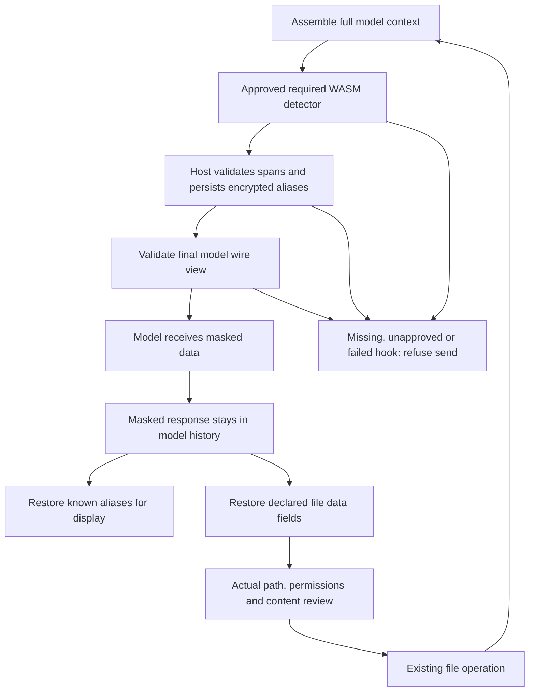

# Privacy hooks — masked model data, restored replies and file edits

Status, November 20, 2026: private encrypted aliases, an approved source-built
WASM detector and host restoration views are implemented and locally tested.
Normal Craftsman sessions do not select this hook yet. Actual key ownership,
required-hook policy and model/file integration remain open. Existing gadget
grants and permissions remain in force.

The selected behavior is to replace supported personal data before a model
request and restore known replacements in **displayed replies and file edits**.
For example, a model can edit a document containing an email alias; Craftsman
would restore the real email in the proposed local edit before its normal
permission and content review. The next model request receives a masked view
of the resulting file content again.

## One gadget system, two roles

| Role | What starts it | Example |
| --- | --- | --- |
| Tool | An explicit tool call | Inspect JSON or compute a CSV total |
| Hook | A host-selected lifecycle stage | Detect personal data before a model send |

Both roles use the existing Wasmtime gadget engine. A future manifest can
declare hook functions and supported events. **Trusted user policy decides
whether a hook is required.** A project, model or gadget cannot make its own
code mandatory, approve its source or widen its capabilities.

The privacy detector receives only bounded input text and returns candidate
UTF-8 byte spans with categories and input bindings. It has no filesystem,
network, environment, mapping-store or key access. Host code validates the
spans, owns the replacement map and decides whether a request or effect may
proceed. A detector's success text is never permission authority.

## Intended path through the harness

This diagram is the target, not the current runtime. Required execution must
cover main, delegated, compaction and other selected model lanes after all
context assembly, including every retry. A missing, unapproved, failed or
timed-out hook, an unavailable key or a failed mapping save must stop the
operation; there is no raw-data fallback. Profile exclusions cannot remove a
selected required hook.

## What can be restored

Initial reversible categories are supported emails and telephone layouts,
plus identifiers explicitly declared by trusted host policy. Email aliases use
the reserved `.invalid` domain. Telephone aliases retain only the supported
digit/separator layout; dummy numbers are not guaranteed to be unassigned.
These are pseudonyms, not anonymous data.

Repeated values must receive the same alias within a project/thread namespace.
Separate namespaces must not share that identity. Replacement generation must
check collisions with original input and already issued aliases; ambiguous,
altered, unknown or foreign-scope aliases cannot reveal a value.

Passwords, API tokens and private keys need a separate irreversible-redaction
or preserve-in-place policy. They must not become automatically restored text.
Detection cannot promise complete coverage of arbitrary names, addresses,
medical information, encoded values or images. Additional detectors and
explicit field rules can extend the supported scope.

## Replies and file edits have different effects

Reply restoration changes only the human-facing view. The model-facing response
and its tool arguments must remain consistent with the masked history. Streaming
can split an alias across chunks, so restoration needs a bounded delayed matcher
or whole-response buffer before any restored output is emitted. Terminal text
still goes through SafeBackend.

File restoration changes data that a real operation will consume. It therefore
must happen **before** the existing approval, path, protected-content and
verification gates, and only in declared content fields. The original model
call remains masked; the host constructs a separate execution view. Both the
match text and replacement text of an edit need the same validated resolution.
Create operations review the new content against absence; updates review the
old/new content. Existing delete and rename operations, if selected later,
retain their own scope and staleness rules.

Structured formats need parsing and escaping appropriate to the format;
restoring an identifier must not introduce executable syntax. An unsupported
or ambiguous field refuses the effect. This is not blanket string substitution
into shell commands, source code, paths, gadget code, MCP calls or network
destinations. A replacement never grants a new capability. New tool-result
data is masked again before later sampling.

The current `privacy_restore` module produces provisional plain-text or complete
JSON-document views from actual live mapping records. It performs no file
operation or model/terminal output. It restores only exact known tokens;
combining marks, joiners, connector punctuation and supported telephone
continuations keep an extended token unresolved. Display preserves that token,
while a file candidate containing
a known alias with such an attachment refuses as a whole. Unmatched marked
`pv1-` tokens also refuse file candidates. Unmarked altered phone numbers need
actual field provenance or a conservative consuming policy; they cannot be
identified universally from their spelling.

JSON restoration changes complete string-value tokens with appropriate escaping.
It keeps surrounding keys, numbers, whitespace and unchanged string tokens
byte-exact; keys, duplicate decoded keys and malformed documents refuse. This
does not classify a JSON value as non-executable in its consuming application.
Partial edits and language-specific code strings still need their own parser,
source/content binding and real tool guard.

Provisional views recheck their live session before and after a trusted host
callback. The callback can copy data or perform work; a later failed check
cannot retract it. Current whole-proposal refusal closes that private mapping
session. A future repair-capable tool adapter must distinguish invalid model
proposals from fatal hook/key/storage failure while recording refusals and
keeping every later request and effect guarded. There is no raw fallback.

Restoration caps are 256 KiB input/result, 512 records, 4096 replacements per
complete view/document, 4096 JSON strings and depth64. Matching charges decoded
string bytes times record count against a shared 64 MiB scan allowance. Parsing,
encoding, hashing and other work also have fixed count/byte bounds; the scan
allowance is not a measurement of every CPU operation or allocation.

## Local mapping storage and key ownership

The proposed mapping store is a separate `privacy-vault.db` under the actual
Craftsman configuration root, using the local libSQL/Turso core. It does not
change `threads.db`, its schema/version, retention or memory files, and it does
not contact a remote Turso service.

The existing conversation/checkpoint storage format remains in use; encrypting
its content would require a separate migration. The new vault encrypts its own
mapping records and indexes.

Authenticated encryption protects each stored original; keyed equality
indexes support repeat detection without plaintext indexes. Category, version,
alias and namespace belong to the authenticated binding. A separate host key
source supplies key material; API credentials and model output cannot supply
that authority. Plaintext maps must not enter logs, tool outputs, conversation
custom state, memory, checkpoints or trace records. Mapping writes must actually
finish before a dependent send.

Private supplied-key tests do not establish real keystore ownership, secure
unlock UI or normal-session authority. Those remain integration requirements.
Encryption and WASM isolation do not protect plaintext from a compromised
Craftsman host or operating system while it is in use.

## Integration and validation gates

The next implementation must keep the four current provider transports and
their signed/opaque history coherent. Provider-owned opaque items cannot be
rewritten or paired with incompatible portable messages; an unsupported
preexisting history needs an explicit refusal or fresh-session requirement.
Rebuild, thread reopen, compaction, cancellation and failed saves must preserve
the correct namespace without replaying model or tool work.

Raw input containing an already issued alias is deliberately refused by the
private vault. A consuming transport therefore needs actual provenance for
already-masked model-history items; it cannot run this raw-input masker repeatedly
and assume idempotence. The actual client send and file terminals must enforce
their guards even when middleware or a resumed approval bypasses the normal
chain.

Required evidence includes actual approved WASM execution, encrypted database
and WAL scans, reopen/wrong-key/tamper/collision/bounds failures, host span
validation, split-stream replies and real builder/loopback-HTTP/file/storage
tests. Tests must show that failed hooks or saves send no unmasked request,
that restored edits still pass real approvals, and that usage and completed
effects remain truthful on stop or failure. Full local and all four native CI
jobs, complete steps/inventories/warnings and independent merged-main proof
remain delivery gates; synthetic provider tests do not spend model credits.

Local evidence: the committed vault passes42 actual database cases in both
feature modes. The detector fixture passes6 source tests and4 app tests,
including33 actual runtime invocations and14 host-refused adversarial results.
The restoration layer passes27 actual-vault cases after independent review
identified telephone, Unicode mark/joiner and connector boundary defects. The
original4 failed controls and10 failed connector controls, repaired source and
warning/driver failures are retained. These
are private feature tests; combined native CI/main proof and actual consumer
integration remain separate.

The first PR #32 native run
[44602915778](https://github.com/kaobei-alabo/craftsman-harness/actions/runs/44602915778)
failed the new Windows vault/restoration opening cases and the detector's locked
offline dependency preparation on all platforms. It is preserved separately
from passing local tests. The corrections retain complete native ancestors,
add Windows raw-path probes, and align only the new detector fixture lock to
the root dependency closure. Fresh complete native proof remains pending;
neither candidate enables privacy or substitutes for actual consumer guards.
Independent review also found that a registry-edge subset guard could accept
omitted required edges. The original two failing controls are retained; the
corrected guard requires exact edges with only the documented root feature-union
differences, and all six graph controls pass locally.

The corrected-first run
[44629784168](https://github.com/kaobei-alabo/craftsman-harness/actions/runs/44629784168)
passed fmt, Ubuntu and macOS. All applicable vault/restoration cases and the
ten new opening probes passed in both Windows modes. Windows still failed the
detector's trusted source build: `link.exe` handled object-file arguments as a
filesystem-link utility. The complete failed run and original warning blocks
are retained; this is not evidence of a missing library or successful Windows
detector execution.

The next correction carries one validated Visual Studio discovery root through
the isolated test helper to its Cargo child. The guest still inherits no
environment. Existing assertions, native/guest deadlines, SDK/WIT, locks and
frozen validation scripts remain unchanged. Actual isolated-child and native
compiler probes pass locally; fresh complete Windows and all-four delivery
proof remain required. This compiler preparation does not select privacy hooks.

Independent compiler review also identified incomplete verbatim-drive and
malformed native-marker inputs omitted by the new fixture checks. The narrow
correction requires complete drive roots and counts registered native prefixes
before string decoding. The reproduced marker failure remains retained;
Windows-only path controls await native execution. Original assertions and
the preexisting detector selector remain unchanged.

Run
[44645950249](https://github.com/kaobei-alabo/craftsman-harness/actions/runs/44645950249)
passed those compiler input controls and all Windows vault/restoration cases,
but the detector still invoked the incompatible linker. Passing the installation
root alone was insufficient. The new fixture preparation uses installed Microsoft
tools to select the actual host MSVC linker, library paths and compiler search
path, while keeping WASIp2 settings and guest capabilities unchanged. This
candidate needs independent review and fresh complete Windows/all-four proof;
the failed run remains preserved and normal privacy stays inactive.

Run
[44668461580](https://github.com/kaobei-alabo/craftsman-harness/actions/runs/44668461580)
passes the existing Windows storage and compiler-input cases, but both detector
terminals fail during MSVC preparation before Cargo. The internal stage was
hidden by the fixed error. New test-only diagnostics retain bounded actual
stage, exit, IO and captured-output facts without exposing a raw environment or
changing compiler grants. They do not identify or fix the native cause yet;
fresh Windows evidence must establish that cause before a supported repair.

Run
[44682051545](https://github.com/kaobei-alabo/craftsman-harness/actions/runs/44682051545)
identified the Windows stage: the filtered installed `vswhere` query exited
successfully with complete empty output. Why it matched no installation remains
unknown. Comparison-only diagnostics now query prerelease eligibility and bounded
installed instance/component summaries under the same isolated environment.
The original selection still refuses; comparison results do not grant execution.
The run also exposed a separate checkpoint creation-time update defect, now
corrected on the candidate. Its applicable native cases passed in the later run
below; this does not establish the new compiler diagnostic's delivery gates.

Run
[44701486328](https://github.com/kaobei-alabo/craftsman-harness/actions/runs/44701486328)
passes fmt, Linux and macOS. Windows still fails both detector/compiler terminals
before Cargo. The original query and all five comparison families admit no
instances, including the unfiltered and prerelease queries. The complete audit
retains all steps, both test modes, original cases and warning records; the
failed run remains separate from local tests and the passing checkpoint cases.

Microsoft's
[vswhere/COM-server maintainer](https://github.com/microsoft/vswhere/issues/236#issuecomment-985741650)
identifies ProgramData as an enumeration dependency. The isolated preparation
omits that field. A new test-only comparison carries the actual bounded native
ProgramData value through the two marked source-build helpers, then adds only
that field to the same installed executable, original component-filtered query
and cleared environment. It records field identity, actual process/output facts
and whole validated summaries. It does not restore profiles, inspect setup-state
contents or change compiler/source grants.

That diagnostic retained the original refusal regardless of comparison results.
It preserves the existing capture, query, cleanup and guest bounds; its
serialized failure plus framing fits the original 64 KiB supervisor capture.
The dependency documentation and local controls do not identify the current
loaded server implementation or prove the Windows cause. Actual differential
evidence must precede a separately reviewed selection correction and genuine
source-built detector execution. Fresh full local/native and independent main
proof remain required before delivery; normal-session privacy remains inactive.

Run
[44739865841](https://github.com/kaobei-alabo/craftsman-harness/actions/runs/44739865841)
passes fmt, Linux and macOS but still retains both Windows preparation failures.
In both actual helpers, the original query and five historical comparisons admit
no instances, while the same strict component-filtered query with only captured
ProgramData admits one installation-path record. The original failure, complete
child output, native field identity and unavailable raw values remain explicit.
This is a measured prerequisite failure in that source/environment context;
it does not identify a universal server implementation or prove compilation.

The narrow correction validates the existing private native ProgramData transfer
and its physical directory before preparation work. It adds that field only to
the original strict `vswhere` query and consumes the new actual query output
through the original installation, VC containment, host PE, SDK/library and
source-build checks. It does not select a compiler from diagnostic metadata or
add the field to VsDevCmd, Cargo or guest environments. Existing helper/test
bodies, input rules, isolation and native/guest limits remain unchanged.
Fresh full local and all-four native validation must now establish usable
compiler inputs and actual source-built WASM execution before merge, followed
by separate independent merged-main proof. The earlier failed run remains
failed; normal-session privacy and the separate request consumer remain inactive.

Run [44752767140](https://github.com/kaobei-alabo/craftsman-harness/actions/runs/44752767140)
reaches the later Windows UTF-16 field parser, but both source-build helpers
still fail: the fixed CMD/VsDevCmd command returns exit 0 with complete empty
streams. Its cause remains unproved. A new test-only comparison preserves that
original refusal and records a fixed builtin plus owned synthetic CALL,
redirection and batch-context controls under the same command/environment
rules. It never adopts comparison data as compiler fields or source authority.
The original command, approval, guest checks and deadlines remain intact;
fresh reviewed Windows execution and full/main gates are still required.

That run also fails four unchanged core one-shot waits and one unchanged gadget
capture test. New isolated observation controls retain their actual native
operation, source/image, requested/observed capture stage, original/result bytes,
child exit and stream completion facts before applying the original verdicts.
They preserve the old payloads, reader ownership, assertions, timeouts and
production code. Fresh observation handles are labelled separately and can
affect scheduling or access time; they are not original retained authority.
Unavailable child internals, model usage and native EOF remain unavailable.
These tests add no normal privacy route or source/permission grant. Combined
source review, fresh full local/native tests and independent merged-main proof
remain required; diagnostic success does not establish a native repair.

Run [44809143594](https://github.com/kaobei-alabo/craftsman-harness/actions/runs/44809143594)
still fails Windows gadget mode. Its builtin control emitted38 complete UTF-16
bytes at exit7, including the input's space before `&`, so the exact token
assertion correctly refused it. Only that owned input space is removed; unknown
output remains refused. All21 recorded command attempts completed, but no
original, redirection or batch-context control produced the selected fields.
Four small owned tail comparisons now retain the seven original controls and
share their existing budget: a diagnostic no-IF chain and a separate-line wrapper
with the unchanged guard, each for requested0/7. Their bounded output facts are
collected before verdicts and cannot become compiler or source authority. The
real setup command, original field refusal, source/guest checks and deadlines
remain unchanged. Neither this input repair nor local controls establish the
installed Windows setup cause; reviewed fresh native/full and separate main
proof remain required before merge or installation.

Run [44837420491](https://github.com/kaobei-alabo/craftsman-harness/actions/runs/44837420491)
confirmed the builtin input repair but retained the Windows setup failures.
Across three helpers, the owned separate-line IF guard produced all five fields
at exit0 and preserved actual exit91 with no fields for requested7. The original
inline tail produced none. The cfg-test command now encloses the whole original
IF refusal in an explicit command group, keeping the five SET commands outside
the conditional scope. This is a source candidate based on that limited command
differential; the installed batch, compiler libraries, pinned source build and
WASM execution still require fresh native proof. Original checks and bounds
remain, and diagnostic metadata never supplies compiler or source authority.

Run [44856159033](https://github.com/kaobei-alabo/craftsman-harness/actions/runs/44856159033)
confirmed the grouped inline/compound controls: exit0 retained all five fields,
and requested7 refused with exit91. The one-line synthetic batch wrapper still
returned0 for requested7; the separate-line control refused with91. The owned
wrapper now uses those same eight fixed commands on physical lines, with only
its source-layout expectation updated. Native assertions and the real setup
command remain unchanged. Fresh Windows execution must validate this wrapper;
the installed linker, pinned source build and approved guest remain unproved.

Both selected-linker help calls in that failed run returned1100. A new cfg-test
data operation replaces only the late help input: three fixed98-byte COFF tables
link a read-only marker with no entry point or default libraries. The original
selected tool/environment, real zero-exit/banner gate and source/guest checks
remain. A fresh owned destination must be absent before LINK; complete stable
PE data and cleanup qualify the result. Independent reviews accept the corrected
source. It grants no gadget source
or normal privacy authority, and the generated DLL is never loaded or executed.

Independent source review identified two PE-format omissions. The private
data probe now refuses section alignment below4096 and requires zero reserved
Win32VersionValue/LoaderFlags fields on every typed host. Native operation,
ownership, clocks and source approval stay unchanged. Independent re-review
accepts these corrections.

Run [44891734880](https://github.com/kaobei-alabo/craftsman-harness/actions/runs/44891734880)
at cea9 returned actual selected LINK exit0 and passed the unchanged banner gate,
then refused PE validation on1024 bytes with machine8664. The full image and
failed predicate were unavailable. Both original detector source/Cargo/WASM
parents failed. The seven-case CMD supervisor, Windows core and77 vault cases
per mode passed, with no vault Deadline phase recorded; unprinted successful
control fields remain unavailable. All earlier failed runs stay failed history.

The cfg-test checker now labels the first failed PE check group through the
existing `expected` field. Fixed ASCII labels fit19 bytes; every acceptance
predicate and original failure/read/process fact remains. The new CreateFileW
security pointer and NULL are corrected to match the existing mutable-pointer
declaration, without suppressing the recorded signature warning. These source
changes await review and fresh Windows execution; the warning is separate from
the unknown PE refusal, and neither labels nor diagnostic success grant compiler,
gadget source or normal privacy authority.

The five original Windows cases and their applicable observation controls pass
in that run. Their earlier failed evidence remains separate and their causes
remain unknown. Successful runner-owned observation packets were not published,
so current passing assertions do not expose their native field values or prove
a general process/filesystem fix. The measured builtin and inline-field
corrections passed their current native controls. The reviewed multiline
wrapper, genuine selected-linker operation and original source/guest gates
still require fresh native validation; normal-session privacy remains inactive.

Run [44856159033](https://github.com/kaobei-alabo/craftsman-harness/actions/runs/44856159033)
retains four core Windows `Vault::open` Deadline refusals in restoration setup;
the same cases pass separately in gadget mode. Their generic error does not
identify an opening phase or underlying cause. A new cfg(test)-only observer
records fixed opening-phase markers, actual original-clock samples and admitted
call/work counters at the original Deadline branch, then emits at most one
bounded private record after a failed worker operation actually returns.
Missing phase/return facts remain unavailable. The original 5s elapsed/200ms
busy/native/SQL/rollback limits and every old test body remain unchanged; no
deadline repair or normal privacy activation is claimed. Independent review
accepts the bounded observer source; actual future native phase evidence is
still required.

The elapsed sample follows the original Deadline predicate. The record marks
return from the opening future; thread join, caller return and complete log
delivery require separate observations. Subsequent serialization and stdout
writing can delay those returns, and stdout can block or write a partial record.

See [private vault](privacy-vault.md), [gadget runtime](gadgets.md),
[current runtime](runtime-status.md) and the
separate [WASM script-runner plan](wasm-script-runner.md).

Run44912859439 at ac798 retained both original source/Cargo/WASM failures after
actual LINK0 and banner acceptance. The first PE group is `pe.directories` on
1024 observed bytes with machine8664; the directory ordinal, RVA/size values
and full image remain unavailable. The declaration clash is absent and the
17 existing Windows warnings remain. This does not identify a loader/tool cause.

The private diagnostic now uses closed `pe.d00.rva` through `pe.d15.rva` and
`pe.d00.size` through `pe.d15.size` labels for the first checked directory
operand, through the same `expected` field. It preserves every checked DWORD,
short-circuit order and the strict all-directory-zero acceptance rule; invalid
indices retain the generic refusal. No field/value/image dump or new native
flag, bound or source grant is added. Ordinary header/data controls verify
ordinal/operand and first-failure identity; the new Windows label is unobserved
until independent review and fresh combined native source/WASM validation.
