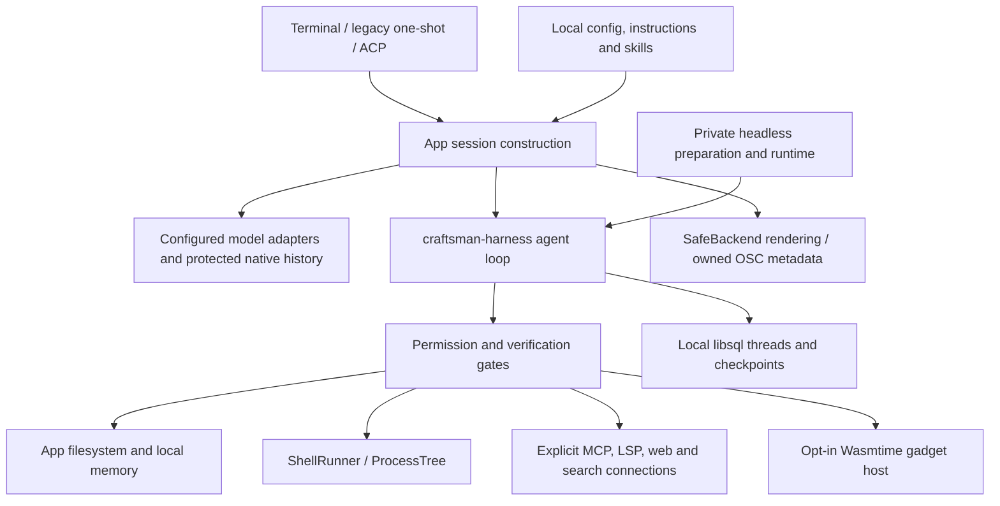

# Craftsman runtime — current implementation and remaining work

Updated November 20, 2026 (Asia/Taipei). This page describes maintained runtime
behavior and its remaining boundaries. The 匠 splash/OSC 7501 runtime is recorded
at `9c5774d`; the subsequent documentation checkpoint `b6b34a2` passed independent
main run [43821887233](https://github.com/kaobei-alabo/craftsman-harness/actions/runs/43821887233).
The private script-capture/bundle foundations are merged as PR #31 at `29349c5`;
independent main run [44567715919](https://github.com/kaobei-alabo/craftsman-harness/actions/runs/44567715919)
passed all four jobs, every mandatory step and both native modes. That main
source is locally installed; public script execution and privacy hooks remain
unselected. The context/failure continuation is recorded below. Source validation, live
coding results and published releases are separate evidence.

The [harness plan](craftsman-harness-plan.md) retains its explicitly historical
October 16 baseline and target architecture. Feature docs retain the relevant
failed/corrected implementation evidence. Those dated records do not describe
current failures or pending merges unless explicitly stated here.

## 1. What users can run now

| Surface | Current behavior | Important limit |
| --- | --- | --- |
| `craftsman` | Streaming terminal conversation, file/shell/web tools, approvals, steering, saved work, local skills/memory, configured MCP/LSP and opt-in gadgets | Host tools are not an OS sandbox; supervised coding and general folder work are supported |
| `craftsman -m PROMPT` | Legacy argument-only one-shot; main content on stdout, activity on stderr | Inherits legacy user-config permissions/storage; not the accepted unattended headless contract |
| `craftsman setup` | Edit/select a configured model connection with masked keys and validated settings | Other connections and existing data remain preserved |
| `craftsman gadgets …` | Inspect/call, create/build/doctor and create-only legacy migration | Native build approval and first guest-load capability approval are separate |
| `craftsman acp-serve` | Standard ACP over stdio | Detailed session/tool/permission interface; native host registration is the client's responsibility |
| `craftsman acp-bridge` | WebSocket relay of ACP JSON-RPC plus HTTP health/stats | Existing proxy authentication and bounded transport behavior |
| `craftsman service-agent` | Restricted request-scoped virtual resources and selected public-web tools | No real filesystem, native shell, local database/memory/LSP/project discovery |
| `craftsman exec` | Not exposed | Accepted contract and private implementation foundations only |

The `craftsman-rs` forwarding executable is removed; `craftsman` is the sole app
binary. The app's internal Cargo package/directory remains `craftsman-rs`.
The former `serve` and `desktop-serve` commands are removed. Platform onboarding,
inbox polling and remote skill browsing are retired. Storage, sessions and
skills are local; model, MCP and search traffic uses explicit configuration.
Cached voice models remain local, and missing models need explicit download
opt-in. See [connections](connections.md).

The startup card uses a block-drawn 匠, small `craftsman` label and miniature
hammer in gray/turquoise. The standard card remains 15 rows and compacts at
narrow widths. Its metadata describes the selected model connection and key
presence without exposing keys or submitting a model task.

`/model` opens the grouped local catalog, then the selected model's effort or
budget picker. Only the final selection saves/applies; `/model --refresh`
explicitly requests bounded configured discovery. Model changes preserve
committed conversation, files, todos, custom state, approvals, thread identity
and checkpoint sequencing without replay.

OSC 7501 reports actual terminal work, approval/question waits, returned
completion/error and bounded delegated-task records. It is enabled by default;
`terminal.osc7501: false` opts out. Trusted fixed metadata is written by the
owned terminal guard; normal rendering stays behind SafeBackend. Orca terminal
monitoring was exercised with the installed CLI. Native Orca chat registration
through ACP remains separate.

## 2. Current architecture



`crates/craftsman-harness` owns the model/tool loop, middleware interfaces,
registry, notifications and state/persistence interfaces. It remains free of
app-layer HTTP, database and UI dependencies. `crates/craftsman-rs` owns the
configuration, providers, filesystem authority, native processes, local libsql,
ACP and TUI. The gadget SDK/WIT and proc macros remain separate crates.

Explicit named connections support Responses, Claude Messages, Gemini
GenerateContent and the compatible chat-completions transport. Actual API ids
are selected as `provider/model-id`; catalog metadata never becomes generation
options, and unselected credentials are not resolved during construction.
Protected native history retains signed/opaque provider items paired with their
committed portable messages and bound to the original connection identity.

The app selects task-focused memory/workflow guidance for TUI/ACP. The declared
verifier reviews bounded user/project policies and protected content, executes
checks through existing approvals and ShellRunner, and requires actual zero
exits plus complete unchanged source observations. Failed checks feed bounded
repairs; unavailable or denied checks cannot become a passing result. These
controls retain their legacy/private/frozen defaults and are not a general
semantic test-integrity or stuck-governor implementation.

Terminal read-only turns perform no automatic workspace snapshot. Mutating tools
capture selected files or bounded context-derived shell scopes. Git is optional;
large, home and multi-project folders are supported. Partial scans never imply
creation/deletion. Conversation checkpoints save real input/tool results and
retain unknown-effect warnings on reopen without automatic replay.

Owned native work retains the 120-second shell default, five-second kill/reap,
two-second drain and truthful 30-second session shutdown error bound. Running
background tasks retain their real status until cleanup returns. These bounds
are not proof of OS containment or blocking-worker quiescence.

## 3. Implemented, private, or still planned

| Area | Current state | Evidence / next boundary |
|---|---|---|
| Terminal usability and reporting | Merged and locally installed | Gray/turquoise 匠 splash, grouped model → effort menus, OSC 7501; [splash](terminal-splash.md), [status](terminal-status.md) |
| Terminal lifecycle and recovery | Merged | Actual turn/session ownership, cancellation, final saves and unknown-effect recovery; [lifecycle](terminal-lifecycle.md), [recovery](terminal-recovery.md) |
| File checkpoints and long turns | Existing features merged; creation-time correction awaits native validation | Mutation-driven bounded snapshots, notices in chat, 200-round default and saved pauses; the locally tested same-checkpoint creation-time fix is pending merge/install. See [checkpoints](workspace-checkpoints.md), [turn limits](terminal-turn-limits.md) |
| Task-focused memory and workflow | Merged and locally installed | TUI/ACP advisory guidance and bounded repeated-error hints; [memory](terminal-memory.md), [workflow](task-workflow.md) |
| Declared verification | Merged and locally installed | Reviewed user/project checks, actual results, bounded repairs and protected-content review; [verification](verification.md) |
| Task context and exact failure controls | Implemented, explicit app opt-in | Bounded input/file observations, local /context, real sampling pause and structural protected-test notes; [context](context.md), [failure controls](failure-controls.md) |
| Coding-evaluation preparation and reliability evidence | Local frozen-source validation and production-TUI synthetic v3 | Unchanged original/reference graders, private SQLite snapshots and independently requested fixed child; full combined-source/native/hosted/live-budget gates remain; [preparation](coding-evaluation-preparation.md), [owned-terminal v3](owned-terminal-evaluation.md) |
| Framework names and TUI split | Implemented source | `craftsman-harness/src`, `craftsman-rs/src/tui`; dependency guard and frozen goldens |
| Shell hardening | Implemented | `ProcessTree`, environment scrub, bounded output and owned TUI cleanup; legacy/global Unix groups still default off |
| Gadgets G1 | Implemented, model-opt-in | Fixed `gadget_list`/`gadget_call`; first-load grants; change-only catalog refresh before main/delegated rounds and after compaction |
| Declarative gadgets/migration G2 | Implemented; legacy loader retained | Shared extension validation/precedence; create-only migration preserves originals; published deprecation still required |
| Embedded SDK/authoring G3 | Implemented | `gadgets new/build/doctor`, immutable SDK/skill; static ABI validation does not run `describe` |
| Reusable script runner | Private capture and test-only bundle foundations merged and natively verified; public runner absent | PR #31/main44567715919 passed complete local/native evidence; Python/JavaScript/TypeScript compatibility proof has scoped functional reviews, while source consent, actual task-root derivation, backend selection and batch/scoped-auto CRUD review remain separate gates; see [wasm-script-runner.md](wasm-script-runner.md) |
| Privacy hooks | Private foundations under PR #32 correction; no normal-session activation | CI44682051545 records an empty installed-compiler query; comparison-only diagnostics await review and native evidence explaining it. Key-source/final-wire/native-history and actual display/file consumers remain separate; see [privacy-hooks.md](privacy-hooks.md) |
| Runtime measurement | Implemented advisory benchmark | `gadget-validation.md`; three-OS runtime measurements are not live-model quality |
| Headless v1 specification | Accepted and merged as #95; #97 clarification explicitly accepted November1 | R1–R7 and126 baseline reference cases preserved;70 accepted admission cases/196 total are conformance, not real CLI enforcement |
| Legacy `-m` safety fixes | Merged as #96 | Non-TTY approval input denies without reading; child/compaction deltas silent; output-closed guards prevent post-failure dispatch |
| Immutable invocation policy | Private implementation, not CLI-wired | Exact selectors, manual/plan, deny precedence, credential-source env-pass restrictions |
| Confined filesystem | Private implementation merged as #98, selected by private runtime adapter only | All six operations, no-follow handles, protected paths, bounded workers; private guest host/text views consume it, not public registration; `headless-mode.md` §§12/14/17/21 |
| Explicit config/discovery/session preparation | Private implementation merged as #99, consumed by private runtime | Bounded selected roots, project trust, no-store ephemeral, random fresh IDs, read-only canonical resume/continue; `headless-mode.md` §13 |
| Shared-builder headless adapter | Private implementation merged as #100, no CLI/output producer | Consumes `Prepared`; retained filesystem authority; same immutable gate for main/delegated/contributed tools and fail latch for every provider; no interactive fallbacks; `headless-mode.md` §14 |
| Byte-safe guest filesystem facet | Private implementation merged as #101, consumed by the private guest host, not model/CLI-wired | `ConfinedFs` typed raw read/create/list; validated declaration plus immutable invocation policy; 10 MiB reads/1 MiB writes/1024 total directory entries; `headless-mode.md` §15 |
| Retained gadget sources/approval snapshots | Private implementation merged as #102, consumed by private guest host only | Selected config/ConfinedFs root handles, whole raw manifest/component hashes, explicit versus stored grant provenance, non-widening approvals and original filesystem/policy; `headless-mode.md` §§16–17 |
| Source-approved headless guest host | Private implementation merged as #103, not model/CLI-wired | Opaque actual-runtime scope; strict byte FS, empty-capability describe, typed caught-import latch, bounded HTTP/log/WASI and fixed diagnostics; `headless-mode.md` §17 |
| Captured credentials/seeded redactor | Private foundation merged as #104; selected by guest/shell/filesystem/web/concrete-framework/request views and fixed gate denials | Known configured values, frozen all-role route, bounded overlapping streams, complete source coverage and structured redaction; `headless-mode.md` §§18–24 |
| Guest JSON/stdout/stderr/log redaction | Private host adapter merged as #105, not a public/tool/storage producer | Actual opaque scope seeds; redaction and delayed literal verification before 64 KiB retention; synchronous gated WASIp2, strict UTF-8/fixed failures and original executed inputs; `headless-mode.md` §19 |
| Scoped private shell-output redaction | Private shared-builder adapter merged as #106, not a public command | Opaque actual ShellScope, same gate, captured scrub/credentials; original pipes redacted before cuts, scoped argument errors, strict UTF-8 and trustworthy raw ToolMeta; `headless-mode.md` §20 |
| Scoped private filesystem views | Private shared-builder adapter merged as #107, not a public command | Actual FilesystemScope, complete original coverage before page/hit selection, original IO/line/query facts, bounded checked names/framing and same typed fail latch; `headless-mode.md` §21 |
| Scoped private web views | Private shared-builder adapter merged as #108, not a public command | WebScope/frozen literal auth, original-byte pre-cut capture, bounded HTML, complete search JSON/field checks, actual request/byte facts and same latch; `headless-mode.md` §22 |
| Concrete private framework views | Private shared-builder adapter merged as #109, not a public command or all-state scrub | Actual FrameworkScope/source witness; known todo/task/message views before cuts, whole typed todo JSON and checked todo context; original state/delivery/metadata and remaining alternative producer gates; `headless-mode.md` §23 |
| Scoped private provider requests | Private shared-builder all-role request producer merged as #110, not a response/storage/public adapter | ProviderScope/original effective options/auth; copied text/decoded arguments/schema annotations before encoding, immutable identities/constraints, bounded exact bytes/client binding and SAME retry gate; `headless-mode.md` §24 |
| Private provider HTTP/error diagnostics | Partial client adapter, not a successful-response/state/public or usage producer | Actual send/receipt/per-request witnesses; frozen literal/strict UTF-8 before cuts, original bounded attempt facts, fixed unsafe failures and same latch; `headless-mode.md` §25 |
| Instruction and attachment-file admission | Private input-first implementation merged as #115, not CLI-wired | Explicit source/UTF-8/1 MiB instruction/1 MiB file/8 MiB total; retained FS/policy and complete framing before optional session creation; actual shared-builder model-only turn; `headless-input.md` |
| Checked main retained-message snapshots | Private actual-runtime view, not a public result/storage/all-role ledger | Actual MessageScope/state lock/frozen seeds/gate; whole source/argument admission before copies, bounded finite encoding, immutable original state/control and fixed refusal; `retained-message-views.md` |
| Bounded private retained-message selection | Private post-capture adapter, not terminal/result publication | Only checked View; exact byte-budget/newest whole suffix/counts and final literal check; unchanged source caps/state/outcome and SAME gate; `message-selection.md` |
| Private terminal-publication authority | Private actual-Run owner, not public result/IO/shutdown | Same deny-only execution seal, original outcome and independent revocable publication lease; typed epoch checks, checked final-text/whole-state-message fragment and truthful limits; `terminal-publication.md` |
| Private terminal-message selection | Independent terminal-lease adapter, not public result/IO | Complete channel admission before exact combined budget; newest whole suffix, unchanged checked answer/facts, counts/new-join checks; `terminal-message-selection.md` |
| Private terminal ASCII encoding | Actual terminal-lease encoder merged as #123, not public schema/IO/human rendering | ASCII UTF-16 escape projection; complete-channel/final literal checks, post-escape budget/whole-message suffix and unchanged data/facts; `terminal-ascii.md` |
| Private safe human display | Actual terminal-lease renderer merged as #124, not stdout/stderr or public text eligibility | Complete original answer/fixed fact diagnostics; visible control/backslash/runner defanging, exact combined LF budget and final literal/lease/epoch checks; `terminal-human.md` |
| Guarded private one-file publication | Merged as #125; explicit pre-session file route, not CLI/stdio/result/events | Actual FileRun owner and immutable outside-workspace/config target; complete checked Record before native staging, one guarded create-only link, fixed failure/actual-link observation; `guarded-output.md` |
| Explicit native byte-pipe stdin | Merged as #128; private, not CLI/console/file support | Exact '-' opaque selection; same-access native ownership/owned-mode or readiness-bounded polling,1MiB/10s/30s/real read EOF/UTF-8 plus old attachments/framing before sessions; `named-stdin.md` |
| Native stdin + guarded file composition | Merged as #129; private, not CLI/full source/output flags | Whole source/destination grammar; original output capture before stdin and recheck after admission before sessions; SAME Bootstrap/ConfinedFs and old paired controller; `stdin-file-output.md` |
| Private relative-scope/output-file argv | Merged as #132; private normal-relative/typed-preview adapter, not public exec/full formats | Explicit original launch base; old complete syntax/physical owners, selected-workspace data and guarded external file scope; `scope-output-arguments.md` |
| Private supported control/source argv | Merged as #131; private absolute-scope/permission/session adapter, not full public CLI | Old source/selector/ID grammar before IO; authoritative Bootstrap/credentials/ConfinedFs/session and same Run/FileRun; `control-arguments.md` |
| Private instruction argv parsing/routing | Source/attachment subset, not a public exec/whole-flag parser | Bounded original OsString inputs; exact source selection/flag arity before IO, four unchanged factories and old Run/FileRun; `input-arguments.md` |
| Headless frontend/stdin input, guest tool integration and persistence | Still open | Complete named-stdin exclusive ownership/console/file and flag/output-path integration; other tool/provider/storage redaction and compatible origin publication before callable registration; checkpoint/journal writers stay disconnected |
| Shared admission/usage | Private request default, separate atomic token-reservation opt-in and admission-correlated send/header observations; usage/settlement ledger still unwired | Actual-builder1..10000/default50 cap, source-bound bounded estimates/clamped reply before atomic charge; active/retained-unsettled observations, not measured usage;40 request +50 reservation +40 receipt-observation tests; #133/#97 accepted/merged, not public producer enforcement; `request-admission.md` / `token-reservations.md` / `admission-receipts.md` / `token-admission.md` |
| Real headless result/event output + redaction/trace | Still open | ASCII schema-backed production, create-only publication, seeded chunk/error/tool/storage redaction, trace-v1 instrumentation |
| Native OS sandbox / public headless shutdown and verification receipts | Separately planned | TUI declared verification is implemented; public headless receipts and OS containment retain their own gates |
| Full Session API/events/content blocks/governed policies | Separately planned | P6/P7; existing callbacks/journal are not that future typed stream |

Private headless components are available only through their reviewed typed
owners. Existing terminal tools and gadget hosts do not inherit private
`ConfinedFs`, redaction, usage or publication authority merely because those
modules exist. Headless gadget callable registration, successful-response and
alternative-state/output/storage adapters, real usage settlement and public
result/event/trace production remain unfinished. See
[headless-mode.md](headless-mode.md) for the accepted contracts and per-slice
bounds; those contracts and their failed/corrected evidence remain unchanged.

## 4. Legacy one-shot versus accepted headless v1

Legacy `-m` retains its argument input, configured permissions/storage and exit
behavior. Main content goes to stdout and activity to stderr; non-TTY approval
input denies without reading. It is not an explicit-only unattended execution
boundary.

Redirected one-shot output captures stdout as an owned native pipe/file
before agent construction. Main, delegated and compaction providers retain
that same owner and recheck actual write/flush error latches before/after model
responses. Sources selected for peer-state observation also run connection
checks after tool-bearing responses and before later model requests, including
when the preceding write succeeded. Closure observed at that boundary stops further
dispatch; BrokenPipe exits quietly at 0 and other IO failures use fixed text.
The first request remains admitted and a no-tool final response still reaches
the actual final-newline write. Windows console encoding, deny-without-read
approval and other frontend defaults remain unchanged; completed real effects,
tool results and received usage are retained rather than rolled back or replayed.

This is a boundary check, not OS containment, background-work quiescence, public
`exec`, general coding-quality or release-readiness proof. A later peer closure
can still race an operation already started. Details and native bounds are in
[the one-shot contract](headless-mode.md#11-implementation-progress--not-a-shipped-exec-command).

Initial36ab019 evidence includes actual Unix builder/loopback/native-pipe controls for stdout rebinding,
closure after successfully read content in the same response, and retention of
a prior completed tool. Its focused core/gadget checks passed 52 test executions,
including all six unchanged one-shot cases in each mode. The prior `0d2fd68`
full-core failure after a real file write remains historical, with its OS trigger
unverified; the first failed controls and unused-mut warning are also preserved.
The independent review's P1 Windows mode/lifetime and P2 type/access/Unix-socket
findings are retained; its pending mock did not execute on Windows. Unix socket
admission now requires actual stream SO_TYPE; datagrams refuse before model/tool/
storage effects, and an actual stream control retains dispatch protection.

Windows support requires a same-access captured owner, actual type/GetLastError,
direct-kernel8/16 bootstrap before File/driver IO, and NONALERT/write eligibility.
Validated disk files and synchronous writable NUL keep checked File IO; NUL
requires actual native FILE_DEVICE_NULL identity. Validated local NPFS selects
an explicit source-dependent app observer before any agent work. NUL has no peer-liveness claim;
NULL/-1 HANDLEs remain invalid. Async/ALERT/non-write/unbuffered, socket, unknown
and other non-console-device cases refuse. The existing recognized console
Unicode path remains. Windows gadget run44262189413 actually ran the24 original/
added one-shot cases:17 passed and7 failed; core was skipped. All six original
cases and the native NUL unit passed. A real socket reached DuplicateHandle,
contradicting the earlier device0x11-only discriminator; named-server queries,
the claimed attribute-free client, console setup and binary NUL fixture also
failed. The prior source-only reviews remain evidence, not compatibility proof.

The repair checks SO_TYPE after direct8/16 eligibility and before duplication,
owns one successful Winsock2.2 reference and requires its checked cleanup. Socket
success, malformed output and unknown errors refuse; WSAENOTSOCK is only a
non-socket candidate for the remaining supported-kind/state checks. These
provider calls may block/use alertable waits; no new hard OS deadline or
arbitrary foreign Winsock lifecycle isolation is claimed. Later IO remains on
the retained duplicate without an atomic handle-table capture claim.

Console fixtures use actual attachment/mode APIs and inactive-buffer Unicode
readback. The pure client now reduces and verifies its actual granted rights;
binary NUL uses spawn/wait_with_output so Tokio cannot replace null stdout.
Marked query diagnostics retain at most32 primitive records, with separate
original/duplicate phases and no fields from partial/error output. Later native
run44322458688 passes the original six, socket/inherited/reference, console and
NUL paths in both modes, but still fails four low-grant named-pipe cases in each
mode. All eight class24 requests return ACCESS_DENIED with no completed fields.
Those failed expectations and all earlier runs remain historical evidence.

The compatible candidate retains legacy checked writes for qualified local
NPFS whose actual access lacks READ_ATTRIBUTES. It requires WRITE_DATA0x2,
SYNCHRONIZE, NONALERT/buffered mode and a completed local-device result on the
same owner; pipe bit0x4 alone is create-instance authority, not data writing.
ObservationSupport::CheckedLocalPipeWrites advertises only actual IO-result
observation. It provides no type/configuration/end/connection data and cannot
detect peer loss after successful output until later IO actually reports it.
Disk/NUL/generic write support and PeerState support remain distinct.

READ_ATTRIBUTES presence selects the full native observer, whose actual
return/IOSB/completed40-byte/type/configuration/end/state validation still must
succeed. Query failure in that selected backend refuses; it never chooses the
limited backend. No access upgrade, byte probe, mode change, cached-state guess
or query-error fallback is used. Native witnesses must show the already passing
anonymous/metadata-capable sources retain full observation. This app-only policy
does not enter private headless/guest/input/output construction paths. The new
candidate and its native tests still require source review/fresh Windows proof.
Current validation requires repaired-source review, actual Windows execution
and full17/all-four/every-step/both-mode/inventory/warning/source-tree/
independent-main proof. No broader source33/image/corpus/capture or live-budget
authorization follows from these boundary checks.

The accepted headless v1 contract requires invocation-only permissions,
canonical scopes, input/output/resource bounds, truthful all-role usage,
seeded redaction, explicit session selection, machine output and signal/deadline
shutdown. Many private foundations are implemented, but no public `exec` route
ships until the remaining boundaries are wired and validated. Filesystem path
checks and the gadget WASM sandbox do not OS-contain host shell/build scripts.

## 5. Toolchain, builds and verification

The workspace is pinned to Rust **1.99.1**. The app declares its tested **1.99**
floor; standalone framework/SDK/macros retain their separate **1.85**
declarations. Wasmtime/wasmtime-wasi remain pinned to **48.0.8**. Default builds
include voice and gadgets; gadget model visibility is user opt-in. Native voice
requires CMake, plus ALSA development headers/pkg-config/clang on Linux.

```sh
./install.sh --upgrade
./scripts/verify.sh
```

The verification script selects an installed python 3.11 or newer runtime
and runs 17 discoverable checks: all 14 original checks plus latest evaluation
preflight, long-session and owned-TUI tests. The original checks retain formatting,
locked core/default builds, exec-contract,
benchmark-driver, CI-cache/workflow, coding-budget/scope/preflight/options contracts,
provenance, both complete native modes and unchanged goldens. A failed core mode
does not hide the gadget mode.

The three additive evaluation tests are also discovered in existing CI contract
steps. This entrypoint count does not claim that all 17 checks or hosted/native
gates have passed at the latest combined source.

Required CI contexts are `fmt`, `test (ubuntu-24.04)`, `test (macos-15)` and
`test (windows-2025)`. Each test platform checks the default voice/gadget build
and both full native modes. Every mandatory step and the tested source/tree,
inventory and warning signatures are audited before merge; merged main receives
independent full validation before local fast-forward/install. Windows is
required. Draft checks are intentionally light and never substitute for ready-PR
validation. See [CI controls](ci.md).

Earlier verified runtime: [PR #24](https://github.com/kaobei-alabo/craftsman-harness/pull/24),
PR run [43797314382](https://github.com/kaobei-alabo/craftsman-harness/actions/runs/43797314382),
independent main run [43799188076](https://github.com/kaobei-alabo/craftsman-harness/actions/runs/43799188076)
at `9c5774d`.

| Platform | Core passed | Gadget mode passed | Compiler warning baseline |
| --- | ---: | ---: | --- |
| macOS 15 | 1,962 | 2,120 | None |
| Ubuntu 24.04 | 1,961 | 2,119 | None |
| Windows 2025 | 1,925 | 2,072 | Five core / eight gadget occurrences, unchanged |

All four jobs, every required step and both modes passed. Local verification
passed all 12 checks with 1,962 core / 2,120 gadget-mode tests. The installed
splash passed five isolated native terminal captures at 24/40/80/120 columns
using GPT/Claude fixture configurations, with clean exit, restored modes,
preserved config and no model requests. Earlier failed runs remain failed
records in their feature docs, Git and local evidence.

## 6. Coding quality and remaining work

The first full 30-task baseline records **17/30 normally completed successful
turns** and **21/30 behavior-passing workspaces**. Selected memory, workflow and
verifier comparisons show working composition and limited-sample improvements;
they do not establish a full latest-runtime score or broad performance
comparisons with other coding products.
Four starter gadgets were built and used in live GPT/Claude sessions, with all
30 independent cases passing. Runtime tests, gadget tests and coding-task grades
remain distinct evidence.

The original evaluation ledger accounts for **$24.285934 of $25**, including
**40 retained unknown-usage reservations**. That is conservative admission
accounting, not an invoice or permission to reset/refund unknown requests.
No live calls were made for OSC or splash changes. See
[coding evaluations](coding-evaluation.md), [live coding](live-coding-evaluation.md),
[workflow comparison](live-workflow-evaluation.md),
[verifier comparison](live-verification-evaluation.md) and
[live starter gadgets](live-gadget-evaluation.md).

The bounded context/failure-control implementation has its own
[selected live comparison](live-context-evaluation.md) and native validation,
separate from the earlier verified main recorded above. Full typed context artifacts,
read-cache/result eviction, semantic test adjudication, broader effectful-loop
controls and a fresh full/repeated evaluation remain work. Larger repositories,
longer sessions and additional models need their own comparisons. Current priority and
completion state are in [harness-improvements.md](harness-improvements.md).
Public headless execution/gadgets, native containment and full typed events /
Session API keep their separate roadmap gates.

The local [owned-terminal synthetic v3](owned-terminal-evaluation.md) runs the
production TUI at frozen source `33a80d9` in immutable image
`sha256:6123321bf37c5641bc6ff4b4f79848f8b8e752fbc78a2f4361406162943cb38b`.
It records real one-call approvals, stored-row/pin evidence, actual OSC/PTY
lifecycle, cancellation, manual compaction and quit/reopen, with an
independently requested fixed native child with verified executed bytes, actual
bounded wait/EOF and one local forwarding attempt. Whole retained SQLite bytes
are queried only in an independently held private copy with current-step
expectations. Duplicate/read negatives require a new saved condition after the
actual owned return; live writer hold is quarantined. Historical v2 capture
gaps and first failed repair attempts remain. Original task behavior, completed
external observations and unverified private callbacks/typed returns/live
recovery/outer invocation/ToolMeta or whole-activity absence remain separate criteria.
This synthetic evidence is not a new full live-model score, production-readiness
decision or OS-containment proof. New combined runtime source/image rebinding
and coordinator full local/native/hosted/independent-main validation remain
pending; additional live-budget approval is still required.

The full unchanged v5 corpus was also validated in that same frozen image:
all 30 original workspaces failed their independent held-out grades and all
30 reference workspaces passed. Complete outputs retain all 20 Rust full-grade
commands and 20 separate original/reference `--doc` diagnostics. This is the
offline corpus prerequisite for source `33a80d9`; it does not supply model
answers, revise historical scores, diagnose an older candidate's doctest failure,
or validate a newer combined source/image automatically.

The repository is public and MIT licensed for its original work. Standard public
GitHub-hosted runner compute is free; storage/concurrency limits remain. The
former account-billing startup blocks are historical, and hosted cache
restore/save has been exercised. Binary/container publication remains disabled
by owner request. Remaining attribution/provenance/distribution review is
separate from the resolved MIT choice; see [NOTICE](../NOTICE) and
[OSS review](oss-review.md).
