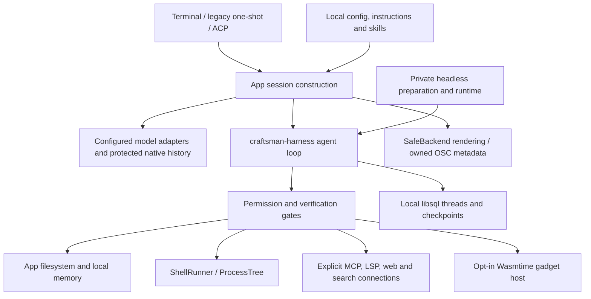

# Craftsman runtime — current implementation and remaining work

Updated November 22, 2026 (Asia/Taipei). This page describes maintained runtime
behavior and its remaining boundaries. The 匠 splash/OSC 7501 runtime is recorded
at `9c5774d`; the subsequent documentation checkpoint `b6b34a2` passed independent
main run [43821887233](https://github.com/kaobei-alabo/craftsman-harness/actions/runs/43821887233).
The private script-capture/bundle foundations are merged as PR #31 at `29349c5`;
independent main run [44567715919](https://github.com/kaobei-alabo/craftsman-harness/actions/runs/44567715919)
passed all four jobs, every mandatory step and both native modes. That main
source was then installed locally; the PR #32 main described below has since
replaced it. Public script execution and privacy hooks remain unselected. The
context/failure continuation is recorded below. Source validation, live
coding results and published releases are separate evidence.

PR #32's private privacy foundations are merged as `dffddeae`, with the same
tree as its reviewed head 7fca. That head's run
[44973387679](https://github.com/kaobei-alabo/craftsman-harness/actions/runs/44973387679)
passed all four contexts, every mandatory step and both native modes, including
both original Windows PE/Prepared/source-Cargo/approved-Wasmtime parents. The
separate run on main,
[44976215399](https://github.com/kaobei-alabo/craftsman-harness/actions/runs/44976215399),
passed its independent audit at `dffddeae`: all four contexts, 68 of 70 steps
with the two skips being the Linux-only voice package step on Windows and
macOS, all 156 test groups in both native modes, and the same two Windows
parents. Windows keeps its 17 earlier Rust warnings and adds none. That main is
was installed locally before PR #33. That build contained the private
foundations and selected none of them. Normal privacy remains inactive and
unselected. The private send guard was not part of that merge. It is merged
separately under PR #33 as `a903af65`, after that PR's run
[44981644431](https://github.com/kaobei-alabo/craftsman-harness/actions/runs/44981644431)
at `4bea365` passed all four contexts, every mandatory step and both native
modes. The separate run on that main,
[44985966590](https://github.com/kaobei-alabo/craftsman-harness/actions/runs/44985966590),
passed its independent audit at `a903af65` in the same way, and that main is now
the locally installed source. Nothing in it selects the guard. The later
private admission and source-view work is local, unreviewed and not installed.

The earlier failed runs remain recorded. Native run
[44891734880](https://github.com/kaobei-alabo/craftsman-harness/actions/runs/44891734880)
at cea9 returned actual selected LINK exit0 and passed the unchanged banner
gate, then refused PE validation on1024 bytes with machine8664. The full image
and rejected predicate were unavailable. Both original detector source/Cargo/WASM
parents failed; Windows core, the seven-case CMD supervisor and77 vault cases
per mode passed, with no vault Deadline phase recorded. Successful raw control
packets remain unavailable. Earlier run44856159033's Deadline, batch-return and
linker-help failures remain retained. Independent source reviews accepted the
multiline batch correction, bounded opening observer and stricter data operation.
The PE checker now adds fixed first-refusal labels through the existing field,
without changing acceptance. Its new CreateFileW security pointer/NULL match
the existing declaration; that warning is separate from the unknown PE refusal.
Those changes and the later fixture diagnostics and fixed options are part of
the merged head; [privacy-hooks.md](privacy-hooks.md) keeps each dated run. The
independent main proof for that merge has passed, as stated above; normal
privacy and OS containment are not claimed.

The [harness plan](craftsman-harness-plan.md) retains its explicitly historical
October 16 baseline and target architecture. Feature docs retain the relevant
failed/corrected implementation evidence. Those dated records do not describe
current failures or pending merges unless explicitly stated here.

## 1. What users can run now

| Surface | Current behavior | Important limit |
| --- | --- | --- |
| `craftsman` | Streaming terminal conversation, file/shell/web tools, approvals, steering, saved work, local skills/memory, configured MCP/LSP and opt-in gadgets | Host tools are not an OS sandbox; supervised coding and general folder work are supported |
| `craftsman -m PROMPT` | Legacy argument-only one-shot; main content on stdout, activity on stderr | Inherits legacy user-config permissions/storage; not the accepted unattended headless contract |
| `craftsman setup` | Edit/select a configured model connection with masked keys and validated settings | Other connections and existing data remain preserved |
| `craftsman gadgets …` | Inspect/call, create/build/doctor and create-only legacy migration | Native build approval and first guest-load capability approval are separate |
| `craftsman acp-serve` | Standard ACP over stdio | Detailed session/tool/permission interface; native host registration is the client's responsibility |
| `craftsman acp-bridge` | WebSocket relay of ACP JSON-RPC plus HTTP health/stats | Existing proxy authentication and bounded transport behavior |
| `craftsman service-agent` | Restricted request-scoped virtual resources and selected public-web tools | No real filesystem, native shell, local database/memory/LSP/project discovery |
| `craftsman exec` | Not exposed | Accepted contract and private implementation foundations only |

The `craftsman-rs` forwarding executable is removed; `craftsman` is the sole app
binary. The app's internal Cargo package/directory remains `craftsman-rs`.
The former `serve` and `desktop-serve` commands are removed. Platform onboarding,
inbox polling and remote skill browsing are retired. Storage, sessions and
skills are local; model, MCP and search traffic uses explicit configuration.
Cached voice models remain local, and missing models need explicit download
opt-in. See [connections](connections.md).

The startup card uses a block-drawn 匠, small `craftsman` label and miniature
hammer in gray/turquoise. The standard card remains 15 rows and compacts at
narrow widths. Its metadata describes the selected model connection and key
presence without exposing keys or submitting a model task.

`/model` opens the grouped local catalog, then the selected model's effort or
budget picker. Only the final selection saves/applies; `/model --refresh`
explicitly requests bounded configured discovery. Model changes preserve
committed conversation, files, todos, custom state, approvals, thread identity
and checkpoint sequencing without replay.

OSC 7501 reports actual terminal work, approval/question waits, returned
completion/error and bounded delegated-task records. It is enabled by default;
`terminal.osc7501: false` opts out. Trusted fixed metadata is written by the
owned terminal guard; normal rendering stays behind SafeBackend. Orca terminal
monitoring was exercised with the installed CLI. Native Orca chat registration
through ACP remains separate.

## 2. Current architecture



`crates/craftsman-harness` owns the model/tool loop, middleware interfaces,
registry, notifications and state/persistence interfaces. It remains free of
app-layer HTTP, database and UI dependencies. `crates/craftsman-rs` owns the
configuration, providers, filesystem authority, native processes, local libsql,
ACP and TUI. The gadget SDK/WIT and proc macros remain separate crates.

Explicit named connections support Responses, Claude Messages, Gemini
GenerateContent and the compatible chat-completions transport. Actual API ids
are selected as `provider/model-id`; catalog metadata never becomes generation
options, and unselected credentials are not resolved during construction.
Protected native history retains signed/opaque provider items paired with their
committed portable messages and bound to the original connection identity.

The app selects task-focused memory/workflow guidance for TUI/ACP. The declared
verifier reviews bounded user/project policies and protected content, executes
checks through existing approvals and ShellRunner, and requires actual zero
exits plus complete unchanged source observations. Failed checks feed bounded
repairs; unavailable or denied checks cannot become a passing result. These
controls retain their legacy/private/frozen defaults and are not a general
semantic test-integrity or stuck-governor implementation.

Terminal read-only turns perform no automatic workspace snapshot. Mutating tools
capture selected files or bounded context-derived shell scopes. Git is optional;
large, home and multi-project folders are supported. Partial scans never imply
creation/deletion. Conversation checkpoints save real input/tool results and
retain unknown-effect warnings on reopen without automatic replay.

Owned native work retains the 120-second shell default, five-second kill/reap,
two-second drain and truthful 30-second session shutdown error bound. Running
background tasks retain their real status until cleanup returns. These bounds
are not proof of OS containment or blocking-worker quiescence.

## 3. Implemented, private, or still planned

| Area | Current state | Evidence / next boundary |
|---|---|---|
| Terminal usability and reporting | Merged and locally installed | Gray/turquoise 匠 splash, grouped model → effort menus, OSC 7501; [splash](terminal-splash.md), [status](terminal-status.md) |
| Terminal lifecycle and recovery | Merged | Actual turn/session ownership, cancellation, final saves and unknown-effect recovery; [lifecycle](terminal-lifecycle.md), [recovery](terminal-recovery.md) |
| File checkpoints and long turns | Existing features merged; creation-time correction awaits native validation | Mutation-driven bounded snapshots, notices in chat, 200-round default and saved pauses; the locally tested same-checkpoint creation-time fix is pending merge/install. See [checkpoints](workspace-checkpoints.md), [turn limits](terminal-turn-limits.md) |
| Task-focused memory and workflow | Merged and locally installed | TUI/ACP advisory guidance and bounded repeated-error hints; [memory](terminal-memory.md), [workflow](task-workflow.md) |
| Declared verification | Merged and locally installed | Reviewed user/project checks, actual results, bounded repairs and protected-content review; [verification](verification.md) |
| Task context and exact failure controls | Implemented, explicit app opt-in | Bounded input/file observations, local /context, real sampling pause and structural protected-test notes; [context](context.md), [failure controls](failure-controls.md) |
| Coding-evaluation preparation and reliability evidence | Local frozen-source validation and production-TUI synthetic v3 | Unchanged original/reference graders, private SQLite snapshots and independently requested fixed child; full combined-source/native/hosted/live-budget gates remain; [preparation](coding-evaluation-preparation.md), [owned-terminal v3](owned-terminal-evaluation.md) |
| Framework names and TUI split | Implemented source | `craftsman-harness/src`, `craftsman-rs/src/tui`; dependency guard and frozen goldens |
| Shell hardening | Implemented | `ProcessTree`, environment scrub, bounded output and owned TUI cleanup; legacy/global Unix groups still default off |
| Gadgets G1 | Implemented, model-opt-in | Fixed `gadget_list`/`gadget_call`; first-load grants; change-only catalog refresh before main/delegated rounds and after compaction |
| Declarative gadgets/migration G2 | Implemented; legacy loader retained | Shared extension validation/precedence; create-only migration preserves originals; published deprecation still required |
| Embedded SDK/authoring G3 | Implemented | `gadgets new/build/doctor`, immutable SDK/skill; static ABI validation does not run `describe` |
| Reusable script runner | Private capture and test-only bundle foundations merged and natively verified; public runner absent | PR #31/main44567715919 passed complete local/native evidence; Python/JavaScript/TypeScript compatibility proof has scoped functional reviews, while source consent, actual task-root derivation, backend selection and batch/scoped-auto CRUD review remain separate gates; see [wasm-script-runner.md](wasm-script-runner.md) |
| Privacy hooks | Private foundations merged under PR #32; normal sessions inactive | Merged as `dffddeae` with the tree of reviewed head 7fca. PR run44973387679 at 7fca passed all four contexts, every mandatory step and both native modes; both original Windows PE/Prepared/source-Cargo/approved-Wasmtime parents passed with the unchanged 16-byte check. That pass covers its selected tools and exact operation only; the producer of the earlier extra 24-byte header and any general effect of `/EMITVOLATILEMETADATA:NO` are not established. Separate main run44976215399 at `dffddeae` passed its independent audit: all four contexts, 68 of 70 steps with two Linux-only skips, all 156 groups, 17 retained Windows warnings and none new, both original Windows parents. It covers the foundation only. That foundation main was installed before PR #33; its build selected no privacy and contained no guard. Earlier failed runs are retained: ac17/44937824282 (`pe.align.section`), 56aa/44949456781 (VirtualSize 40) and 61ac/44957234452 (two Windows `Vault::open` Deadline unwraps, the 40-against-16 refusal, one macOS closed-stdout observer status, skipped post steps; causes unknown). Current Ubuntu compaction passes both modes; old cause unknown. The guard is separately merged and installed under PR #33 but unselected, as recorded below. Key ownership, policy/masking, display/file restoration and activation remain pending. See [privacy-hooks.md](privacy-hooks.md) |
| Private send guard | Private, default-absent refusal seam at both model send sites; unselected | Refuses final request bytes that contain originals already held by real vault mapping records. No configuration, frontend, key source, detector, masking, restoration or activation. Not part of PR #32; merged under PR #33 as `a903af65` with the tree of `4bea365`. Guard source `70d4b0e` has a source-scoped independent acceptance. Merged with the earlier fixture foundation `ac17c4d` as `38da30b`, the unchanged `scripts/verify.sh` passed once on macOS: 17 of 17 checks, the default voice build build-checked only, and both no-default-feature test modes (core 2208 passed/36 ignored, gadgets 2527/48, 26 groups each, no compiler warnings). That run belongs to `38da30b`, not to later commits. A later local merge with the final foundation source 7fca changes no guard or foundation implementation file; any local run of that merge is recorded with its own head, and none is stated here. PR #33's hosted run 44981644431 at `4bea365` passed all four contexts, every mandatory step and both native modes with the guard's cases; the foundation's earlier runs ran trees without the guard. The separate run on the merged main, 44985966590, passed its independent audit at `a903af65` the same way, and that main is installed locally; nothing in it selects the guard. Concurrency, charge propagation and the copy bound remain source-only, and key, policy, hook, masking, restoration and activation remain separate work. See [privacy-send.md](privacy-send.md) |
| Private admission core | Private detector contract with a narrow host floor, source-pinned detector call and one-conversation admission owner; unselected | Local, unmerged, not installed. The pinned call reaches a user-level source by handle without following a link, requires regular single-link files, both file hashes, no capability and a stored grant for the exact bytes before any compile, describe or run, and returns the reply bytes unchanged; ordinary gadget approval is unchanged. An admitted node exists only after the vault's commit of one actual raw capture, including a commit that found nothing, and the send guard's admission. Raw text with an issued placeholder is refused; every detector, vault or guard failure stops the session; stored history is not changed. The conversation binding reserves the application's own fresh thread id, but the session builder does not consume it yet. No producer, provider, tool, approval, display, file, key, policy or activation wiring; no Linux, Windows or hosted run. See [privacy-admission.md](privacy-admission.md) and [privacy-provenance.md](privacy-provenance.md) |
| Source view boundary | Optional, default-absent framework boundary; unselected | Local, unmerged, not installed. An agent built without it runs its existing paths. With it, the agent takes turns, steering and approval decisions only through typed entries, keeps one opaque host source beside each recorded message, composes each request from sources through a provider method that defaults to refusal, asks the boundary before every call runs, and records the source of a reply, a tool result or a message it appended itself only after the real one is committed. A middleware runs only with its author's statement. A preserving one must leave messages, todos, files, custom state and system additions alone, which the agent checks after every hook phase and around every tool call. A tracked reviewer changes a received reply only through recorded operations; the protected `patch_tool_calls` repair runs that way. A tracked middleware adds system text only as source parts, and a tool or middleware announces what it stores, appends or repeats during a call; the todo list, memory, todo reminders and task workflow notes run that way. A tracked preparation can also replace recorded messages with a summary made through the summarizer's view path; automatic compaction runs that way, and manual or idle compaction through a typed entry. Recorded input, results, replies, usage, journal and checkpoints are unchanged. Boundary policies, completion checks, system text on the agent, untracked system additions, an inbox, reopening and transfer have no source path and are refused. Typed idle compaction uses an explicit source-derived request and actual stage/commit witnesses; unchanged moved native replies retain their items, changed replies refuse normal replay. See [privacy-provenance.md](privacy-provenance.md) |
| Conversation view, four-wire providers and builder selection | Private application side of the boundary for one privacy conversation, providers for Chat, Responses, Claude Messages and Gemini, and a private selection in the shared session builder; selected by nothing | Local, unmerged, not installed. Immutable framework commit/invocation witnesses and private transport/human producers bind sources; returned reply/usage/tool data survives later source failures. A request is composed by replacing each recorded text with the view of its own source; a source that is foreign or no longer fits stops the session before a request exists. A call runs only if the last committed reply asked for exactly it or a checked human decision allowed exactly it. The providers send the view through the existing clients, encoders, transport policies and send guard, and refuse recorded text. On native wires the provider items of a reply are kept in an in-memory receipt of the conversation and sent back exactly, only by a client of the same endpoint, model, protocol and credential; the history cache and its checkpoint copy are not used, and a user policy that requires inspectable provider items refuses those wires. The builder selection takes the user's captured policy through a trait that nothing in this branch implements outside tests, reports a typed reason when it refuses, uses the reserved thread id and the conversation's own guard, admits the system prompt section by section from its producer, and refuses the build when any installed middleware has no source path. The ordinary delegated set now has actual agent/parent/commit/envelope adapters; there is no limited-set constructor. Real user policy/frontend selection is absent, and configured unsupported controls and inline-human adapters remain gated; gadget runtime/catalog and per-file prompt pieces use actual host-note source adapters. Explicit compaction has distinct actual stage/commit witnesses and preserves original native items for unchanged moved replies; changed native replies refuse normal replay, and opaque inspectability is not claimed. The stored record is not redacted. No frontend, configuration or command makes the selection. See [privacy-provenance.md](privacy-provenance.md) |
| Privacy restoration views | Private human view of a committed reply, hold on a streamed reply, a reply display the terminal's bridge draws from, and derived file operations for `write_file` and `edit_file` of the root agent and of delegated agents; selected by nothing | Local, unmerged, not installed. A person's view of a reply is made only from a reply the live conversation committed and from the occurrences that commit recorded, each checked against the live record of the commit that issued the placeholder; it is a separate typed text, never written to the record or sent to a model. A streamed reply is held and shown only from the committed reply. A file write or edit that names a placeholder is derived with the real content before the approval gate looks at it, only under a data-format rule of the user's captured policy and only into the content fields; the decision is bound to what was shown, and the file tool checks the operation, the call and the destination again before it writes through what the derivation held on to. The ordinary file tool runs around such a write with its workspace checkpoint, diagnostics and result, and takes only the write from the derived operation. A delegated agent's write is derived in its own lane before its own gate, which is shown the real content and decides as for any delegated write; whether a call names a placeholder comes from the conversation's record, so an alias without a marker is found too. Paths, commands, memory files and every other argument are never restored. The terminal's bridge registers a reply sink and its application draws a committed reply once through the safe backend, proven on a PTY; the terminal still has no entry for a privacy turn. The core union now supplies actual pre-review/parked/terminal events and carriage of the source-bound shown digest; this restoration candidate has not yet consumed them to replace its caller-call proposal and gate-own approval fallback. Those authority gaps remain open, the base full-suite failures are retained, and nothing implements the policy outside owned test fixtures. See [privacy-restore.md](privacy-restore.md) |
| Runtime measurement | Implemented advisory benchmark | `gadget-validation.md`; three-OS runtime measurements are not live-model quality |
| Headless v1 specification | Accepted and merged as #95; #97 clarification explicitly accepted November1 | R1–R7 and126 baseline reference cases preserved;70 accepted admission cases/196 total are conformance, not real CLI enforcement |
| Legacy `-m` safety fixes | Merged as #96 | Non-TTY approval input denies without reading; child/compaction deltas silent; output-closed guards prevent post-failure dispatch |
| Immutable invocation policy | Private implementation, not CLI-wired | Exact selectors, manual/plan, deny precedence, credential-source env-pass restrictions |
| Confined filesystem | Private implementation merged as #98, selected by private runtime adapter only | All six operations, no-follow handles, protected paths, bounded workers; private guest host/text views consume it, not public registration; `headless-mode.md` §§12/14/17/21 |
| Explicit config/discovery/session preparation | Private implementation merged as #99, consumed by private runtime | Bounded selected roots, project trust, no-store ephemeral, random fresh IDs, read-only canonical resume/continue; `headless-mode.md` §13 |
| Shared-builder headless adapter | Private implementation merged as #100, no CLI/output producer | Consumes `Prepared`; retained filesystem authority; same immutable gate for main/delegated/contributed tools and fail latch for every provider; no interactive fallbacks; `headless-mode.md` §14 |
| Byte-safe guest filesystem facet | Private implementation merged as #101, consumed by the private guest host, not model/CLI-wired | `ConfinedFs` typed raw read/create/list; validated declaration plus immutable invocation policy; 10 MiB reads/1 MiB writes/1024 total directory entries; `headless-mode.md` §15 |
| Retained gadget sources/approval snapshots | Private implementation merged as #102, consumed by private guest host only | Selected config/ConfinedFs root handles, whole raw manifest/component hashes, explicit versus stored grant provenance, non-widening approvals and original filesystem/policy; `headless-mode.md` §§16–17 |
| Source-approved headless guest host | Private implementation merged as #103, not model/CLI-wired | Opaque actual-runtime scope; strict byte FS, empty-capability describe, typed caught-import latch, bounded HTTP/log/WASI and fixed diagnostics; `headless-mode.md` §17 |
| Captured credentials/seeded redactor | Private foundation merged as #104; selected by guest/shell/filesystem/web/concrete-framework/request views and fixed gate denials | Known configured values, frozen all-role route, bounded overlapping streams, complete source coverage and structured redaction; `headless-mode.md` §§18–24 |
| Guest JSON/stdout/stderr/log redaction | Private host adapter merged as #105, not a public/tool/storage producer | Actual opaque scope seeds; redaction and delayed literal verification before 64 KiB retention; synchronous gated WASIp2, strict UTF-8/fixed failures and original executed inputs; `headless-mode.md` §19 |
| Scoped private shell-output redaction | Private shared-builder adapter merged as #106, not a public command | Opaque actual ShellScope, same gate, captured scrub/credentials; original pipes redacted before cuts, scoped argument errors, strict UTF-8 and trustworthy raw ToolMeta; `headless-mode.md` §20 |
| Scoped private filesystem views | Private shared-builder adapter merged as #107, not a public command | Actual FilesystemScope, complete original coverage before page/hit selection, original IO/line/query facts, bounded checked names/framing and same typed fail latch; `headless-mode.md` §21 |
| Scoped private web views | Private shared-builder adapter merged as #108, not a public command | WebScope/frozen literal auth, original-byte pre-cut capture, bounded HTML, complete search JSON/field checks, actual request/byte facts and same latch; `headless-mode.md` §22 |
| Concrete private framework views | Private shared-builder adapter merged as #109, not a public command or all-state scrub | Actual FrameworkScope/source witness; known todo/task/message views before cuts, whole typed todo JSON and checked todo context; original state/delivery/metadata and remaining alternative producer gates; `headless-mode.md` §23 |
| Scoped private provider requests | Private shared-builder all-role request producer merged as #110, not a response/storage/public adapter | ProviderScope/original effective options/auth; copied text/decoded arguments/schema annotations before encoding, immutable identities/constraints, bounded exact bytes/client binding and SAME retry gate; `headless-mode.md` §24 |
| Private provider HTTP/error diagnostics | Partial client adapter, not a successful-response/state/public or usage producer | Actual send/receipt/per-request witnesses; frozen literal/strict UTF-8 before cuts, original bounded attempt facts, fixed unsafe failures and same latch; `headless-mode.md` §25 |
| Instruction and attachment-file admission | Private input-first implementation merged as #115, not CLI-wired | Explicit source/UTF-8/1 MiB instruction/1 MiB file/8 MiB total; retained FS/policy and complete framing before optional session creation; actual shared-builder model-only turn; `headless-input.md` |
| Checked main retained-message snapshots | Private actual-runtime view, not a public result/storage/all-role ledger | Actual MessageScope/state lock/frozen seeds/gate; whole source/argument admission before copies, bounded finite encoding, immutable original state/control and fixed refusal; `retained-message-views.md` |
| Bounded private retained-message selection | Private post-capture adapter, not terminal/result publication | Only checked View; exact byte-budget/newest whole suffix/counts and final literal check; unchanged source caps/state/outcome and SAME gate; `message-selection.md` |
| Private terminal-publication authority | Private actual-Run owner, not public result/IO/shutdown | Same deny-only execution seal, original outcome and independent revocable publication lease; typed epoch checks, checked final-text/whole-state-message fragment and truthful limits; `terminal-publication.md` |
| Private terminal-message selection | Independent terminal-lease adapter, not public result/IO | Complete channel admission before exact combined budget; newest whole suffix, unchanged checked answer/facts, counts/new-join checks; `terminal-message-selection.md` |
| Private terminal ASCII encoding | Actual terminal-lease encoder merged as #123, not public schema/IO/human rendering | ASCII UTF-16 escape projection; complete-channel/final literal checks, post-escape budget/whole-message suffix and unchanged data/facts; `terminal-ascii.md` |
| Private safe human display | Actual terminal-lease renderer merged as #124, not stdout/stderr or public text eligibility | Complete original answer/fixed fact diagnostics; visible control/backslash/runner defanging, exact combined LF budget and final literal/lease/epoch checks; `terminal-human.md` |
| Guarded private one-file publication | Merged as #125; explicit pre-session file route, not CLI/stdio/result/events | Actual FileRun owner and immutable outside-workspace/config target; complete checked Record before native staging, one guarded create-only link, fixed failure/actual-link observation; `guarded-output.md` |
| Explicit native byte-pipe stdin | Merged as #128; private, not CLI/console/file support | Exact '-' opaque selection; same-access native ownership/owned-mode or readiness-bounded polling,1MiB/10s/30s/real read EOF/UTF-8 plus old attachments/framing before sessions; `named-stdin.md` |
| Native stdin + guarded file composition | Merged as #129; private, not CLI/full source/output flags | Whole source/destination grammar; original output capture before stdin and recheck after admission before sessions; SAME Bootstrap/ConfinedFs and old paired controller; `stdin-file-output.md` |
| Private relative-scope/output-file argv | Merged as #132; private normal-relative/typed-preview adapter, not public exec/full formats | Explicit original launch base; old complete syntax/physical owners, selected-workspace data and guarded external file scope; `scope-output-arguments.md` |
| Private supported control/source argv | Merged as #131; private absolute-scope/permission/session adapter, not full public CLI | Old source/selector/ID grammar before IO; authoritative Bootstrap/credentials/ConfinedFs/session and same Run/FileRun; `control-arguments.md` |
| Private instruction argv parsing/routing | Source/attachment subset, not a public exec/whole-flag parser | Bounded original OsString inputs; exact source selection/flag arity before IO, four unchanged factories and old Run/FileRun; `input-arguments.md` |
| Headless frontend/stdin input, guest tool integration and persistence | Still open | Complete named-stdin exclusive ownership/console/file and flag/output-path integration; other tool/provider/storage redaction and compatible origin publication before callable registration; checkpoint/journal writers stay disconnected |
| Shared admission/usage | Private request default, separate atomic token-reservation opt-in and admission-correlated send/header observations; usage/settlement ledger still unwired | Actual-builder1..10000/default50 cap, source-bound bounded estimates/clamped reply before atomic charge; active/retained-unsettled observations, not measured usage;40 request +50 reservation +40 receipt-observation tests; #133/#97 accepted/merged, not public producer enforcement; `request-admission.md` / `token-reservations.md` / `admission-receipts.md` / `token-admission.md` |
| Real headless result/event output + redaction/trace | Still open | ASCII schema-backed production, create-only publication, seeded chunk/error/tool/storage redaction, trace-v1 instrumentation |
| Native OS sandbox / public headless shutdown and verification receipts | Separately planned | TUI declared verification is implemented; public headless receipts and OS containment retain their own gates |
| Full Session API/events/content blocks/governed policies | Separately planned | P6/P7; existing callbacks/journal are not that future typed stream |

Private headless components are available only through their reviewed typed
owners. Existing terminal tools and gadget hosts do not inherit private
`ConfinedFs`, redaction, usage or publication authority merely because those
modules exist. Headless gadget callable registration, successful-response and
alternative-state/output/storage adapters, real usage settlement and public
result/event/trace production remain unfinished. See
[headless-mode.md](headless-mode.md) for the accepted contracts and per-slice
bounds; those contracts and their failed/corrected evidence remain unchanged.

## 4. Legacy one-shot versus accepted headless v1

Legacy `-m` retains its argument input, configured permissions/storage and exit
behavior. Main content goes to stdout and activity to stderr; non-TTY approval
input denies without reading. It is not an explicit-only unattended execution
boundary.

Redirected one-shot output captures stdout as an owned native pipe/file
before agent construction. Main, delegated and compaction providers retain
that same owner and recheck actual write/flush error latches before/after model
responses. Sources selected for peer-state observation also run connection
checks after tool-bearing responses and before later model requests, including
when the preceding write succeeded. Closure observed at that boundary stops further
dispatch; BrokenPipe exits quietly at 0 and other IO failures use fixed text.
The first request remains admitted and a no-tool final response still reaches
the actual final-newline write. Windows console encoding, deny-without-read
approval and other frontend defaults remain unchanged; completed real effects,
tool results and received usage are retained rather than rolled back or replayed.

This is a boundary check, not OS containment, background-work quiescence, public
`exec`, general coding-quality or release-readiness proof. A later peer closure
can still race an operation already started. Details and native bounds are in
[the one-shot contract](headless-mode.md#11-implementation-progress--not-a-shipped-exec-command).

Initial36ab019 evidence includes actual Unix builder/loopback/native-pipe controls for stdout rebinding,
closure after successfully read content in the same response, and retention of
a prior completed tool. Its focused core/gadget checks passed 52 test executions,
including all six unchanged one-shot cases in each mode. The prior `0d2fd68`
full-core failure after a real file write remains historical, with its OS trigger
unverified; the first failed controls and unused-mut warning are also preserved.
The independent review's P1 Windows mode/lifetime and P2 type/access/Unix-socket
findings are retained; its pending mock did not execute on Windows. Unix socket
admission now requires actual stream SO_TYPE; datagrams refuse before model/tool/
storage effects, and an actual stream control retains dispatch protection.

Windows support requires a same-access captured owner, actual type/GetLastError,
direct-kernel8/16 bootstrap before File/driver IO, and NONALERT/write eligibility.
Validated disk files and synchronous writable NUL keep checked File IO; NUL
requires actual native FILE_DEVICE_NULL identity. Validated local NPFS selects
an explicit source-dependent app observer before any agent work. NUL has no peer-liveness claim;
NULL/-1 HANDLEs remain invalid. Async/ALERT/non-write/unbuffered, socket, unknown
and other non-console-device cases refuse. The existing recognized console
Unicode path remains. Windows gadget run44262189413 actually ran the24 original/
added one-shot cases:17 passed and7 failed; core was skipped. All six original
cases and the native NUL unit passed. A real socket reached DuplicateHandle,
contradicting the earlier device0x11-only discriminator; named-server queries,
the claimed attribute-free client, console setup and binary NUL fixture also
failed. The prior source-only reviews remain evidence, not compatibility proof.

The repair checks SO_TYPE after direct8/16 eligibility and before duplication,
owns one successful Winsock2.2 reference and requires its checked cleanup. Socket
success, malformed output and unknown errors refuse; WSAENOTSOCK is only a
non-socket candidate for the remaining supported-kind/state checks. These
provider calls may block/use alertable waits; no new hard OS deadline or
arbitrary foreign Winsock lifecycle isolation is claimed. Later IO remains on
the retained duplicate without an atomic handle-table capture claim.

Console fixtures use actual attachment/mode APIs and inactive-buffer Unicode
readback. The pure client now reduces and verifies its actual granted rights;
binary NUL uses spawn/wait_with_output so Tokio cannot replace null stdout.
Marked query diagnostics retain at most32 primitive records, with separate
original/duplicate phases and no fields from partial/error output. Later native
run44322458688 passes the original six, socket/inherited/reference, console and
NUL paths in both modes, but still fails four low-grant named-pipe cases in each
mode. All eight class24 requests return ACCESS_DENIED with no completed fields.
Those failed expectations and all earlier runs remain historical evidence.

The compatible candidate retains legacy checked writes for qualified local
NPFS whose actual access lacks READ_ATTRIBUTES. It requires WRITE_DATA0x2,
SYNCHRONIZE, NONALERT/buffered mode and a completed local-device result on the
same owner; pipe bit0x4 alone is create-instance authority, not data writing.
ObservationSupport::CheckedLocalPipeWrites advertises only actual IO-result
observation. It provides no type/configuration/end/connection data and cannot
detect peer loss after successful output until later IO actually reports it.
Disk/NUL/generic write support and PeerState support remain distinct.

READ_ATTRIBUTES presence selects the full native observer, whose actual
return/IOSB/completed40-byte/type/configuration/end/state validation still must
succeed. Query failure in that selected backend refuses; it never chooses the
limited backend. No access upgrade, byte probe, mode change, cached-state guess
or query-error fallback is used. Native witnesses must show the already passing
anonymous/metadata-capable sources retain full observation. This app-only policy
does not enter private headless/guest/input/output construction paths. The new
candidate and its native tests still require source review/fresh Windows proof.
Current validation requires repaired-source review, actual Windows execution
and full17/all-four/every-step/both-mode/inventory/warning/source-tree/
independent-main proof. No broader source33/image/corpus/capture or live-budget
authorization follows from these boundary checks.

The accepted headless v1 contract requires invocation-only permissions,
canonical scopes, input/output/resource bounds, truthful all-role usage,
seeded redaction, explicit session selection, machine output and signal/deadline
shutdown. Many private foundations are implemented, but no public `exec` route
ships until the remaining boundaries are wired and validated. Filesystem path
checks and the gadget WASM sandbox do not OS-contain host shell/build scripts.

## 5. Toolchain, builds and verification

The workspace is pinned to Rust **1.99.1**. The app declares its tested **1.99**
floor; standalone framework/SDK/macros retain their separate **1.85**
declarations. Wasmtime/wasmtime-wasi remain pinned to **48.0.8**. Default builds
include voice and gadgets; gadget model visibility is user opt-in. Native voice
requires CMake, plus ALSA development headers/pkg-config/clang on Linux.

```sh
./install.sh --upgrade
./scripts/verify.sh
```

The verification script selects an installed python 3.11 or newer runtime
and runs 17 discoverable checks: all 14 original checks plus latest evaluation
preflight, long-session and owned-TUI tests. The original checks retain formatting,
locked core/default builds, exec-contract,
benchmark-driver, CI-cache/workflow, coding-budget/scope/preflight/options contracts,
provenance, both complete native modes and unchanged goldens. A failed core mode
does not hide the gadget mode.

The three additive evaluation tests are also discovered in existing CI contract
steps. This entrypoint count does not claim that all 17 checks or hosted/native
gates have passed at the latest combined source.

Required CI contexts are `fmt`, `test (ubuntu-24.04)`, `test (macos-15)` and
`test (windows-2025)`. Each test platform checks the default voice/gadget build
and both full native modes. Every mandatory step and the tested source/tree,
inventory and warning signatures are audited before merge; merged main receives
independent full validation before local fast-forward/install. Windows is
required. Draft checks are intentionally light and never substitute for ready-PR
validation. See [CI controls](ci.md).

Earlier verified runtime: [PR #24](https://github.com/kaobei-alabo/craftsman-harness/pull/24),
PR run [43797314382](https://github.com/kaobei-alabo/craftsman-harness/actions/runs/43797314382),
independent main run [43799188076](https://github.com/kaobei-alabo/craftsman-harness/actions/runs/43799188076)
at `9c5774d`.

| Platform | Core passed | Gadget mode passed | Compiler warning baseline |
| --- | ---: | ---: | --- |
| macOS 15 | 1,962 | 2,120 | None |
| Ubuntu 24.04 | 1,961 | 2,119 | None |
| Windows 2025 | 1,925 | 2,072 | Five core / eight gadget occurrences, unchanged |

All four jobs, every required step and both modes passed. Local verification
passed all 12 checks with 1,962 core / 2,120 gadget-mode tests. The installed
splash passed five isolated native terminal captures at 24/40/80/120 columns
using GPT/Claude fixture configurations, with clean exit, restored modes,
preserved config and no model requests. Earlier failed runs remain failed
records in their feature docs, Git and local evidence.

## 6. Coding quality and remaining work

The first full 30-task baseline records **17/30 normally completed successful
turns** and **21/30 behavior-passing workspaces**. Selected memory, workflow and
verifier comparisons show working composition and limited-sample improvements;
they do not establish a full latest-runtime score or broad performance
comparisons with other coding products.
Four starter gadgets were built and used in live GPT/Claude sessions, with all
30 independent cases passing. Runtime tests, gadget tests and coding-task grades
remain distinct evidence.

The original evaluation ledger accounts for **$24.285934 of $25**, including
**40 retained unknown-usage reservations**. That is conservative admission
accounting, not an invoice or permission to reset/refund unknown requests.
No live calls were made for OSC or splash changes. See
[coding evaluations](coding-evaluation.md), [live coding](live-coding-evaluation.md),
[workflow comparison](live-workflow-evaluation.md),
[verifier comparison](live-verification-evaluation.md) and
[live starter gadgets](live-gadget-evaluation.md).

The bounded context/failure-control implementation has its own
[selected live comparison](live-context-evaluation.md) and native validation,
separate from the earlier verified main recorded above. Full typed context artifacts,
read-cache/result eviction, semantic test adjudication, broader effectful-loop
controls and a fresh full/repeated evaluation remain work. Larger repositories,
longer sessions and additional models need their own comparisons. Current priority and
completion state are in [harness-improvements.md](harness-improvements.md).
Public headless execution/gadgets, native containment and full typed events /
Session API keep their separate roadmap gates.

The local [owned-terminal synthetic v3](owned-terminal-evaluation.md) runs the
production TUI at frozen source `33a80d9` in immutable image
`sha256:6123321bf37c5641bc6ff4b4f79848f8b8e752fbc78a2f4361406162943cb38b`.
It records real one-call approvals, stored-row/pin evidence, actual OSC/PTY
lifecycle, cancellation, manual compaction and quit/reopen, with an
independently requested fixed native child with verified executed bytes, actual
bounded wait/EOF and one local forwarding attempt. Whole retained SQLite bytes
are queried only in an independently held private copy with current-step
expectations. Duplicate/read negatives require a new saved condition after the
actual owned return; live writer hold is quarantined. Historical v2 capture
gaps and first failed repair attempts remain. Original task behavior, completed
external observations and unverified private callbacks/typed returns/live
recovery/outer invocation/ToolMeta or whole-activity absence remain separate criteria.
This synthetic evidence is not a new full live-model score, production-readiness
decision or OS-containment proof. New combined runtime source/image rebinding
and coordinator full local/native/hosted/independent-main validation remain
pending; additional live-budget approval is still required.

The full unchanged v5 corpus was also validated in that same frozen image:
all 30 original workspaces failed their independent held-out grades and all
30 reference workspaces passed. Complete outputs retain all 20 Rust full-grade
commands and 20 separate original/reference `--doc` diagnostics. This is the
offline corpus prerequisite for source `33a80d9`; it does not supply model
answers, revise historical scores, diagnose an older candidate's doctest failure,
or validate a newer combined source/image automatically.

The repository is public and MIT licensed for its original work. Standard public
GitHub-hosted runner compute is free; storage/concurrency limits remain. The
former account-billing startup blocks are historical, and hosted cache
restore/save has been exercised. Binary/container publication remains disabled
by owner request. Remaining attribution/provenance/distribution review is
separate from the resolved MIT choice; see [NOTICE](../NOTICE) and
[OSS review](oss-review.md).

Run44912859439 at ac798 retained both original source/Cargo/WASM failures after
actual LINK0 and banner acceptance. The first PE group is `pe.directories` on
1024 observed bytes with machine8664; the directory ordinal, RVA/size values
and full image remain unavailable. The declaration clash is absent and the
17 existing Windows warnings remain. This does not identify a loader/tool cause.

Run44925496617 at dd79 observed `pe.d06.rva` after LINK0/banner: directory6's
RVA check refused, while its size, contents and cause remain unavailable. The
private data-only fixture now appends `/NOCOFFGRPINFO` after the unchanged object
input. [LLVM's compatibility table](https://github.com/llvm/llvm-project/blob/a037d2ad7312adc58664358893c20927efae22cf/lld/COFF/Options.td#L402)
corroborates the option name; Microsoft does not document it. Its effect remains
a conditional candidate pending fresh Windows acceptance of the unchanged PE
validator and original Prepared/source-Cargo-WASM gates. The closed refusal
labels, strict all-directory-zero rule, native bounds and source approval stay
unchanged. Normal privacy remains off; this adds no public command or capability.

The private alignment diagnostic preserves `pe.align.section` and every original
predicate/read/short-circuit. On its first failed predicate it attempts one fixed
`PEA:<id>:<16hex>[:<16hex>]` stderr line (at most41 bytes including newline)
using only that predicate's owned header operands. Success stays silent; missing
reads retain the coarse fallback. The line can block or be partial and is not a
new time or quiescence guarantee. Actual first operands remain pending a fresh
Windows run; PE acceptance, native/source-Cargo-WASM gates and normal privacy
activation remain unchanged and unmet.

Run [44949456781](https://github.com/kaobei-alabo/craftsman-harness/actions/runs/44949456781)
at 56aa observed `PEA:09:0000000000000028` after LINK0 and the banner: every
directory was zero, and the one section declares 40 bytes where the unchanged
check requires 16. What the other 24 bytes are, the section's flags and raw
layout, and the cause remain unknown; no linker switch is chosen from the size.
The diagnostic now also attempts one `PES:<hex>` line (at most 133 bytes) with
exactly the declared 17 to 64 bytes, only when that predicate fails first and
the bytes lie in the already captured image and begin with the public fixture
marker. Otherwise it writes `PES:unavailable`. It reads no file again and
changes no predicate, label or limit. Its data awaits a fresh Windows run; PE
acceptance, the source-Cargo-WASM gates and normal privacy remain unmet and
inactive.

Run [44957234452](https://github.com/kaobei-alabo/craftsman-harness/actions/runs/44957234452)
at 61ac returned that record. The section's 40 declared bytes are the 16-byte
marker followed by six little-endian 32-bit values: 24, 0x80008000, 0, 0, 0, 0.
That is the size and field order of `IMAGE_VOLATILE_METADATA` as a pinned
third-party header defines it
([FEX-Emu `winnt.h`](https://github.com/FEX-Emu/FEX/blob/53e148474caff8a8eae50e66a9da643da232b3d9/Source/Windows/include/winnt.h#L220-L227)).
The fixture now appends `/EMITVOLATILEMETADATA:NO` as its eleventh argument.
[FlexDLL](https://github.com/ocaml/flexdll/blob/ab8161fc7161a598c5aaf66f02298035639d5ef3/reloc.ml#L1154-L1161)
passes that switch when LINK advertises it, and two other projects list or use
it ([msvc-undoc](https://github.com/assarbad/msvc-undoc/blob/5423c9f0390e770b8b6c667209aacaa33970643f/LINK.exe.md),
[TinyPE](https://github.com/Masfo/TinyPE/blob/6560d797ea40678d3b951c9f8d3cfb6ab63c18e1/CMake/SetupMSVC.cmake#L122)).
Microsoft does not document its effect, and the fixture does not ask LINK for
its help text. This is a conditional candidate: which tool wrote the block,
what its second value means and whether the switch removes it are not
established. The unchanged 16-byte check and the original Prepared, source-Cargo
and WASM gates decide on a fresh Windows run; a refusal stays a refusal. Normal
privacy remains off.

The completed audit of that run records failed required gates. Fmt and Ubuntu
passed. Windows core failed two restoration cases whose `Vault::open` returned
Deadline. Both Windows gadget source/guest parents failed: the installed-linker
helper's record is the strict check refusing the section's 40 declared bytes
against the unchanged 16, and the same operands are not inferred for the
source-built parent. macOS core failed one closed-stdout observer case with an
unsuccessful helper status. The required post steps were skipped. Which vault
phase ran out of time and why, and how and why the observer's helper failed,
remain unknown. No full PE, Prepared, Cargo or WASM pass existed at that head.

Run [44973387679](https://github.com/kaobei-alabo/craftsman-harness/actions/runs/44973387679)
at 7fca, which is this fixture source plus documents, passed all four contexts,
every mandatory step and both native modes. Both original Windows parents
passed with the eleven arguments: the unchanged validator accepted the linked
image, Prepared returned, the offline locked source Cargo build produced the
WASM and the approved Wasmtime guest assertions completed. The image is
validated and cleaned; it is never loaded or executed. The two Windows
restoration cases and the macOS observer case also passed; why they failed at
61ac is still unknown. The pass covers that run's selected tools and this exact
operation only: which tool wrote the block, what its second value means and any
general effect of the switch remain not established. PR #32 is merged as
`dffddeae` with the same tree. The separate run on main, 44976215399, passed its
independent audit at `dffddeae`: all four contexts, every mandatory step and
both native modes, with both original Windows parents passing again. It covers
this foundation only. Normal privacy remains off.


## Core event corrections — November 22, 2026

The local correction branch combines the immutable transport/source-part slices
with framework-issued events. It remains unmerged, uninstalled and unselected;
the installed `a903af65` guard is separate. No frontend, key/policy, restoration
or normal privacy selection is enabled by this work.

Typed turn, resume and idle-compaction entries acquire activity before comparing
state and source. Internal checks use explicit state-then-source guard scopes.
Every retained witness binds the complete immutable message, including role,
call id and error status, to its actual event. Public state, a caller message,
equal content, a label, a digest or an ordinal cannot issue one.

A private fact owner keeps actual provider returns, received replies and usage,
terminal calls and outcomes, and final-chain outcomes before fallible source or
review work. Returned data is not a transport, origin, save, permission or billing
certificate. Selected failure closes future required privacy work, retains real
facts and accepted input, and follows the actual journal/final-save path; a save
failure remains a failure and is not retried as proof. Selected cancellation
seals new steering and keeps already accepted originals and sources through real
call balancing and final save. The unselected paths keep their existing behavior.

A parked-call witness and a private registered human-input owner replace the
caller action factory. The actual absent, denied, approved, Always or edited
choice and raw edited bytes are retained. Every `ApproveEdited` remains human
origin even when its JSON equals model bytes, and is admitted before effects.
An issued alias in raw edited input refuses. An Always permission update happens
only after the sealed decision passes its source/admission checks. Inline
approval-gate and `ask_user` producer adapters remain separate, unfinished work.

Each post-chain terminal invocation gets its own call, decision and source
witness, with a synchronous live check immediately before the actual tool poll.
That source check grants no tool permission. Completed tool and chain facts are
kept independently of whether any model view can be published.

A separate pre-review witness is now issued before the actual approval chain.
It stays linked to a parked call and the later terminals, with the selecting
host's source-bound preview digest carried unchanged to the registered human
callback. An inline delegated gate can attach its private actual decision once
before the inner tool runs; that entry closes at terminal return/drop. The
generic annotation and digest grant no authority. Concrete derived-file and
automatic-policy adapters must still validate their private real producers,
exact preview, final call, source and destination before effects.

The one 45-second admission-entry clock is checked after actual vault return,
after guard work and immediately before node release. Completed map facts
survive late refusal. The 16-slot admission bound, vault five-second/native busy
limits and original terminal bounds remain; queued time does not prove blocking
worker quiescence. Final pinned-source confirmation requires available before
and after modified timestamps and relative no-follow identities from the
retained root. Same-user rename/race limits remain observations, not containment.

Compaction keeps a distinct actual working-state stage; its retained witness is
issued only when that stage really becomes canonical state. The summarizer's
unrecorded host instruction has a request-input witness, not a retained commit.
Compaction uses an explicit source-derived summarizer request. Unchanged kept
native replies retain their original items after movement, together with the
original client/request context. The summarizer sees committed text/calls in its
explicit projection; opaque originals stay in their private source receipts.
A changed native reply refuses later replay instead of silently stripping items.
A policy requiring opaque inspectability still refuses those wires at startup.
Configured controls and real frontend/inline-human adapters
remain incomplete.

Validation belongs to its exact source head in
`target/verification/privacy-core-frontier-corrections`. Independent source
review, combined-source native/hosted proof and separate merged-main validation
remain gates before integration/install. The restricted private MAIN
callback/budget-boundary, equivalent and close-between-retry scenarios remain
UNEXECUTED and UNINSPECTED; no adverse main-loop callback/budget test was added.
The original $24.285934/$25 ledger and 40 unknown reservations are unchanged.
